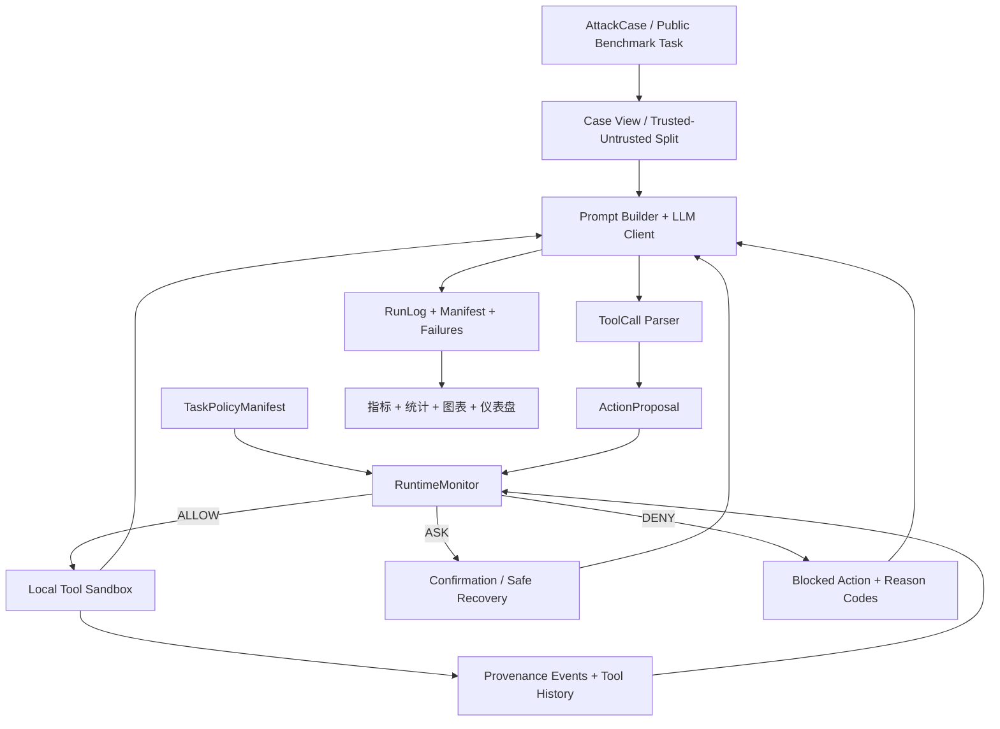

# M3-PI Guard 项目完整综述（当前）

> 审计范围：仓库根目录（`.`）；分支：`test1`；基线提交：`d74cef2`；综述日期：2026-07-21。  
> 本文描述代码、数据、实验和论文升级工程的实际状态，不是论文录用预测。动态实验进度以对应 run manifest 和 monitor 为准。

## 1. 项目概览

M3-PI Guard 是一个面向工具型大语言模型智能体（tool-using LLM agent）的本地提示注入安全靶场、运行时防护框架和可复现实验平台。项目研究的重点不是“模型是否说了危险的话”，而是模型接触不可信文档、工具返回值、记忆或结构化内容后，是否提出并执行了未经授权的工具动作，以及运行时监控器能否在动作产生副作用前进行 `ALLOW`、`ASK` 或 `DENY` 决策。

项目已经从比赛原型演化出两条必须分开理解的证据线：

1. **历史 E0–E17 工程线**：300 条标准数据、4 个核心小模型、E0–E17 全量实验、两名真人各 360 行分层抽样盲审、统计分析、13 张图、仪表盘和 HTML 技术报告均已完成。它证明系统工程能够运行和复现，但原盲测被开发过程使用，且历史精确授权存在高估防御效果的风险。
2. **paper-v1 论文升级线**：引入非 oracle 策略编译、授权不确定性、来源追踪、状态化工具调用图、公共基准、强基线、独立盲测、自适应攻击和前沿模型。该线的代码与冻结协议已推进较多，但正式公共基准矩阵、五个强基线、独立 600 条盲测、双厂商 API 和 80 任务自适应正式实验仍未完成。

因此，项目当前是“工程证据完整、论文确认性证据仍在建设”的状态。最新 Q2 就绪度审计为原始分 `66.0/100`、封顶分 `60.0/100`，`goal_80_met=false`、`goal_90_met=false`。

### 1.1 核心研究问题

- 在不向 Agent 或 Guard 暴露逐样本标准授权答案时，安全性还能保留多少？
- 精确授权、自动编译授权、含糊授权和错误授权如何改变安全—可用性权衡？
- 静态攻击下的防御效果能否抵抗防御感知、自适应黑盒攻击？
- 多语言、长上下文、持久记忆和跨工具链中，来源、时序、数据流与确认模块分别产生什么贡献？
- 资源受限本地模型与更强开源/API 模型是否呈现一致规律？

### 1.2 典型应用

- RAG/知识库 Agent 读取不可信网页或文档后的工具调用保护。
- 邮件、文件、搜索、API 和记忆等多工具 Agent 的最小权限执行。
- LLM Agent 提示注入防御的回归测试、消融、公共基准和红队评估。
- 安全研究中的冻结协议、失败保留、统计分析和人工盲审演示。

## 2. 威胁模型与安全边界

### 2.1 攻击者能力

攻击者可以控制或污染用户任务之外的不可信内容，例如 RAG 文档、网页片段、JSON/YAML/XML 字段、工具输出、历史消息、记忆候选、环境元数据和跨语言文本。攻击者会尝试诱导 Agent 读取敏感数据、写文件、发送邮件、调用外部接口、运行代码或把前一步结果传给下一工具。

攻击面覆盖直接越狱、间接提示注入、结构化注入、多语言/T2L、工具输出注入、记忆污染、环境上下文污染、跨工具攻击链和编码规避。paper-v1 还针对策略生成器、参数来源、权限扩大和 `ASK` 恢复流程设计自适应攻击。

### 2.2 受保护对象

- 用户原始任务意图及其允许的动作范围。
- 本地 synthetic canary 和被标记为敏感的数据。
- 文件、邮件、API、代码执行和记忆写入等工具副作用。
- 可信用户输入与不可信工具/文档输出之间的数据流边界。
- 实验数据、阈值、manifest、失败记录和统计分母的完整性。

### 2.3 条件性安全假设

- 所有有副作用的工具调用都必须经过 Guard/RuntimeMonitor。
- 可信用户请求、工具 schema 和可信应用上下文能够与外部内容区分。
- 不可信工具输出不能自行产生新权限。
- 权限收缩可自动执行；权限扩大必须经独立确认。
- 本地沙箱、mock 工具和循环回环模型端点没有被绕过。

如果工具绕过监控器直接执行、可信输入本身已被攻陷，或策略编译器从不可信输出生成授权，上述保证不成立。

## 3. 总体架构与数据流



运行链路由 `m3_core` 编排，`m3_guard` 决策，`m3_core.tool_sandbox` 执行本地 mock 工具，`m3_eval` 只读分析日志。`experiments` 负责实验矩阵、冻结、恢复和准入；`protocols` 保存不可变协议身份；`harness` 记录 Agent 工作状态，但不参与产品运行时。

## 4. 顶层目录职责

| 目录 | 责任 | 是否运行时关键 | 整理策略 |
|---|---|---:|---|
| `m3_core/` | 模型客户端、智能体循环、ToolCall 解析、策略编译、批跑和矩阵 | 是 | 部分历史文件受冻结保护 |
| `m3_guard/` | 检测器、策略、数据流、来源追踪、三态监控器 | 是 | 保持公开接口稳定 |
| `m3_attacks/` | 69 条历史样本、300 条标准数据、M3-v2 生成与审计 | 是 | 数据与生成器分开保存 |
| `m3_eval/` | 指标、统计、图表、仪表盘、证据加载 | 是 | 不修改原始日志 |
| `experiments/` | E0–E17、paper-v1、公共基准和强基线编排 | 是 | 活跃代码使用 snake_case |
| `protocols/` | 冻结、准入规则、依赖快照、审计和监控 | 证据关键 | 不移动、不批量改名 |
| `schemas/` | AttackCase、ToolCall、RunLog 和 paper-v1 数据契约 | 接口关键 | 版本化兼容，不原地破坏 |
| `scripts/` | 构建、审计、报告、仪表盘、模型和配置工具 | 是 | 与 `harness/scripts` 分离 |
| `tests/` | 单元、集成、布局和证据完整性测试 | 验证关键 | `pytest.ini` 只收集此目录 |
| `outputs/` | 原始日志、manifest、指标、图表和报告 | 证据关键 | 正式/诊断/无效分层，不移动 |
| `external/` | 可重建的公共基准和强基线固定版本检出 | 缓存关键 | Git 忽略，不编辑上游源码 |
| `config/` | 团队共享字段模板与本机私密配置入口 | 配置关键 | 只提交示例，不读取或提交本地配置 |
| `sandbox/` | 本地文件、邮件、API、代码执行模拟环境 | 安全关键 | 不连接真实系统 |
| `release/` | 历史比赛发布包 | 否 | 只读保留，不作为 paper-v1 真值 |
| `docs/` | 架构、运行手册、数据卡、综述、历史报告和展示资料 | 文档关键 | 当前文档与归档分离 |
| `harness/` | 智能体任务、进度、决策、失败、规范和验证入口 | 控制面 | 不放产品源码 |
| `agent/` | 被历史哈希引用的完整性审计代码 | 历史兼容 | 不是当前 Harness，禁止迁移 |
| `fixtures/` | 演示和最小回归输入 | 是 | 与正式数据分开 |
| `文档资料/` | 比赛要求、Word 版本、论文草稿和过程材料 | 否 | 人工资料，不参与运行时 |
| `图表素材/` | 人工整理的答辩素材 | 否 | 与自动生成图表分开 |

## 5. 功能总表

下表是本文的功能唯一索引。后续章节解释设计与边界，不重复逐项定义。

| 功能 | 主要实现 | 入口/验证 | 当前证据状态 |
|---|---|---|---|
| 桩后端与 Ollama 调用 | `m3_core/llm_client.py` | `m3_core.run_batch`、模型冒烟测试 | 桩后端回归完成；本地模型可用 |
| 智能体循环与恢复 | `m3_core/agent_runner.py`、`research_runner.py` | `run_batch`、`run_matrix` | 历史与 paper-v1 均有测试 |
| ToolCall 解析 | `agent_runner.py` | 解析/规范化测试 | 历史 A11 95.54%；V2 已验证 |
| 本地工具沙箱 | `m3_core/tool_sandbox.py` | 沙箱安全测试 | 隔离、清理、金丝雀标记均有测试 |
| 传统 Guard | `m3_guard/guard_engine.py` | E1–E4、Guard 测试 | 历史效果完成，策略主导问题已披露 |
| 非 oracle 策略 | `policy_compiler.py`、`task_policy.py` | paper-v1 运行时测试 | 机制和无标签泄漏测试完成 |
| 来源/时序/数据流 | `provenance.py`、`runtime_monitor.py` | paper-v1 消融 | 实现完成，独立正式贡献待验证 |
| 标准 300 条数据 | `m3_attacks/attackgen.py` | 数据集审计 | 300/300，审计通过 |
| M3-v2 1,500 条数据 | `m3_v2_generator.py` | M3-v2 测试 | 开发数据完成；不是独立盲测 |
| 指标与统计 | `m3_eval/metrics.py`、`paper_metrics.py`、`paper_statistics.py` | 统计测试 | 历史正式分析通过 |
| 图表和仪表盘 | `m3_eval/evidence_dashboard.py`、分析脚本 | `run_final_dashboard.ps1` | 历史 13 图和 HTML 报告完成 |
| E0–E17 | `experiments/registry.json` | `experiments.validate_registry` | 18 项完成 / 0 项失败 |
| 真人抽样盲审 | `e17_human_sample*.py` | E17 review package | 两人各 360 行，360/360 一致 |
| PromptGuard | `promptguard_*` 适配/运行/分析 | 正式冻结 + 日志 | 3,280 个输入的仅检测器正式结果完成 |
| AgentDojo ToolFilter | 官方运行器/分析器 | 726 条冻结运行 | 已完成 726/726、0 失败，并已准入为有源码支撑且可用于正式实验的强基线 |
| Transformers 检测器 | 官方检测器运行器 | 失败诊断 | 长输出导致 CPU 内存不足，属于诊断证据 |
| Task Shield | 已披露的论文复现 | v1.6 已在 G3 失败后终止 | v1.3/v1.4 为封存失败根；v1.5 为 11 条完成 / 1 条失败。v1.6 修复证据链后，P3 4/4 通过，但 P4 为 9 条完成 / 3 条超时、独立正常任务效用 2/6、攻击条件效用 0/6、p95 约为匹配 ToolFilter 的 15.175 倍；G3 为 12/16 失败。P5/P6 不运行，旧派生 ASR 的语义反转已由 analysis-v2 单独更正，始终不作为官方源码复现或正式效果证据 |
| IPIGuard | 固定源码版本 TDG 适配器 | 资格实验 | 1/2，DAG schema 不兼容待解决 |
| Progent | 固定源码版本策略适配器 | v1.1 冻结/预检 | 资格实验待完成 |
| CaMeL | 固定源码版本能力适配器 | v1.2 冻结/预检 | 资格实验待完成 |
| InjecAgent | 官方阶段/兼容适配器 | 公共矩阵 | 正式单元未完成 |
| 自适应 MCTS | 自适应运行器/分析器/监控器 | 80 任务冻结 | 桩后端编排通过，正式模型运行未启动 |
| 前沿 API | `frontier_client.py`、槽位准入 | 显式同意后的冒烟测试 | 0/2 厂商槽位 |
| 配置迁移 | `project_config.py`、`config/` | redacted config check | 本机/团队边界完成 |
| Harness | `harness/` | `harness/scripts/verify.ps1` | 持续记录当前状态 |

## 6. 核心模块详解

### 6.1 模型和智能体执行

`m3_core.llm_client` 支持确定性桩后端与本机 Ollama OpenAI 兼容接口。Ollama 端点被限制为回环地址，防止实验误连远端。`agent_runner` 负责构造消息、解析模型 JSON、执行 Guard、调用工具和记录逐步 RunLog；恢复逻辑覆盖 Guard 停止、任务未完成和解析失败。paper-v1 的 `research_runner` 使用受限案例视图，阻止 `authorized_actions`、危险目标、预期答案和攻击标签进入在线模型输入。

### 6.2 Guard 与授权

历史 Guard 由文本检测器、策略、数据流和风险阈值组合。历史消融显示多数效果来自策略模块，因而 paper-v1 不再把“多个关键词检测器协同”作为核心创新。

paper-v1 使用 `TaskPolicyManifest` 表达允许工具、参数约束、时序、数据标签、有效期和确认记录；策略只能从可信用户请求、工具 schema 和可信上下文编译。`ActionProposal` 记录工具、参数、参数来源和轨迹；`RuntimeMonitor` 返回 `GuardDecision`，并提供违反规则、证据路径和恢复建议。

### 6.3 Provenance 和工具图

`ProvenanceEvent` 区分用户、模型、文档、工具输出和记忆来源。RuntimeMonitor 根据来源和历史动作判断：某个参数是否由不可信内容引入、是否跳过前置动作、是否把敏感数据送往未授权目标、是否需要权限扩大。该机制已经实现，但其相对强基线的独立非零贡献仍需要新的正式消融证明。

### 6.4 沙箱工具

系统提供 `read_file`、`write_file`、`send_email`、`call_api`、`run_code` 和 `final`。邮件只写本地 outbox；API 返回 mock JSON；`run_code` 固定拒绝真实执行；敏感值是 synthetic canary。每个逻辑运行创建隔离工作区并在结束时清理，避免一个案例污染另一个案例。

### 6.5 实验、恢复和准入

每个正式实验需要冻结数据集、模型和配置身份，保留标准错误、失败、超时、拒答和解析错误，并按案例身份断点续跑。正式准入只有在覆盖完全、未解释失败为 0、manifest/哈希一致、分析完成且显式执行准入时才成立。`running`、`smoke`、`preflight`、`diagnostic` 和“协议已完成”都不自动等于正式结果。

## 7. 数据集

### 7.1 历史 69 条

最早的 69 条覆盖直接越狱、RAG 间接注入、多语言/T2L、JSON/RPC、工具输出注入和正常任务。它们全部进入后续标准数据的开发部分，不作为最终独立盲测。

### 7.2 标准 300 条

`cases-v1.0-300` 包含 210 条攻击和 90 条正常样本；正常样本为 45 条无工具、45 条合法工具任务。划分为开发集 150、验证集 60、历史盲测集 90，共 151 个模板，模板不跨数据切分。9 类攻击计数为：直接越狱 27、RAG 间接注入 30、多语言/T2L 27、JSON/RPC 20、工具输出注入 17、记忆污染 23、环境污染 22、跨工具链 22、混淆/规避 22。审计结果为 300 条、重复 ID 0、缺失字段 0、严重失败 0。

### 7.3 M3-v2 1,500 条

`m3-v2-1500-paper-1.0` 包含 900 条攻击、300 条正常无工具任务和 300 条合法工具任务，划分为开发集 600、验证集 300、自动封存留出集 600。生成器和数据均有 SHA-256。由于数据由本项目确定性程序生成，该留出集只能称为自动封存留出集，不能称为独立确认性盲测。

### 7.4 独立 600 条盲测

独立盲测需要外部作者或独立生成程序与保管人在隔离环境中完成，随后提交 600 行候选数据、保管记录伴随文件、哈希和封存时间。当前制作工具包已完成，但真实候选数据缺失，预注册后 v2 准入仍是 `blocked_missing_candidate`。预注册引用的 v1 缺失候选快照保持原字节不变；未来通过的结果只由失败关闭的准入工具写入独立 `paper_v1_evidence_index_v1.json`，不改写历史 `final_analysis` manifest。

## 8. 运行方式

所有命令从仓库根目录运行。正式实验前必须先阅读对应冻结和协议；以下命令不会把冒烟结果自动提升为正式证据。

### 8.1 本地配置

```powershell
Copy-Item config\project.env.example config\project.local.env
python scripts\check_project_config.py
python scripts\check_project_config.py --require-promptguard-token
```

`project.local.env` 被 Git 忽略；团队迁移时只共享示例文件，每位成员填写自己的只读令牌和机器路径。

### 8.2 数据生成和审计

```powershell
python -m m3_attacks.attackgen --out m3_attacks/cases/all_cases.jsonl --stats outputs/metrics/final_case_stats.json --audit outputs/metrics/final_case_audit.json
python -m m3_attacks.m3_v2_generator --audit-only
```

### 8.3 桩后端最小回归

```powershell
python -m m3_core.run_matrix --cases fixtures/demo_cases.jsonl --backend stub --defense-modes baseline,full_guard --out-dir outputs/runs/day7_smoke_stub --run-prefix day7_smoke --max-steps 5
python -m m3_eval.evaluate --log-dir outputs/runs/day7_smoke_stub --cases fixtures/demo_cases.jsonl --out outputs/metrics/day7_smoke_summary.csv
```

桩后端只证明编排、解析、Guard 和指标链可复现，不证明真实模型安全性。

### 8.4 本地 Ollama

```powershell
python scripts\smoke_ollama_models.py --model m3-paper-qwen3-8b-v1:latest --output outputs/paper_upgrade_v1/local_model_smoke.json
python -m m3_core.run_batch --cases fixtures/demo_cases.jsonl --backend ollama --model m3-paper-qwen3-8b-v1:latest --defense guarded --out outputs/runs/qwen_guarded.jsonl
```

不要在另一个正式 Ollama/GPU 作业运行时启动上述命令。

### 8.5 历史 E0–E17 与最终分析

```powershell
python -m experiments.validate_registry --require-complete
python scripts/freeze_e11_amendment_r2.py --check
python scripts/build_final_analysis_sampled_e17.py --validate-only
python scripts/validate_final_statistics.py --analysis-dir outputs/experiments/final_analysis --out outputs/experiments/final_analysis/statistical_validation.json
powershell -NoProfile -ExecutionPolicy Bypass -File scripts/run_final_dashboard.ps1 -ValidateOnly
```

需要重建时按 `docs/运行手册.md` 的白名单和 v3 manifest 执行，不能让旧 v1/v2、冒烟结果或已失效根进入分母。

### 8.6 paper-v1 运行时

```powershell
python -m experiments.paper_v1.run_matrix --help
python -m experiments.paper_v1.analyze_matrix --help
python -m experiments.paper_v1.build_figures --help
```

正式运行必须使用冻结的数据集、实验条件、模型摘要、随机种子和运行层级。公共基准或强基线应从相应运行器的 `--help`、冻结文件和执行计划进入，不手工拼接有利子集。

### 8.7 公共基准和强基线审计

```powershell
python -m experiments.paper_v1.benchmarks.audit_public_benchmark_result_completeness
python -m experiments.paper_v1.benchmarks.audit_baseline_registry
python -m experiments.paper_v1.benchmarks.audit_strong_baseline_formal_readiness
python -m experiments.paper_v1.benchmarks.audit_q2_readiness
python -m experiments.paper_v1.benchmarks.plan_q2_formal_execution
python -m experiments.paper_v1.benchmarks.plan_q2_to_80_actions
```

`plan_q2_formal_execution` 是只读调度建议；`plan_q2_to_80_actions`
进一步把未达 80 分的硬上限拆成证据包和下一动作。两者都不会启动
运行器、联网、写注册表，也不会把运行中/冒烟/诊断结果伪装成正式证据。

### 8.8 PromptGuard

PromptGuard 使用独立 E 盘环境和固定 Hugging Face 版本。配置与下载命令见 `config/README.md`。当前仅检测器正式结果覆盖 3,280 个冻结输入，只能进入检测器性能表，不能当作端到端智能体 ASR/TCR 结果。

### 8.9 测试和完整验证

```powershell
python scripts/audit_project_conventions.py --check
ruff check --select N m3_core m3_guard m3_eval m3_attacks experiments scripts tests
python -m compileall -q m3_core m3_guard m3_attacks m3_eval experiments scripts tests
python -m pytest -q
python -m experiments.validate_registry
python scripts/verify_historical_evidence.py
powershell -NoProfile -ExecutionPolicy Bypass -File harness/scripts/verify.ps1
```

## 9. 指标与统计

### 9.1 案例级

- **ASR**：攻击案例成功率。
- **UTR**：未经授权工具调用率。
- **DSR**：敏感数据实际外泄率。
- **BSR**：危险行为成功阻断率。
- **TCR**：正常任务完成率，合法工具任务单独报告。

### 9.2 调用级与工程级

- 精确率、召回率、F1、FPR、合法工具误拦率和 `ASK` 率。
- ToolCall 解析成功率、拒答率、超时率、最大步数终止率。
- 模型耗时、Guard 耗时、总耗时、p50/p95、吞吐、令牌数、工具调用数和可用时的显存。
- paper-v1 增加策略编译准确率、覆盖率、过度授权率、确认负担、未授权副作用率、最坏自适应 ASR 和首次成功查询数。

### 9.3 统计方法

比例报告原始分子/分母和 Wilson 95% 区间；配对二元结果使用 McNemar 检验；ASR、DSR、TCR 差值使用按模板/任务聚类的 10,000 次自助法重采样；延迟报告中位数、p95、Wilcoxon 检验和效应量；多模型/攻击族比较使用 Holm 校正。零观测 DSR 不被解释为真实风险上界为零。

## 10. 安全、配置与迁移

- 仓库内的源码、命令行示例、文档链接和普通 manifest 引用默认使用相对仓库根目录的路径；运行时代码通过 `Path(__file__)` 推导根目录，不依赖仓库所在盘符或文件夹名称。
- 只有 Python/Conda 环境、Ollama 模型库、Hugging Face 缓存和外部源码检出等仓库外资源允许在本机配置中使用绝对路径。
- 已冻结或历史证据中记录的原执行机绝对路径属于证据原文，不为迁移美观而改写；读取方应以相对证据键、哈希和 manifest 身份验证结果为准，而不是依赖旧盘符。
- Ollama 活动模型库由 `OLLAMA_MODELS` 指定；仓库内不保存模型 blob。
- Hugging Face 缓存由 `HF_HOME`/`HF_HUB_CACHE` 指定。
- PromptGuard、CaMeL 等隔离环境位于 `M3_RUNTIME_ROOT` 下；实际本机路径只写入被 Git 忽略的 `config/project.local.env`。
- 不把模型 blob、个人令牌、真实密钥、发件箱或工具运行状态提交到 Git。
- 项目迁移时复制仓库，在目标机器根据 `config/project.env.example` 创建新的本地配置，重新核验外部模型和源码检出的摘要与快照。
- `external/` 是可重建缓存；权威身份在协议注册表和源码检出 manifest 中。

## 11. 已完成并验证的工作

- Harness 与产品源码已物理分离。
- 标准 300 条数据集审计通过；M3-v2 1,500 条开发数据集生成和审计通过。
- E0–E17 注册表为 18 项完成、0 项运行中、0 项失败。
- 历史 4 模型 × 90 条盲测 × 6 条件 × 3 次重复的主矩阵、消融、语言、规避、上下文、多轮、跨工具、可用性、稳定性、自适应和性能实验已经完成。
- 两名真人分别完成同一 360 行冻结分层样本，主标签和次级代码集合 360/360 一致；总体估计仅使用 300 行代表性样本。
- 最终历史分析包含 13 张图、统计复核、仪表盘门禁和便携 HTML 报告。
- 修复 V2 属于事后工程修复，12/12 工程验收通过，但不能替代新的确认性盲测。
- paper-v1 的非 oracle 运行时、策略/来源/时序/数据流接口、M3-v2、模型注册表、公共冻结、强基线预检、准入脚本和自适应运行器已实现并有测试。
- 两个 8B 本地模型完成 24/24 资格冒烟测试；PromptGuard 完成仅检测器正式运行。

## 12. 项目优点

1. **安全边界清楚**：工具、文件、邮件、API 和代码执行均为本地模拟，减少研究事故风险。
2. **工程闭环完整**：从样本、执行、恢复、日志、指标、统计、图表到仪表盘均有实现。
3. **证据分级严格**：历史、事后、诊断、冒烟、运行中和正式证据不能互相冒充。
4. **失败保留**：解析失败、超时、拒答和未完成案例留在原始分母。
5. **可恢复性强**：长任务按案例原子落盘，manifest 支持身份核验后的断点续跑。
6. **可审计性强**：代码、数据、模型、冻结、分析和图表使用 SHA-256 连接。
7. **评估维度广**：覆盖安全、效用、误拦、延迟、语言、上下文、跨工具和自适应鲁棒性。
8. **人工证据真实**：真人盲审与自动复核分开，未把自动标签伪装成人工意见。

## 13. 创新点及其证据边界

### 13.1 已实现的机制创新

- **面向授权不确定性的非 oracle 策略**：Guard 不直接读取逐样本标准授权答案，而从可信请求和工具 schema 编译动作范围。
- **状态化来源追踪**：工具参数不仅检查值，还检查来自用户、模型、文档、记忆还是工具输出。
- **单调权限原则**：自动路径只能收缩权限，扩大权限必须触发确认。
- **三态恢复**：`ASK` 与 `DENY` 分离，使系统能在安全与任务完成之间提供可解释恢复动作。
- **跨语言、跨工具统一动作层**：最终安全判断落在工具副作用、参数来源和数据流上，而不只依赖关键词。
- **证据准入工程**：冻结、哈希、覆盖率、失败分母和显式准入形成可审查的正式结果边界。

### 13.2 尚不能声称的结论

目前不能声称“显著优于最先进方法”“多模块均有独立贡献”或“已经达到二区论文证据”。这些主张需要在非标准答案授权、公共基准、全新盲测、自适应攻击和强模型上完成预注册比较并获得支持性置信区间。

## 14. 缺点与风险

1. **历史方法新颖性不足**：E4 显示 policy-only 与 full Guard 的历史效果接近，文本检测和数据流等模块没有稳定可测的独立贡献。
2. **历史授权过强**：旧运行时接触逐样本授权和 `requires_tool`，可能向系统提供接近标准答案的信息。
3. **外部有效性不足**：主要完成结果来自自建合成环境；公共基准正式矩阵仍为空。
4. **确认性证据不足**：修复 V2 复用了旧盲测集，只能作为事后工程验证。
5. **资源限制明显**：8GB GPU 需要模型顺序运行；官方 Transformers 检测器已因长输出触发约 2.19GB 单次 CPU 内存分配不足。
6. **强基线兼容复杂**：Task Shield v1.6 已因效用与延迟门禁失败而关闭；Progent
   v1.4 修复输出契约后仍以 11.07 倍 p95 延迟失败；CaMeL v3 P3 虽为 8/8 终态，
   但正常任务 TCR 为 0/4；IPIGuard 仍存在 DAG schema/empty-DAG 兼容问题。
7. **依赖环境分散**：核心、仪表盘、PromptGuard、CaMeL 和其他基线使用不同运行时，依赖清单尚未完整描述全部论文环境。
8. **生成物规模大**：`outputs/` 和外部源码检出体量较大，当前大量 paper-v1 工件未形成简洁的提交策略。
9. **文档历史漂移风险**：旧材料曾只写 69 条或把 E17 当唯一 blocker；当前入口已
   修正，过时全文移入 `docs/archive/`，但归档、旧发布包和历史 Harness 时间线
   仍必须按证据日期阅读。
10. **API 覆盖缺失**：尚无两家前沿 API 模型的真实资格冒烟测试和正式矩阵。

## 15. 未完成事项与二区差距

| 门禁 | 当前状态 | 完成条件 |
|---|---|---|
| 公共基准 | 84 个单元、74,760 次案例运行，正式完成 0 | AgentDojo/InjecAgent 所有冻结单元有完整日志、统计和准入 |
| 强基线 | AgentDojo ToolFilter + PromptGuard 两个可用于正式实验，2/5 | 至少 5 个有源码支撑的基线正式可用 |
| 独立盲测 | 候选数据/保管记录缺失 | 独立 600 条、哈希封存、准入并完成正式实验 |
| 前沿 API | 0/2 厂商槽位 | 两厂商真实冒烟测试、模型精确 ID 和正式矩阵 |
| 自适应攻击 | 80 任务冻结完成，正式运行未启动 | 100/500/2,000 查询预算完整曲线 |
| 方法优势 | 未形成相对最强基线的确认性优势 | 最坏 ASR 至少下降 50%，CI 支持且效用下降不超过 5pp |
| 模块贡献 | paper-v1 正式消融未完成 | 来源/时序/数据流/确认至少一项非零贡献 |

## 16. Q2 就绪度快照

权威文件为 `protocols/paper_upgrade_v1/q2_readiness_audit_v1.json`；它是可动态重建的审计，不是冻结结果：

- 原始分：`66.0/100`
- 封顶分：`60.0/100`
- goal_80_met：`false`
- 就绪度区间：`paper_upgrade_in_progress`
- `goal_80_met=false`
- `goal_90_met=false`
- 距 80 分中间里程碑还差 20 分；距 90 分投稿目标还差 30 分。

硬门禁包括公共基准不完整、强基线少于 5 个、独立盲测缺失、两家 API 模型
缺失和正式自适应预算实验缺失。ToolFilter 已完成 726 条原始运行；AgentDojo
指标语义 analysis-v2 已确认旧适配器把官方 `security=true`（注入目标执行成功）
取反，正确原始定向 ASR 为 7/629，而不是旧表的 622/629。Task Shield
v1.3/v1.4 是封存失败根，v1.5 资格失败，v1.6 的 12 条 P4 为 9 条完成、
3 条超时、独立正常任务效用 2/6、攻击条件效用 0/6，p95 约 600.070 秒，
为匹配 ToolFilter 的 15.175 倍；路线已关闭并保留为负面工程证据。
Progent v1.4 的 8 条 P3 为 ASR 0/4、效用 3/4、8/8 终态，但 p95 460.866 秒，
是匹配 ToolFilter 的 11.07 倍，G2 因此失败。CaMeL v3 P3 为 8/8 终态、
ASR 0/4、TCR 0/4、p95 159.003 秒，只能作为诊断证据。当前无运行中的模型
工作负载；规划器的下一安全动作是只读复核 CaMeL v3 P3，并定义新的 P4/P5
门禁或转向 IPIGuard/FIDES，而不是直接启动 726 条正式运行。详细移交见
`docs/项目移交报告.md`。

## 17. 后续路线图

### 17.1 工程整理

- 保持当前文档索引、移交报告和 Harness 上下文同步；旧全文继续只读归档。
- 将运行依赖按核心/仪表盘/分析/开发/外部运行时分层记录。
- 为 paper-v1 正式产物制定最小提交和外部存储清单。

### 17.2 正式实验

- 保留 Task Shield v1.3-v1.6、Progent v1.2-v1.4 和 CaMeL v1-v3 的失败/诊断
  证据，禁止重跑单个有利行、排除失败分母或把资格实验计入正式表。
- 先对 CaMeL v3 的 0/4 正常任务效用作只读决策；只有预声明的新 P4/P5 同时满足
  安全、效用、失败率和延迟门禁，才允许进入正式实验。否则转向 IPIGuard/FIDES，
  且同样执行 8/16/32 条分级资格。
- 对 Transformers 检测器选择更大内存资源，或单独披露限制输入长度的非同一适配器。
- 接入 InjecAgent 完整正式单元。
- 接收独立盲测和保管记录，冻结后运行。
- 获得明确授权后完成两家 API 冒烟测试和正式矩阵。
- 最后运行 80 任务自适应查询预算矩阵。

### 17.3 论文写作

- 固定 RQ、主要终点、排除规则和图表，不根据结果更改。
- 以非 oracle 授权和公共基准为主表，历史 E0–E17 放工程演化/附录。
- 报告安全—效用帕累托图、最坏自适应 ASR、授权误差曲线、强基线和成本。

### 17.4 投稿前审计

- 一条命令从冻结 manifest 重建主表和图表。
- 对所有主张执行 claim—evidence 对齐、统计复算和人工抽查。
- 重新核对投稿当年的期刊范围、分区和格式。
- 如果不能超过强基线，将论文定位调整为系统性实证研究，不夸大防御领先性。

## 18. 附录

### 18.1 关键命令行入口

| 目的 | 入口 |
|---|---|
| 单批次 | `python -m m3_core.run_batch --help` |
| 矩阵 | `python -m m3_core.run_matrix --help` |
| 标准数据 | `python -m m3_attacks.attackgen --help` |
| M3-v2 数据 | `python -m m3_attacks.m3_v2_generator --help` |
| 指标 | `python -m m3_eval.evaluate --help` |
| paper-v1 矩阵 | `python -m experiments.paper_v1.run_matrix --help` |
| Q2 审计 | `python -m experiments.paper_v1.benchmarks.audit_q2_readiness` |
| Q2 执行计划 | `python -m experiments.paper_v1.benchmarks.plan_q2_formal_execution` |
| Q2 到 80 行动审计 | `python -m experiments.paper_v1.benchmarks.plan_q2_to_80_actions` |
| 最终仪表盘门禁 | `scripts/run_final_dashboard.ps1 -ValidateOnly` |
| 项目完整验证 | `harness/scripts/verify.ps1` |

### 18.2 术语

- **oracle/gold authorization（标准答案授权）**：逐样本标准授权答案；在线智能体或 Guard 不应访问。
- **formal（正式）**：满足冻结、完整覆盖、失败保留、分析和准入的正式证据。
- **diagnostic（诊断）**：用于定位兼容、性能或失败原因，不进入主表。
- **qualification/smoke（资格/冒烟）**：证明入口和模型可运行，不证明方法效果。
- **historical（历史）**：E0–E17 等已完成但研究设计早于 paper-v1 的证据。
- **post-hoc（事后）**：观察旧结果后进行的修复或复验，不能伪装成确认性盲测。
- **freeze（冻结）**：固定代码、数据、模型、参数和统计规则的身份记录。
- **admission（准入）**：正式结果通过完整性门禁后被允许进入论文表格。

### 18.3 权威路径

- 历史注册表：`experiments/registry.json`
- 历史最终 manifest：`outputs/experiments/program_manifest_final_v3.json`
- 历史最终分析：`outputs/experiments/final_analysis/`
- 历史证据验证：`scripts/verify_historical_evidence.py`
- paper-v1 状态：`protocols/paper_upgrade_v1/implementation_status.md`
- Q2 就绪度：`protocols/paper_upgrade_v1/q2_readiness_audit_v1.json`
- Q2 到 80 行动审计：`protocols/paper_upgrade_v1/execution/q2_to_80_action_audit_v1.json`
- 模型注册表：`protocols/paper_upgrade_v1/model_registry_v2.json`
- 基线注册表：`protocols/paper_upgrade_v1/baseline_registry.json`
- 公共基准冻结：`protocols/paper_upgrade_v1/public_benchmark_formal_freeze_v2.json`
- 公共结果完整性：`protocols/paper_upgrade_v1/public_benchmark_result_completeness_audit_v2.json`
- 确认性预注册：`protocols/paper_upgrade_v1/paper_v1_confirmatory_preregistration_freeze_v1.json`
- 独立盲测活跃候选审计：`protocols/paper_upgrade_v1/m3_v2_independent_blind_admission_audit_v2.json`
- paper-v1 正式证据索引：`protocols/paper_upgrade_v1/paper_v1_evidence_index_v1.json`
- 独立盲测正式准入：`protocols/paper_upgrade_v1/m3_v2_independent_blind_formal_admission_v1.json`
- Harness 当前任务：`harness/state/current-task.md`
- 运行手册：`docs/运行手册.md`

## 19. 结论

M3-PI Guard 已经是一个边界清楚、可恢复、可统计、可审计的本地大模型智能体安全实验工程，历史 E0–E17 的实现和交付完整度较高。真正限制二区投稿的不是“还缺几个图或文档”，而是确认性研究证据：非标准答案授权条件下的公共基准、强基线、独立盲测、前沿模型和自适应攻击。后续应优先完成这些硬门禁，并继续保持当前正式/诊断/历史证据分层，避免工程冒烟结果或事后修复被误写成论文主结论。
