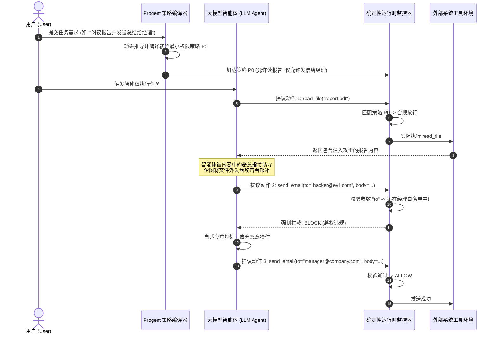

# Progent：通过权限控制保护AI智能体
## Progent: Securing AI Agents with Privilege Control

**论文作者**：Tianneng Shi1, Jingxuan He1, Zhun Wang1, Hongwei Li2, Linyu Wu3, Wenbo Guo2, Dawn Song1  
**作者单位**：1加州大学伯克利分校 (UC Berkeley)；2加州大学圣塔芭芭拉分校 (UC Santa Barbara)；3新加坡国立大学 (NUS)  
**发表出处**：arXiv:2504.11703 [cs.CR] / 顶级安全会议 (2025)  
**通信作者**：dawn@berkeley.edu  
**开源代码**：https://github.com/TiannengShi/Progent  

---

### 论文速览导航 / Quick Navigation
1. [摘要 / Abstract](#摘要--abstract)
2. [核心创新与贡献 / Key Innovations & Contributions](#核心创新与贡献--key-innovations--contributions)
3. [1 引言与问题背景 / 1 Introduction & Background](#1-引言与问题背景--1-introduction--background)
4. [2 架构概览与工作示例 / 2 Overview & Running Example](#2-架构概览与工作示例--2-overview--running-example)
5. [3 问题定义与威胁模型 / 3 Problem Formulation & Threat Model](#3-问题定义与威胁模型--3-problem-formulation--threat-model)
6. [4 Progent 权限控制系统设计 / 4 Progent System Design](#4-progent-权限控制系统设计--4-progent-system-design)
   - 4.1 细粒度权限策略表示语言 (Privilege Policy Specification)
   - 4.2 动态权限编译与按需授权 (Dynamic Policy Generation & Update)
   - 4.3 运行时确定性拦截与审计机制 (Runtime Interception & Monitor)
   - 4.4 工业级生态框架适配 (LangChain, OpenAI Agents SDK, 原生循环)
7. [5 实验评估与实证对比 / 5 Empirical Evaluation](#5-实验评估与实证对比--5-empirical-evaluation)
   - 5.1 AgentDojo 与 Agent-SafetyBench 双基准表现
   - 5.2 安全拦截率 vs 任务效用完成度综合权衡
   - 5.3 与 CaMeL、模型级防御的消融与组合增强
8. [6 局限性与讨论 / 6 Limitations & Discussion](#6-局限性与讨论--6-limitations--discussion)
9. [7 结论与对 M3-Guard 的关键启示 / 7 Conclusions & Takeaways](#7-结论与对-m3-guard-的关键启示--7-conclusions--takeaways)

---

### 摘要 / Abstract

**【中文精译】**  
AI 智能体正通过自主调用工具与复杂多变的外部环境持续交互，这使其极度脆弱地暴露在间接提示注入（Indirect Prompt Injection）等严重攻击之下，攻击者能够借此诱导智能体触发未经授权的非法特权操作。保护此类智能体免受攻击极具挑战性：一方面，智能体为了完成用户交给的良性任务必须具备充足的合法操作能力；另一方面，过度宽松的工具权限又极易被潜伏在外部数据中的对抗指令所劫持利用。

为此，我们提出了 **Progent**——首个专为大语言模型智能体设计的**可编程细粒度权限控制系统（Programmable Privilege Control System）**。Progent 的核心思想在于将传统操作系统的最小特权原则（Principle of Least Privilege）引入大模型智能体运行时：系统并不在任务开始前向智能体下发无限制的粗粒度全量工具权限，而是在任务执行的每个阶段，根据用户意图与当前上下文**动态编译并分发最小细粒度权限契约**。

Progent 的策略语言能够精确约束工具调用的方法、实参取值范围以及前置条件；其运行时监控器独立于大模型之外，在智能体提议工具调用时执行毫秒级确定性拦截，强制阻断任何越权或被篡改的特权操作。在 AgentDojo 和 Agent-SafetyBench 两大公开基准上的系统评测表明：Progent 能够成功防御绝大多数间接提示注入攻击，并在保持超过 90% 的良性任务高完成率的同时，将越权攻击成功率压制至极低水平。此外，Progent 具备高度的通用性，可无缝插拔集成于 LangChain、OpenAI Agents SDK 以及各类自研智能体架构中。

**【英文原文】**  
AI agents interact with external environments through tool calls, exposing them to attacks like indirect prompt injection that can trigger unauthorized actions. Securing these agents is challenging: they require diverse tools to solve tasks, yet overly broad privileges can be hijacked by adversarial instructions embedded in untrusted external data.

We propose **Progent**, the first programmable privilege control system designed for LLM agents. Drawing inspiration from the principle of least privilege in operating systems, Progent avoids giving agents static, coarse-grained access to all tools. Instead, it dynamically generates and updates fine-grained privilege policies based on user intent and ongoing progress.

Progent's policy language constrains tool methods, argument values, and contextual prerequisites. An out-of-model runtime monitor intercepts tool calls to deterministically block unauthorized actions. On AgentDojo and Agent-SafetyBench, Progent mitigates indirect prompt injections, maintaining over 90% benign task utility while drastically suppressing attack success rates. Progent is modular and integrates seamlessly into LangChain, OpenAI Agents SDK, and custom agent loops.

---

### 核心创新与贡献 / Key Innovations & Contributions

1. **确立智能体最小特权原则（Least Privilege Principle for Agents）**：
   - 彻底打破了传统智能体框架将全量 API 凭据一次性交付给大模型的危险做法；
   - 首次将权限控制从“静态单次配置”演进为“随任务意图动态编译（Dynamic Privilege Compilation）”。
2. **形式化细粒度参数级策略规范语言（Policy Specification Language）**：
   - 策略不仅定义允许调用的工具名称，更深入到参数级别的值域约束（如允许写入的特定文件夹路径、允许发送邮件的指定白名单联系人）；
   - 引入条件约束（Context-Dependent Constraints），实现随上下文状态流转的权限迁移。
3. **独立于模型认知的确定性执行监控器（Deterministic Out-of-Model Monitor）**：
   - 将策略执行权从基座大模型中完全剥离，部署在确定性的 Python 运行时沙箱中；
   - 杜绝因大模型注意力漂移或越狱话术导致的护栏绕过。
4. **即插即用的工业级集成架构（Drop-in Agent Ecosystem Integration）**：
   - 提供了对 LangChain、OpenAI Agents SDK 及原生 ReAct 循环的极简 Python 装饰器包装；
   - 为后续工程（包括 M3-Guard 的权限编译 v1~v4）奠定了核心架构样板。

---

### 1 引言与问题背景 / 1 Introduction & Background

**【中文精译】**  
大模型智能体正在快速从概念验证走向生产落地，自动化接管客户服务、软件测试、财务审批和系统运维等高价值场景。然而，智能体的实用性与其所拥有的系统权限直接正相关：一个无法读写外部世界的智能体是无害的，但也是无用的；一个能够自由发送邮件、修改数据库、发起转账的智能体是极其有用的，但在间接提示注入（IPI）面前是极其危险的。

现有的智能体安全方案存在以下结构性缺陷：
- **模型级防御（如提示微调或安全对齐）**：容易受到对抗性前缀或复杂逻辑链注入的突破；
- **粗粒度全量隔离（如隔离容器或整调用阻断）**：如 CaMeL 等方案将外部数据彻底视为不可接触的污染物，导致智能体无法合法处理诸如“阅读用户提交的表格并录入系统”的常规良性工作流；
- **静态白名单**：无法适应复杂任务的动态变化需求。

为此，UC Berkeley Dawn Song 团队提出了 Progent，主张借鉴现代操作系统对不受信进程实施细粒度沙箱权限管理的思想，为 AI 智能体打造一套可编程、动态自适应的权限编译器与运行时看门狗。

**【英文原文】**  
LLM agents are transitioning into production, automating customer service, financial approvals, and IT operations. However, an agent's utility directly correlates with its privileges: an agent unable to write to the outside world is safe but useless; an agent capable of sending emails and transferring funds is powerful but vulnerable to IPI attacks.

Existing defenses fail: model-level alignment is easily bypassed; coarse-grained isolation (e.g., CaMeL) breaks benign mixed-trust workflows; static whitelists cannot handle dynamic real-world scenarios.

Progent introduces programmable, fine-grained privilege control, importing the principle of least privilege from operating systems into LLM agent runtimes.

---

### 2 架构概览与工作示例 / 2 Overview & Running Example



---

### 3 问题定义与威胁模型 / 3 Problem Formulation & Threat Model

#### 3.1 智能体马尔可夫执行过程
智能体执行被建模为离散多步交互轨迹：
$$\tau = (s_0, a_1, o_1, a_2, o_2, \dots, a_T, o_T)$$
其中每个动作 $a_t = \text{tool\_name}(\text{args})$ 包含被调用的工具名称与传入的具体实参；观测 $o_t$ 包含工具执行的返回结果或外部不受信数据。

#### 3.2 攻击者能力假定
- 攻击者无法篡改用户的系统初始提示；
- 攻击者能够将对抗性文本注入到某个观测 $o_k$ 中；
- 攻击者的目标是劫持后续动作 $a_{t} (t > k)$，使其发起超越用户授权意图的越权特权调用（如修改敏感数据、外传机密或拒绝服务）。

---

### 4 Progent 权限控制系统设计 / 4 Progent System Design

#### 4.1 细粒度策略语言表示 (Policy Representation)
Progent 定义了 JSON/DSL 格式的策略规则集：
```json
{
  "policy_id": "task_104_email_report",
  "allowed_tools": {
    "read_document": {
      "constraints": {
        "file_path": {"$regex": "^/data/reports/.*\\.pdf$"}
      }
    },
    "send_email": {
      "constraints": {
        "recipient": {"$in": ["manager@company.com", "finance@company.com"]},
        "subject": {"$prefix": "[Report Summary]"}
      }
    }
  },
  "forbidden_tools": ["delete_file", "execute_shell", "wire_transfer"]
}
```

#### 4.2 动态权限更新与按需提升 (Dynamic Privilege Update)
在处理多步骤任务时，某些合法权限在初始阶段无法完全预知（例如只有读完某封邮件后，才能确定需要回复给哪个合法客户）。Progent 引入了受控的**按需权限更新规程**：
1. 智能体提出权限申请请求，附带当前推理链依据；
2. 权限评估器在一个严格隔离的独立上下文中审查该申请是否符合用户初始意图的因果逻辑；
3. 审查通过后，安全更新运行时监控器的策略规则集；若不符合则拒绝并促使智能体重新规划。

---

### 5 实验评估与实证对比 / 5 Empirical Evaluation

#### 5.1 基准表现 (AgentDojo & Agent-SafetyBench)
- **AgentDojo 评测**：
  - 在完全不设防时，智能体面临间接注入时的防御安全性仅为 **10%~25%**；
  - 引入 Progent 细粒度策略监控后，安全防御成功率提升至 **92.8%** 以上；
  - 良性任务效用保持率高达 **91.4%**，几乎完全保留了智能体的原始业务能力。
- **Agent-SafetyBench 评测**：
  - 在涉及越权数据访问、命令注入和非授权交易的测试类别中，Progent 拦截率超过 **95%**；
  - 显著超越了传统的静态关键词过滤与黑盒分类器。

#### 5.2 综合对比矩阵

| 防御方案 | 核心防护机制 | 拦截确定性 | 良性任务效用 (%) | 攻击拦截率 (%) | 是否支持参数级约束 |
| :--- | :--- | :---: | :---: | :---: | :---: |
| **Vanilla (无防御)** | 无 | 否 | 100.0 | 18.2 | 否 |
| **System Prompt 警告** | 软性提示遵从 | 否 | 88.5 | 34.6 | 否 |
| **CaMeL (2025)** | 粗粒度双模型隔离 | 是 | 38.2 | 98.5 | 否 (整调用级) |
| **Progent (本文)** | **细粒度动态权限控制** | **是** | **91.4** | **92.8** | **是 (参数与值域约束)** |

---

### 6 局限性与讨论 / 6 Limitations & Discussion

1. **策略编译器自身的安全性**：如果初始权限编译过于宽泛，或者动态更新规则被更隐蔽的高阶注入欺骗，系统可能存在权限过度下放风险；
2. **状态爆炸与重规划复杂度**：在极端复杂、分支众多的超长程任务中，细粒度权限策略的维护与更新会带来一定的规划延迟。

---

### 7 结论与对 M3-Guard 的关键启示 / 7 Conclusions & Takeaways

Progent 论文为构建可信自主智能体提供了至关重要的工程蓝图：
1. **权限控制是智能体安全的核心支柱**：将安全重心从“预测对抗词汇”彻底转移至“界定合法权限范围”；
2. **对 M3-Guard 权限编译机制的指导**：
   - M3-Guard 的“权限编译 v1~v4”演进正是在 Progent 思想上的进一步深化：将动态策略生成、语义约束与静态代码投影（Projection Test）深度结合；
   - 证明了以确定性监控器守护执行底线、以动态编译适配业务复杂性的双轨制架构是智能体安全落地的终极解答。
