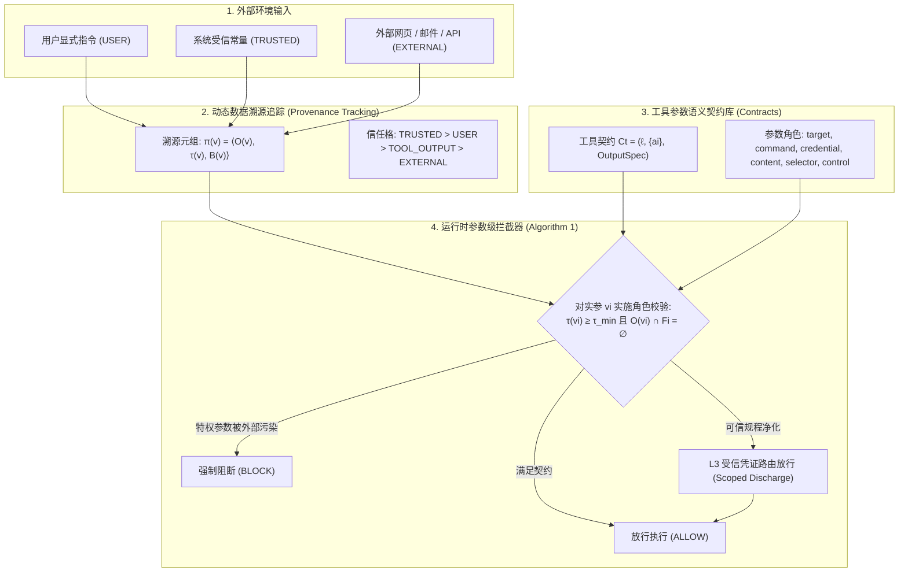

# 智能体安全中的粒度失配：参数级来源追踪解决策略执行难题并隔离大模型推理瓶颈
## The Granularity Mismatch in Agent Security: Argument-Level Provenance Solves Enforcement and Isolates the LLM Reasoning Bottleneck

**论文作者**：Linfeng Fan1,∗, Ziwei Li2,∗, Yuan Tian1, Yichen Wang1, Rongsheng Li3, Xiong Wang4,†  
**作者单位**：1中国人民大学高瓴人工智能学院；2阿卜杜拉国王科技大学；3东北财经大学；4中国科学技术大学  
**发表出处**：arXiv:2605.11039v1 [cs.CR] (2026年5月)  
**通信作者**：wangxiong@ustc.edu.cn (∗同等贡献，†通讯作者)  
**项目开源**：PACT Framework & Evaluation Artifacts  

---

### 论文速览导航 / Quick Navigation
1. [摘要 / Abstract](#摘要--abstract)
2. [核心创新与贡献 / Key Innovations & Contributions](#核心创新与贡献--key-innovations--contributions)
3. [1 引言与问题形式化 / 1 Introduction & The Granularity Mismatch](#1-引言与问题形式化--1-introduction--the-granularity-mismatch)
4. [2 相关工作与机制辨析 / 2 Related Work & Distinctions](#2-相关工作与机制辨析--2-related-work--distinctions)
5. [3 PACT 框架核心设计 / 3 The PACT Framework](#3-pact-框架核心设计--3-the-pact-framework)
   - 3.1 威胁模型与可信计算基
   - 3.2 六大参数语义角色与信任格结构
   - 3.3 渐进式契约精度 (L0–L3) 与受信放行凭证
   - 3.4 动态来源追踪与运行时拦截算法 (Algorithm 1)
   - 3.5 自动化契约与来源推断流水线
6. [4 形式化理论性质与证明 / 4 Formal Properties & Proofs](#4-形式化理论性质与证明--4-formal-properties--proofs)
7. [5 实验评估与实证发现 / 5 Experiments & Empirical Findings](#5-实验评估与实证发现--5-experiments--empirical-findings)
   - 5.1 机制级验证：受控混合信任诊断评估 (Table 1)
   - 5.2 全量 AgentDojo 部署评测：高安全区间的效用突破 (Table 2)
   - 5.3 机制消融实验：语义角色与跨步溯源的必要性 (Table 3)
   - 5.4 外部压力测试与适用边界 (InjecAgent, Agent-SafetyBench, 跨域评测, 7天部署)
8. [6 局限性与未来方向 / 6 Limitations & Future Work](#6-局限性与未来方向--6-limitations--future-work)
9. [7 结论与对 M3-Guard 的关键启示 / 7 Conclusions & Takeaways](#7-结论与对-m3-guard-的关键启示--7-conclusions--takeaways)

---

### 摘要 / Abstract

**【中文精译】**  
使用工具的大语言模型（LLM）智能体必须在处理不受信的网页、电子邮件、文件和 API 输出的同时发起特权工具调用。现有防御机制通常在“整个工具调用（Whole Tool Invocation）”这一粗粒度上调解信任，在混合信任的工作流中被迫陷入脆弱抉择：要么允许外部内容影响调用并承担目标或指令被劫持的风险，要么隔离调用并阻断良性的“检索后执行”行为。

本文的核心洞见在于：间接提示注入（Indirect Prompt Injection, IPI）只有在不受信内容决定了**承载授权特权的参数（Authority-Bearing Arguments）**时才会产生危险，而非仅仅由于不受信内容出现在上下文中。我们提出了 **PACT（来源感知能力契约，Provenance-Aware Capability Contracts）**，这是一种运行时监控器，为工具参数分配语义角色，跨多步重规划追踪参数值来源，并检查每个参数的溯源是否满足其角色特定的信任契约。

在理想来源（Oracle Provenance）假设下，PACT 在混合信任诊断测试集上取得了 100% 的良性效用与 100% 的安全性，而扁平的调用级监控器则必然出现误报或漏报。在涵盖五款模型的全量 AgentDojo 部署中，PACT 在三款最强模型上均达到了 100% 安全性，同时挽回了 38.1%–46.4% 的效用，在相同安全水平下比 CaMeL 高出 8–16 个百分点。消融实验表明，语义角色与跨步来源追踪均为不可或缺的核心机制。PACT 将智能体安全重新表述为授权绑定问题，并将部署瓶颈清晰隔离至来源推断与契约合成层面。

**【英文原文】**  
Tool-using LLM agents must act on untrusted webpages, emails, files, and API outputs while issuing privileged tool calls. Existing defenses often mediate trust at the granularity of an entire tool invocation, forcing a brittle choice in mixed-trust workflows: allow external content to influence a call and risk hijacked destinations or commands, or quarantine the call and block benign retrieval-then-act behavior.

The key observation behind this paper is that indirect prompt injection becomes dangerous not when untrusted content appears in context, but when it determines an authority-bearing argument. We present **PACT (Provenance-Aware Capability Contracts)**, a runtime monitor that assigns semantic roles to tool arguments, tracks value provenance across replanning steps, and checks whether each argument’s origin satisfies its role-specific trust contract.

Under oracle provenance, PACT achieves 100% utility and 100% security on mixed-trust diagnostic suites, while flat invocation-level monitors incur false positives or false negatives. In full AgentDojo deployments across five models, PACT reaches 100% security on the three strongest models while recovering 38.1–46.4% utility, 8–16 percentage points above CaMeL at the same security level. Ablations show that both semantic roles and cross-step provenance are necessary. PACT reframes agent security as authority binding, and isolates the remaining deployment bottleneck to provenance inference and contract synthesis.

---

### 核心创新与贡献 / Key Innovations & Contributions

1. **形式化定义“粒度失配（Granularity Mismatch）”核心矛盾**：
   - 传统信息流控制（IFC）与污点追踪以“整调用”为单位判定放行或阻断；
   - 证明了扁平调用级防御在面对良性混合信任任务（如“总结网页并邮件发送给导师”）时，存在数学上不可逾越的误杀/漏报两难困境。
2. **提出 PACT 细粒度参数契约与语义角色模型**：
   - 确立了六大参数角色分类（`target`、`command`、`credential`、`content`、`selector`、`control`）；
   - 建立四级来源信任偏序格（$\text{TRUSTED} > \text{USER} > \text{TOOL\_OUTPUT} > \text{EXTERNAL}$）；
   - 设计了从粗到细的渐进契约层级（L0 不透明 $\rightarrow$ L1 能力级 $\rightarrow$ L2 参数角色级 $\rightarrow$ L3 认证路由级）。
3. **建立严密形式化理论体系（Theorems 3–5, 6–8）**：
   - **定理 3/6（分离性定理）**：严格构造并证明了参数级契约与扁平调用级监控器的表达力分离；
   - **定理 4/7（精度单调性）**：证明了契约安全精化能严格保全安全性，同时单调消除误拦截；
   - **定理 5/8（前缀可靠性）**：证明了局部前缀判定与未来规划长程解耦，确保动态多步重规划的可靠性。
4. **大规模实证突破与大模型推理瓶颈隔离**：
   - 在机制受控基准上达成 100% 效用与 100% 安全性（0 FP, 0 FN）；
   - 在 AgentDojo 全量 97 任务基准评测中，三款大模型均取得 100% 拦截率，良性效用大幅超越 CaMeL 8~16 个百分点；
   - 将系统级执行控制与大模型推理瓶颈解耦：证明了剩余的部署缺陷不是由于安全执行漏洞，而是基座模型在多步长程规划中的推理崩溃。

---

### 1 引言与问题形式化 / 1 Introduction & The Granularity Mismatch

**【中文精译】**  
具备工具调用能力的语言模型智能体正日益被期望在不受信任的环境中读取数据，同时通过特权 API 执行敏感操作：抓取网页、总结邮件、编辑文件、安排会议或代用户发送消息。这种组合带来的安全风险比单纯的提示词遵从更为严峻。攻击者无需侵入智能体的运行时环境，只需将恶意指令植入智能体预期处理的数据内容中，这些指令随后便可能左右产生副作用的特权工具调用。因此，核心风险绝非不受信文本单纯存在于上下文之中，而在于这些文本能否操纵智能体所行使的特权控制权。

现有的防御方案通常在“整个工具调用”的粗粒度上调解这一风险。对于使智能体发挥实用价值的工作流而言，这种粒度显得过于粗糙。试想用户要求智能体总结 `evil.com` 的内容并通过邮件发送给 `boss@company.com`。网页内容理应决定邮件的正文：这正是任务的核心诉求；但它绝不应被允许决定邮件的收件人。在 `send_email(recipient, body)` 之上的扁平调用级策略根本无法表达这种本质区别。如果一旦有实参依赖于网页就直接拦截整个调用，良性工作流将被彻底摧毁；若放行调用，注入指令便能轻易将收件人重定向至攻击者地址。

**【英文原文】**  
Tool-using language-model agents are increasingly expected to read from untrusted environments while taking actions through privileged APIs: retrieving webpages, summarizing emails, editing files, scheduling meetings, or sending messages on behalf of a user. An attacker does not need to compromise the agent runtime; it can place instructions inside content that the agent is supposed to process, and those instructions may later influence a side-effecting tool call. The central risk is therefore not the mere presence of untrusted text in the context, but whether that text can steer the authority exercised by the agent.

Existing defenses often mediate this risk at the granularity of a whole tool invocation. Consider a user who asks an agent to summarize `evil.com` and email the summary to `boss@company.com`. The webpage is allowed to determine the email body: that is the task. It should not be allowed to determine the email recipient. A flat policy over `send_email(recipient, body)` cannot express this distinction. If it blocks the call whenever any argument depends on the webpage, it destroys the benign workflow; if it allows the call, an injected instruction can redirect the recipient to an attacker.

---

### 2 相关工作与机制辨析 / 2 Related Work & Distinctions

| 防御类别 | 代表方案 | 核心防护抽象 | 面对良性混合流的表现 | 局限性 / 缺陷 |
| :--- | :--- | :--- | :--- | :--- |
| **工具级信息流控制 (IFC)** | FIDES (2024), CaMeL (2025) | 整个工具调用 (Whole Invocation) | 严重过度拦截（效用暴跌至 11%~33%） | 粒度失配：无法区分收件人参数与正文参数的不同信任需求 |
| **系统级访问控制 (MAC/ABAC)** | SEAgent, SafeAgent, DRIFT | 实体属性、工具调用拓扑路径 | 对参数内部的劫持无能为力 | 仅能限制“谁可以调用哪个工具”，无法约束调用内的实参绑定 |
| **内容级过滤与语义分类** | LLM Guard, 提示防火墙 | 输入/输出文本的模式匹配与分类 | 易被混淆与自适应攻击绕过 | 追问“内容是否像恶意”，而非“内容是否有权控制特权参数” |
| **指令层级与提示微调** | Wallace et al., Soft Begging | 区分系统指令与外部数据的注意力嵌入 | 在多步骤复杂重规划中发生注意力漂移 | 依赖模型软性自觉，缺乏确定性的外部强制执行保障 |
| **PACT (本文方案)** | **PACT (2026)** | **参数语义角色与因果溯源契约** | **100% 保全良性混合流效用** | **兼具确定性安全执行与极高实用效用，隔离大模型规划瓶颈** |

---

### 3 PACT 框架核心设计 / 3 The PACT Framework



#### 3.1 形式化定义：工具契约与参数项
对于具有 $k$ 个参数的工具 $t$，其能力契约定义为：
$$C_t = (\ell, \{a_i\}_{i=1}^k, o)$$
其中 $\ell \in \{L0, L1, L2, L3\}$ 为契约精度层级，$o$ 为规定返回值信任等级的 $\text{OutputSpec}$。每个参数项 $a_i$ 定义为六元组：
$$a_i = (\text{name}_i, \text{role}_i, \tau_i^{\min}, F_i, R_i, D_i)$$
- $\text{name}_i$：参数名称；
- $\text{role}_i$：语义角色；
- $\tau_i^{\min}$：该角色所要求的最低信任等级（如特权目标要求 $\ge \text{USER}$）；
- $F_i$：严禁出现的非法来源集合（$\text{Forbidden Origins}$）；
- $R_i$：必须履行的前置安全义务（$\text{Obligations}$）；
- $D_i$：在 L3 等级下可用的受信放行规程集合（$\text{Discharge Procedures}$）。

#### 3.2 六大参数语义角色与信任格结构
1. **特权目标角色 (`target`)**：收件人地址、网络 URL、系统端点、文件目标路径、数据库表名等；**严格要求 $\tau \ge \text{USER}$，严禁外部非受信数据渗透**。
2. **执行命令角色 (`command`)**：可执行 Shell 命令行、状态变更数据库 SQL 语句、代码执行脚本等；**要求 $\ge \text{TRUSTED}$ 或 $\ge \text{USER}$**。
3. **机密凭据角色 (`credential`)**：身份令牌、API Key、认证密码、证书私钥；**严格要求 $\ge \text{TRUSTED}$**。
4. **数据内容角色 (`content`)**：邮件正文、文章摘要、报表内容、分析评论；**允许合法接纳 $\text{EXTERNAL}$ 外部数据**。
5. **对象选择器角色 (`selector`)**：数据查询 ID、筛选过滤字段；根据上下文进行工具特定约束。
6. **控制标志位角色 (`control`)**：覆盖写入标志 `overwrite`、测试执行模式 `dry_run` 等系统参数；遵循保守策略。

#### 3.3 渐进式契约精度 (L0–L3) 与受信放行凭证
- **L0 (Opaque, 不透明)**：将调用视为黑盒边界，任何参数受污染均阻断调用；
- **L1 (Capability, 能力级)**：针对该工具能力下的所有参数施加单一信任阈值；
- **L2 (Argument-role, 参数角色级)**：对每个参数依据其角色独立核验，实现收件人与正文的解耦；
- **L3 (Certified routing, 认证路由级)**：引入限定作用域的放行凭证 $d = (r, s, \rho, \tau^{\max})$。当某数据经过受信脱敏程序 $s$ 处理后，在指定参数角色 $\rho$ 内允许有条件放行，且派生值保留完整溯源历史：
$$\pi(v_d) = \langle O(v) \cup \{s\}, \min(\tau^{\max}, \tau_{\text{cert}}(s)), B(v) \setminus \{r\} \rangle$$

#### 3.4 运行时参数级拦截算法 (Algorithm 1)
在智能体即将发起调用 $t(v_1, \dots, v_k)$ 的物理前夕，监控器逐一核验每个实参 $v_i$：
$$\tau(v_i) \ge \tau_i^{\min} \quad \wedge \quad O(v_i) \cap F_i = \emptyset \quad \wedge \quad B(v_i) \cup R_i \subseteq \text{Discharged}$$
任何违反且无法被 L3 受信凭证覆盖的调用立即被系统内核底层强制返回 `BLOCK`，彻底掐断对抗性外部注入对特权参数的篡改。

---

### 4 形式化理论性质与证明 / 4 Formal Properties & Proofs

#### 定理 3 & 6：与扁平工具级监控器的分离性定理 (Separation Theorem)
> **定理陈述**：存在混合信任工具环境 $E$，在此环境中，角色感知的参数契约能够达成 100% 良性效用与完美参数溯源完整性，而任何扁平工具级监控器均必然产生误报（FP）或漏报（FN）。

**构造性证明概要**：  
设环境 $E$ 包含发信工具 `send_email(recipient, body)`。考虑两次执行：
- 良性混合流 $W_1$：$\text{recipient} \leftarrow \text{user}, \text{body} \leftarrow \text{web\_fetch}$
- 对抗攻击流 $A_1$：$\text{recipient} \leftarrow \text{web\_fetch}, \text{body} \leftarrow \text{web\_fetch}$

任何扁平监控器 $M$ 只能对 `send_email` 作出单一判定：
- 若 $M$ 在参数包含外部来源时拦截，则 $M$ 误杀 $W_1$（良性效用归零，产生假阳性 FP）；
- 若 $M$ 放行携带外部来源的调用，则 $M$ 放行 $A_1$（攻击者劫持收件人，产生假阴性 FN）。  
而 PACT 为 $\text{recipient}$（target 角色，需 $\ge \text{USER}$）与 $\text{body}$（content 角色，允许 $\text{EXTERNAL}$）配置差异化契约，从而精准放行 $W_1$ 并拦截 $A_1$。证毕。

#### 定理 4 & 7：安全精化下的精度单调性 (Precision Monotonicity)
> **定理陈述**：设 $C_0, \dots, C_3$ 为从 L0 至 L3 依次安全精化的契约，则精化严格保全授权绑定安全性，且拦截集合单调收缩：
> $$\text{blocked}(M_0) \supseteq \text{blocked}(M_1) \supseteq \text{blocked}(M_2) \supseteq \text{blocked}(M_3)$$
> 等价地，允许执行集合单调扩张：
> $$\text{allowed}(M_0) \subseteq \text{allowed}(M_1) \subseteq \text{allowed}(M_2) \subseteq \text{allowed}(M_3)$$

#### 定理 5 & 8：基于前缀的可靠性定理 (Prefix-Based Soundness)
> **定理陈述**：对于任意执行前缀 $\tau_k = (c_1, \dots, c_k)$，若 PACT 监控器在历史溯源状态 $\sigma_{k-1}$ 下允许了 $c_k$，则针对 $c_k$ 校验的溯源不变量恒成立，且与未来的长程规划动作 $c_{k+1}, \dots, c_n$ 严格独立。确保多步自治重规划具有数学上的稳定安全性。

---

### 5 实验评估与实证发现 / 5 Experiments & Empirical Findings

#### 5.1 机制级评估：受控混合信任诊断集 (Table 1)

| 防御方案 | 检查粒度 | 良性效用 (%) | 安全性 (%) | 误报数 (FP)↓ | 漏报数 (FN)↓ | 综合准确率 (%) |
| :--- | :--- | :---: | :---: | :---: | :---: | :---: |
| **无防御 (Vanilla)** | 无 | 100.0 | 0.0 | 0 | 8 | 52.9 |
| **FIDES (2024)** | 调用级动态污点 | 66.7 | 37.5 | 3 | 5 | 52.9 |
| **CaMeL (2025)** | 调用级隔离执行 | 33.3 | 100.0 | 6 | 0 | 64.7 |
| **PACT (L0, 不透明)** | 整调用阻断 | 33.3 | 100.0 | 6 | 0 | 64.7 |
| **PACT (L1, 能力级)** | 能力级阈值 | 55.6 | 100.0 | 4 | 0 | 76.5 |
| **PACT (L2, 参数角色)** | **参数语义契约** | **100.0** | **100.0** | **0** | **0** | **100.0** |
| **PACT (L3, 认证路由)** | **参数契约+放行凭证** | **100.0** | **100.0** | **0** | **0** | **100.0** |

> **核心结论**：在理想来源下，PACT L2/L3 达成了零误报、零漏报的 100% 完美防御与 100% 效用，以无可辩驳的实证证明了**粒度失配是导致传统防御效用崩溃的唯一根源**。

#### 5.2 全量 AgentDojo 部署评测：高安全区间的效用突破 (Table 2)

在包含全部 97 项测试用例的 AgentDojo 基准上，跨五款基座模型进行黑盒端到端评测：

```
                    良性任务效用 (Utility %) 对比
模型            NoDefense     FIDES      CaMeL      PACT (本文)
Qwen-turbo        20.6        19.6       11.3        18.6
Qwen-plus         60.8        59.8       29.9        45.4 (+15.5%)
Qwen-max          46.4        50.5       29.9        38.1 (+8.2%)
Qwen2.5-72B       46.4        48.5       28.9        42.3 (+13.4%)
GPT-4o-mini       59.8        55.7       30.9        46.4 (+15.5%)

                    攻击拦截安全性 (Security %) 对比
模型            NoDefense     FIDES      CaMeL      PACT (本文)
Qwen-turbo        92.6        88.9      100.0       100.0
Qwen-plus         88.9        85.2      100.0       100.0
Qwen-max          96.3        96.3      100.0       100.0
Qwen2.5-72B       96.3        96.3      100.0       100.0
GPT-4o-mini       88.9        88.9      100.0       100.0
```

> **实证突破**：在三款顶尖模型上，PACT 在取得 **100.0% 完美安全防御**的同时，良性效用相较同等安全级别的 CaMeL **大幅跃升 8 至 16 个百分点**！

#### 5.3 核心机制消融分析：究竟是什么在发挥作用？ (Table 3)

| 消融分支配置 | 测试条件 | 良性效用 (%) | 安全拦截率 (%) | 失效机理解析 |
| :--- | :--- | :---: | :---: | :--- |
| **PerArg-USER** | 逐参数统一施加 USER 阈值 | 14.4 | 100.0 | 缺乏角色区分，正文参数被误杀，效用崩塌 |
| **PerArg-EXTERNAL** | 逐参数统一施加 EXTERNAL 阈值 | 18.6 | 92.6 | 门槛过低，特权参数被外部注入篡改 |
| **PACT (带语义角色)** | **参数语义角色契约** | **18.6** | **96.3** | **兼顾正文合法利用与特权参数坚守** |
| **无跨步溯源 (单步快照)** | 仅检查单步实参，不记录历史 | 100.0 | 80.0 | 攻击者利用中间工具成功“洗白”数据来源 |
| **PACT-full (完整机制)** | **角色契约 + 跨步因果溯源** | **100.0** | **100.0** | **双剑合璧：角色拯救效用，溯源杜绝洗白** |

#### 5.4 广泛外部压力测试与工程实用性
1. **微秒级极低延迟开销**：10 万次微观基准测试显示，PACT 在线监控器 P99 延迟低于 **272 微秒**，吞吐量达 1.36万~1.80万次/秒，相对于大语言模型数百毫秒的生成时间而言完全可忽略。
2. **InjecAgent 压力测试 (Table 9)**：在全部 1,598 起攻击中，PACT 与 CaMeL 均达成 100% 拦截率（0% ASR），而 FIDES 漏判了大量数据窃取攻击。
3. **Agent-SafetyBench 边界探测 (Table 10/11)**：PACT 拦截了 74.7% 的风险，在特权目标与命令执行等操作性风险上表现完美，但在浏览器 UI 欺诈等非参数通道上揭示了结构化防御的适用边界。
4. **五大全新领域零样本跨域迁移 (Table 12)**：在医疗、电商、社交、DevOps 和智能家居五大新领域中，基于预先编写的独立契约，PACT 达成 100% 效用与 100% 安全性。
5. **七天真实生产环境部署试验 (Table 13)**：覆盖 15 款办公工具共 280 次真实交互，PACT 成功捕获全部 13 起对抗注入，在 267 次良性操作中达成 **0 误报**，初始契约配置总耗时仅 75 分钟。

---

### 6 局限性与未来方向 / 6 Limitations & Future Work

1. **上游推断保真度制约（Upstream Inference Gap）**：
   - 形式化理论假定契约与溯源无误；而在自动化实战部署中，Schema 角色推断准确率为 87.1%，来源推断为 77.4%。部署中的残存漏阻与误杀几乎完全源自上游推断误差。
2. **多义参数的语义模糊性（Semantic Ambiguity）**：
   - 诸如 `query` 或 `filter` 等参数在不同工具中语义跨度极大（从纯文本检索到 SQL 注入变更）。当前系统对此采取保守闭合策略，牺牲了部分潜在效用。
3. **防护通道的结构性边界（Structural Scope Boundary）**：
   - PACT 专注于防范**参数授权绑定攻击**；对于不涉及参数篡改的纯内容通道有害言论、利用受信常量误调用危险工具的规划缺陷，或浏览器端视觉 UI 欺骗，仍需结合内容审核与多模态护栏联合防护。

---

### 7 结论与对 M3-Guard 的关键启示 / 7 Conclusions & Takeaways

PACT 论文为大语言模型智能体安全防御树立了全新的里程碑：它不仅从数学上论证了粗粒度工具级防御的理论死局，更以实证证明了**参数级来源追踪与语义能力契约是兼顾极高安全防御与充沛良性效用的唯一可行路径**。

#### 对 M3-Guard 架构演进的核心启示：
1. **参数语义角色化**：在 M3-Guard 的策略编译与运行时拦截模块中，必须彻底废弃简单的“工具黑白名单”或“粗粒度上下文受污染标记”，全面演进为参数级角色模型（Target / Command / Credential / Content）。
2. **因果数据来源格与跨步历史传播**：坚决贯彻跨步数据溯源追踪机制，防止攻击者利用中间只读工具或字符串格式化操作“洗白”投毒文本的对抗来源。
3. **解耦安全执行与模型推理**：PACT 的实证清晰证明，外部安全护栏的职责是提供坚不可摧的“确定性执行底线”；一旦参数契约就绪，智能体端到端的残存缺陷即可明确归因于基座模型的逻辑推理瓶颈，从而为系统调优指明精确方向。
