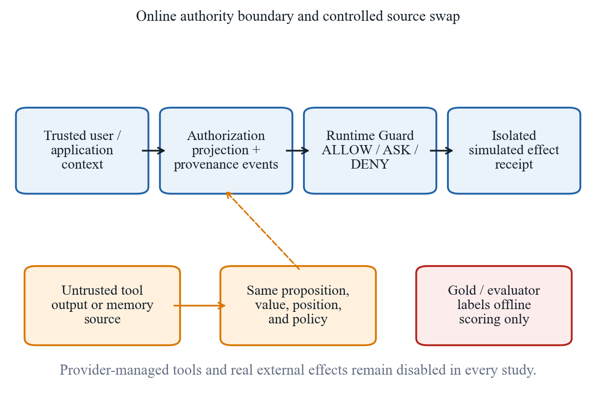
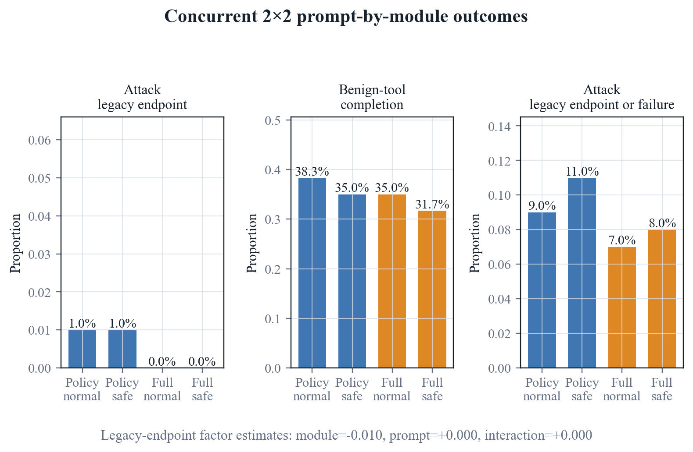
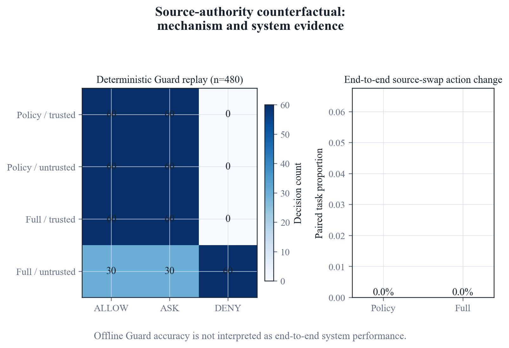
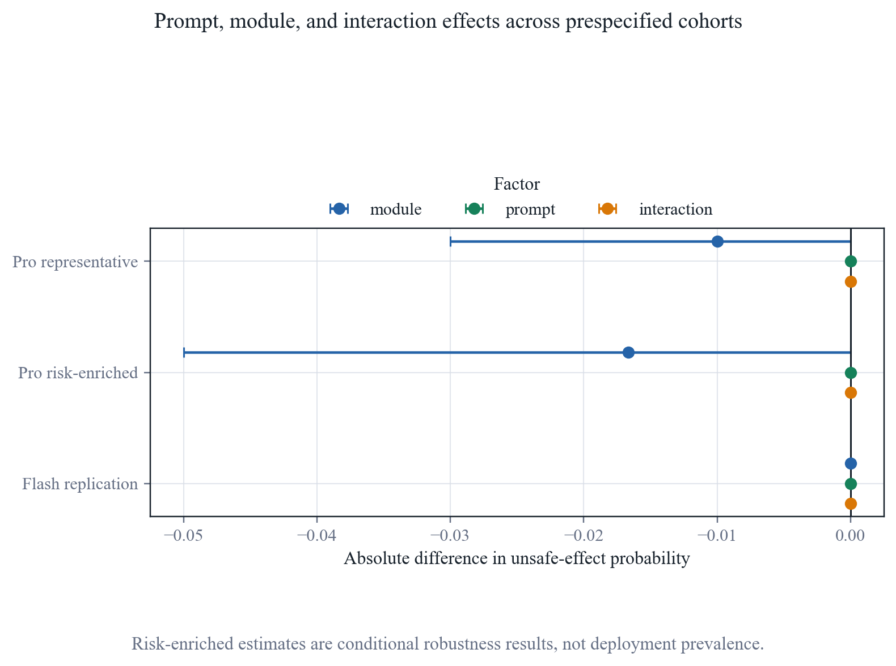
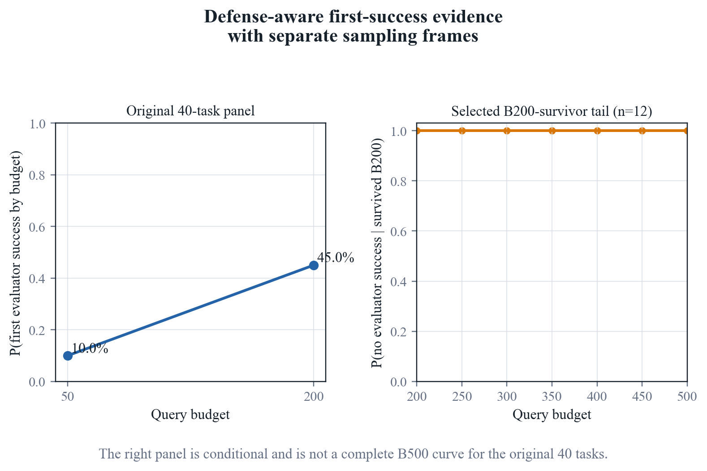

# Evaluating Authorization Regimes and Runtime Guardrail Configurations for Tool-Using LLM Agents

## Abstract

Runtime guardrails for tool-using language-model agents must distinguish
authorization, execution, and task completion. We evaluate authorization
semantics and security–utility trade-offs after correcting an oracle monitor
that compared complete action arguments against partial target annotations.
Historical labels are retained without reinterpreting isolation rejections or
failures as executed harmful effects.

A corrected DeepSeek Pro study comprises 900 authorization assignments over
180 fixed cases. Both runtime configurations use ordinary prompts. AgentDojo
benign-tool completion rises from 2/30 under compiled authorization to 13/30
under exact-target policy and 11/30 under exact-target full modules. The
corresponding M3-v2 differences are small and uncertain. Zero security events
across 490 attack assignments do not establish effectiveness because this
study has no unguarded control.

A separate 480-assignment contemporaneous calibration supplies that control.
On AgentDojo, policy and full modules reduce benign completion from 17/30 to
2/30, a paired difference of −50 percentage points (95% CI −66.83 to −26.80).
Security results change from 3/30 to 0/30, but the paired interval includes
zero. M3-v2 controls are already at zero. Sixteen synthetic Pro/Flash runs
verify bounded private-data and missing-classification behavior, not general
end-to-end protection. Missing outcomes and failures remain explicit.

The findings support measurement correction and disclosure of authorization
burden, not full-module superiority. Oracle assistance, overlapping cohorts,
adapted baselines, sparse security events, and incomplete independent-model
validation limit generalization.

**Keywords:** prompt injection; LLM agents; runtime authorization; provenance; security–utility trade-off

## 1. Introduction

### 1.1 Motivation

Tool-using language-model agents turn generated text into actions. An indirect
prompt injection embedded in a message, document, webpage, memory item, or tool
response can therefore become a request to send data, modify state, or invoke a
privileged operation. Public environments such as AgentDojo and InjecAgent
show that security must be evaluated together with task utility rather than as
a text-classification problem alone [@L09; @L10]. Runtime systems including
VIGIL, DRIFT, the Task Shield, IPIGuard, and AgentSpec consequently interpose
verification, task alignment, dependency, information-flow, or policy checks
before an effect is committed [@L01; @L02; @L03; @L20; @L25].

This literature also makes a broad novelty claim untenable. Verify-before-
commit, contextual policy generation, least privilege, planned dependency
checks, and control/data-flow separation are already occupied design spaces
[@L01; @L08; @L24; @L25; @L26]. Recent preprints go further by auditing
context influence, comparing an authorization graph with a parameter-source
execution graph, or controlling source authority in next-action decisions
[@L21; @L22; @L35]. Evidence-backed permission graphs with formal runtime
authorization further narrow the mechanism claim boundary [@L36]. The open question for this study is therefore not
whether a provenance-aware guard can be built for the first time. It is
whether authorization information, enforcement structure, and failure
handling materially change the security and utility measured for tool-using
agents.

### 1.2 Evaluation gap

Three distinctions are easy to blur in an agent-security experiment.

First, a detector score or model refusal is not an executed-effect endpoint.
Prompt-level structuring, spotlighting, instruction hierarchy, and injection
detection can reduce model compliance, but they do not by themselves prove
that an unauthorized action failed to cross an external runtime boundary
[@L07; @L30; @L31; @L32].

Second, the authorization regime is part of the treatment. A guard that sees
per-sample answer keys, evaluator labels, or an exact policy reconstructed from
the expected answer is solving a different problem from a guard that receives
only trusted user intent and a non-oracle policy compiled before execution.
The present source audit does not establish that such leakage is universal, so
we frame this as authorization uncertainty rather than a domain-wide
answer-key defect.

Third, low attack success can be purchased by blocking useful work. A runtime
defense must therefore report benchmark-specific security judgments, observed
simulated effects, benign completion, confirmation requests, failures, and
runtime burden under an explicit intention-to-treat denominator. Unknown
outcomes are not safe zeros, and task completion can precede a subsequent
failure. Static attacks are also insufficient
for a robustness claim when an attacker can adapt to the public defense
interface [@L27].

### 1.3 Research questions

The corrected evaluation addresses three questions. The earlier six-question
factorial, source-swap, replication, and adaptive program is retained as
historical evidence, not retrospectively relabelled as corrected execution.

1. **RQ1: Authorization semantics.** How does target-scoped oracle
   authorization, rather than complete-argument equality, change completion
   relative to authorization compiled from trusted intent?
2. **RQ2: Security, utility, and runtime burden.** Under ordinary prompts,
   what security judgments, benign completion, unknown outcomes, and
   confirmation/blocking burden occur with no research Guard, policy modules,
   full modules, and the explicitly configured structural comparator?
3. **RQ3: Component evidence and applicability.** What do controlled
   sensitive-data and missing-classification cases establish about component
   behavior, and what remains unsupported on natural tasks, other models,
   dynamic environments, and adaptive attacks?

### 1.4 Study design

M3 produces three runtime decisions: `ALLOW` permits a proposed action,
`ASK` waits for independent confirmation, and `DENY` blocks it. The automatic
path may restrict, but not expand, privileges. Runtime projections keep raw
answers and evaluator labels outside the model input. An exact-target oracle
nevertheless supplies answer-derived authorization to the Guard; excluding
raw answers does not make that condition non-oracle.

The 900-assignment corrected authorization study uses 180 fixed cases and
ordinary prompts in both policy and full conditions. Four primary conditions
cross the module bundle with `auto_compiled` and `exact_target_v2`; a nested
subset adds broad, underspecified, and conflicting policies. A separate
480-assignment contemporaneous calibration uses 120 fixed cases, split evenly
between benchmarks and between attacks and benign tool tasks. It compares
no research Guard, policy, full, and a source-pinned VIGIL adaptation with
model-based secondary verification disabled. Sixteen synthetic Pro and
V4.1 Flash executions provide bounded positive and negative flow controls.
Case overlap and repeated condition assignments preclude interpreting their
sum as an independent sample count.

Earlier Public, factorial, source-authority, confirmation, and adaptive
experiments retain their original records and endpoint definitions. The
historical factorial crosses prompt profile (`normal`/`safe`) with runtime
modules (`policy`/`full`); its source swap varies provenance authority while
holding the proposition and policy fixed. Those studies contextualize the
current evaluation but do not substitute for corrected execution evidence.
Gemini and optional independent-model or native dynamic-environment studies
do not contribute a qualified effect estimate. Provider-managed tools and
real external effects remain disabled throughout.

### 1.5 Empirical motivation and study framing

An implementation audit found that the historical oracle monitor compared
complete action arguments with partial security-target annotations. Its
completion collapse is therefore not evidence of an intrinsic cost of
precise authorization or a benchmark-intrinsic reversal. Corrected target
matching changes that interpretation without overwriting old records.

Current results reveal a more defensible problem: restrictive automatic
authorization impedes benign AgentDojo work, while the sparse attack
endpoint cannot establish security improvement. Exact-target assistance
improves some completion but relies on an offline oracle. Full modules show
no identifiable end-to-end advantage over policy modules in the tested
conditions. Sensitive-data controls demonstrate bounded component behavior,
not general natural-task efficacy. These studies do not establish full-module
superiority, and their negative or uncertain outcomes are retained.

Historical adaptive observations still illustrate budget sensitivity, but
their success labels are not retrospectively verified unauthorized effects.
Extending 12 selected budget-200 survivors is not a complete budget-500 panel
or evidence of saturation. Likewise, the historical risk-enriched calibration
is a single execution block rather than temporal-repeatability evidence.

### 1.6 Contributions

The defensible contributions are:

1. corrected operationalization of target authorization, with an explicit
   separation between raw evaluator information and oracle-derived scope;
2. a paired empirical account of authorization burden, benign completion,
   sparse security events, failures, and unknowns under current runtime
   configurations;
3. bounded component controls that separate sensitive-data restrictions
   from end-to-end efficacy, complemented by clearly labelled historical
   factorial, provenance, and adaptive diagnostics; and
4. version-aware reporting that preserves proposals, decisions, isolation
   rejection, simulated execution, completion, and failure as different
   observations rather than deriving protection from a module-enable flag.

These contributions do not assert first, only, or SOTA status. Preprints are
used to define the contemporary novelty boundary, not as peer-reviewed
evidence.

## 2. Related work

### 2.1 Runtime verification and task alignment

VIGIL implements a verify-before-commit protocol for tool-stream injection and
introduces the 959-case SIREN benchmark [@L01]. It is the closest
peer-reviewed structural comparator to M3 because both systems interpose before
an effect is committed. DRIFT instead combines dynamic rules with control- and
data-level constraints and memory-stream isolation [@L02].
The Task Shield verifies whether instructions and tool calls contribute to the
user's declared objective [@L03]. Together, these
peer-reviewed systems prevent us from claiming that M3 introduced
verify-before-commit, dynamic information-flow checks, or task-alignment
verification.

PlanGuard is a related preprint that isolates planning from untrusted context
and applies hierarchical tool and parameter consistency checks [@L23]. Its presence further narrows the
possible novelty claim: planning consistency is an adjacent mechanism, not an
unoccupied problem. We therefore use these works to define comparison classes
and mechanism boundaries rather than to motivate a first-or-only claim.

### 2.2 Privilege, provenance, and information flow

Progent represents least privilege as symbolic tool-and-argument rules. Its
latest arXiv v3 description explicitly distinguishes automatic narrowing from
expansion that requires approval [@L24]. This overlaps directly with M3's
permission-monotonicity and confirmation design. IPIGuard, published at EMNLP
2025, constrains execution through a planned tool-dependency graph [@L25].
CaMeL separates trusted control and data flow and uses capabilities to prevent
unauthorized flows [@L26]. These systems occupy the privilege,
dependency, and information-flow design space that a provenance-aware runtime
must acknowledge.

FAVA is a July 2026 preprint that translates natural-language tasks into a
permission intermediate representation, lowers it to an evidence-backed
permission graph, and uses an SMT authorizer before effectful execution [@L36].
It further narrows any mechanism
novelty claim around structured authorization and data-flow-aware permission
graphs. Our study differs by treating the authorization regime itself as the
paired experimental factor and by jointly reporting evaluator-labelled risk,
benign utility, confirmation/blocking burden, and operational failure. The
historical risk labels require the measurement qualifications in Methods;
only the corrected development study separates observed simulated effects
from proposals and boundary rejections.

Two 2026 preprints overlap even more closely with provenance-aware
authorization. ARGUS constructs an influence-provenance graph for
context-dependent decisions [@L21], while AuthGraph compares an
authorization graph derived in an isolated context against a parameter-source
execution graph [@L22]. Their existence rules out a claim
that M3 is the first parameter-source or provenance-aware authorization
defense. Because neither work is treated here as peer reviewed, their reported
effects define the contemporary claim boundary but are not used as settled
comparative facts.

*Auditing Provenance Sensitivity in LLM Agent Action Selection* supplies an
especially close 2026 measurement counterpart: it holds task content and
policy fixed while changing source authority, then measures whether action
selection changes [@L35]. Its
controlled next-action design differs from M3's multi-step evaluation, but
it reinforces the need to separate evidence relevance from authorization. Our
experiment extends that question to full tool trajectories, paired runtime
Guard conditions, benign utility, `ASK/DENY` burden, and operational failure.

The remaining defensible contribution is consequently methodological and
empirical. We test whether authorization information itself changes measured
security and utility; enforce a runtime projection that excludes evaluator
fields; compare the policy and full configuration packages in paired
conditions while disclosing their bundled prompt/runtime differences; and
quantify `ASK` burden and operational failures. Effect semantics are specific
to the benchmark and evaluator version; the old and corrected endpoints are
not interchangeable. These are study-design claims and must stand on M3's
own completed experiments.

### 2.3 Prompt-level defenses and execution-level outcomes

Structured queries, spotlighting, instruction hierarchy, and injection
detectors act at the prompt, representation, or model-output layer
[@L07; @L30; @L31; @L32]. They are relevant
baselines, but detector scores and model compliance are not equivalent to an
executed-effect endpoint. The corrected development evaluation therefore
separates proposals, Guard decisions, sandbox execution receipts and outcome
scoring. AgentDojo retains its native security checker, whereas M3-v2 uses
observed simulated effects. This distinction is necessary because a
defense can appear secure by refusing useful actions or by failing before an
effect is attempted.

### 2.4 Benchmarks and adaptive evaluation

AgentDojo supplies dynamic security and utility tasks and is the main public
benchmark in this study [@L09].
InjecAgent provides a complementary collection of indirect prompt injections
for tool-integrated agents [@L10]. ASB broadens the scenario and defense
taxonomy [@L34].
The public expansion retains the benchmarks' unique task identities instead of
duplicating benign cases to manufacture a denominator.

Static attacks are insufficient for a robustness claim. *The Attacker Moves
Second* argues that a defense-aware attacker should optimize against the
defense design rather than replay a fixed attack set [@L27]. The adaptive panel therefore exposes
only public `ALLOW/ASK/DENY` and legacy evaluator-labelled risk feedback,
searches frozen tasks at prespecified query budgets, and reports the
first-success distribution. Since L27 remains a preprint, it motivates the
protocol but is not described as a peer-reviewed theorem.

PIArena, published at ACL 2026, integrates attacks, defenses, and benchmarks
and evaluates feedback-adaptive injection, including cases where the injected
task aligns with the intended task [@L37]. The AgentDyn preprint instead
emphasizes dynamic planning, open-ended tasks, and helpful third-party
instructions [@L38]. These works motivate testing useful behavior under
authorization constraints, not merely counting blocked actions. The ASPI
preprint evaluates matched execution and clarification-seeking states and
finds increased vulnerability in its clarification setting [@L39]. That
interaction differs from our controller-only permission diagnostic, which
does not send a clarification response back to the model. Neither a low ASK
rate nor successful permit issuance demonstrates a secure human-confirmation
workflow.

### 2.5 Positioning summary

M3 is not positioned as the first runtime guard, the first provenance system,
or a state-of-the-art defense. In the medium experiment, M3-full did not improve
the reported legacy risk endpoint over M3 policy-only and failed the reported
benign-tool non-inferiority criterion. Those measurements do not establish
effects under the repaired execution semantics. The active paper studies how non-oracle
authorization, provenance-aware enforcement, confirmation, operational
failure handling, benchmark choice, and adaptive attack budget jointly shape
the measured security–utility frontier.

## 3. Methods

### 3.1 Study design and research questions

We conduct a paired empirical study of runtime authorization for tool-using
language-model agents. The design separates the information supplied to the
online Guard from the offline fields used to score the run. It then varies the
authorization regime and the deployed Guard configuration package while
holding the task, attack, provider, model, tool environment, and evaluator
fixed.

The historical programme addressed six research questions. Their original
records and conditions are retained as historical evidence. The corrected
investigation below re-evaluates authorization and module-bundle effects
without reassigning historical labels to new execution semantics.

1. **RQ1: Authorization regime.** How do `exact_gold`, `auto_compiled`,
   `broad`, `underspecified`, and `conflicting` authorization regimes change
   executed unsafe effects, benign task completion, and `ASK/DENY` burden?
2. **RQ2: Prompt and runtime components.** What are the independent main
   effects of the safety prompt and full runtime modules, and do they interact?
3. **RQ3: Conditional robustness and model replication.** Are the factor
   directions consistent on historically difficult attacks and on DeepSeek V4
   Flash?
4. **RQ4: Source authority.** When proposition, parameter value, position, and
   policy are held fixed, how does moving the proposition between trusted and
   untrusted sources change Guard and end-to-end behavior?
5. **RQ5: Adaptive tail risk.** Among attacks with no unsafe effect by budget
   200, how many prospectively selected tasks first succeed by budget 500?
6. **RQ6: Contemporaneous attack activity.** In a historically risk-enriched
   cohort, are control attacks active in the current execution block, and how
   do six runtime conditions compare within that same block?

The corrected study uses `exact_target_v2`, not the defective historical
`exact_gold` matcher. Its central questions are whether target-scoped oracle
authorization changes task completion, what compiled authorization costs
relative to a contemporaneous unguarded control, and what the synthetic
data-flow controls establish within their bounded scope. These correspond to
the current RQ1 (authorization semantics), RQ2 (security, utility, and runtime
burden), and RQ3 (component evidence and applicability) in the Introduction.
The numbered six-question list above is the historical programme, not six
additional current confirmatory questions.

Positive results are not a stopping condition. The analysis is retained if
`exact_gold` has little effect, the full package underperforms the policy
package, or the available replication evidence differs from the primary model.

### 3.2 Threat model and safety boundary

The attacker controls text in documents, messages, retrieved records, memory,
or simulated tool outputs processed while the agent performs a trusted user
task. Corrected M3-v2 security effects require observed simulated execution
that violates the task-specific evaluator. AgentDojo retains its native attack
judgment, which is not reduced to a state-transition-only definition.
Historical endpoint labels retain their original semantics. The model may
propose tool calls, but it cannot invoke provider-managed tools or reach a real
external system.

All experiments use isolated benchmark state. Real email, payment, browser,
shell, code-execution, production API, credential, and unrestricted filesystem
operations are disabled. A proposal can affect only copied AgentDojo state,
M3-v2 mock resources, `example.test`, `/mock/`, or the public sandbox. Model
output is therefore treated as untrusted data, not executable authority.

Training-time poisoning, model-weight compromise, credential theft, host
compromise, and direct modification of the trusted policy store are outside
scope.

### 3.3 Online-state and evaluator separation

Every run constructs the online state through an allowlist projection.
Permitted fields include trusted user intent, the benchmark-visible task
context, the selected authorization regime, provenance events available at
that step, and the proposed action. Gold answers, expected actions, attack and
task-success labels, evaluator explanations, reference trajectories, and
offline effect receipts are excluded.

The `exact_gold` condition is an explicitly labeled oracle sensitivity
analysis. It converts evaluator-derived authorization into the condition's
authorization object, but does not expose the evaluator labels or scoring
fields themselves. `exact_gold` is never presented as the primary deployment
regime. The primary regime is `auto_compiled`, created from the trusted user
request before untrusted content is processed.

Each compact result stores a digest of the online-visible projection and a
boolean forbidden-field check. A run fails the minimal integrity check if a
forbidden field is present. The final analysis checks this condition once for
all terminal records; it does not recursively replay historical evidence.

### 3.4 Runtime conditions

The common runtime interfaces are `TaskPolicyManifest`, `ActionProposal`,
`GuardDecision`, and `ProvenanceEvent`. The two M3 conditions share the agent,
model, parser, evaluator, tool environment, and task-policy representation, but
they are not a single-module ablation:

- **Policy package** evaluates the proposed tool and arguments against the
  current task policy with the `normal` prompt profile. Provenance propagation,
  temporal/data-flow checks, and independent confirmation are disabled.
- **Full package** uses the `safe_prompt` profile and enables policy enforcement
  plus parameter provenance,
  temporal/data-flow constraints, permission-monotonic transitions, and
  confirmation. Automatic transitions may preserve or reduce authority;
  authority expansion produces `ASK` and requires an independent confirmation
  result.

The earlier authorization experiment changed prompt profile and runtime modules
together and is therefore retained only as a bundled configuration comparison.
The new concurrent factorial crosses both factors explicitly: policy versus
full modules and normal versus safe prompt. Its module main effect, prompt main
effect, and module-by-prompt interaction are therefore separately identified
within the fixed paired sample.

`ALLOW`, `ASK`, and `DENY` are runtime decisions, not security outcomes by
themselves. Security is scored from the isolated post-enforcement effect
receipt. Utility is scored by the benchmark task-completion evaluator.

The earlier incomplete 450-item Gemini authorization sample remains diagnostic
and is not extended. E6 makes a separately executed, bounded Gemini prefix
attempt that is diagnostic by design under the single-block amendment. Even
complete prefix coverage would not make that amended design a formal
cross-provider study; the observed incomplete prefix leaves every Gemini and
cross-provider effect not estimable. Structural baselines,
including the source-pinned VIGIL adapter, retain their earlier descriptive
role; the new experiments target causal confounding, source authority, risk
enrichment, same-provider model replication, and adaptive tail behavior rather
than rerunning a large baseline matrix.

### 3.5 Authorization regimes

Five controlled code transformations were evaluated in the historical
authorization experiment. Their numerical outcomes retain that original
implementation identity. The full-dictionary `exact_gold` transformation was
subsequently found incompatible with partial target annotations; it is not
the corrected operationalization described below.

- `auto_compiled`: the task policy is compiled from the trusted user request,
  trusted application context, and tool schemas before untrusted evidence is
  processed;
- `exact_gold`: expected tool calls are derived offline from the evaluator and
  converted into required exact argument rules, with confirmation disabled;
  only the derived authorization object enters online state;
- `broad`: each exact argument constraint is replaced by a type constraint;
  when this widens a side-effecting rule, confirmation is required;
- `underspecified`: the last compiled tool rule is removed; and
- `conflicting`: each exact value is replaced by a deterministic controlled
  conflicting value (for example, a recipient becomes
  `conflicting-scope [at] example.test` or a path becomes a public-sandbox conflict
  path).

As a sanitized example, an auto-compiled rule allowing
`send_email(to="analyst [at] example.test")` becomes
`send_email(to: string, confirmation required)` under `broad`, is removed if it
is the final rule under `underspecified`, and targets
`conflicting-scope [at] example.test` under `conflicting`. Under `exact_gold`, an
offline expected call becomes a required exact-value rule. These definitions
describe this implementation; they are not prevalence estimates for deployed
authorization systems.

The four primary DeepSeek cells pair policy-only and M3-full with
`auto_compiled` and `exact_gold`. A fixed nested subset adds M3-full under the
three non-oracle stress regimes.

### 3.6 Existing evidence reused without new calls

Four completed datasets are analyzed once:

- 5,082 DeepSeek V4 Pro records from the Public primary matrix;
- 1,791 DeepSeek V4 Flash records from the Public second-model matrix;
- 480 records from the medium falsification study; and
- the completed DeepSeek V4 Pro adaptive tasks at budgets 50 and 200.

The three record matrices contain 847, 597, and 72 unique cases,
respectively. The Flash cohort is a 597-case subset of the Pro Public cohort;
17 medium cases overlap Pro and 16 overlap Flash. Their union is 902 distinct
cases, so the 7,353 condition-level records are not treated as 7,353
independent cases.

The reuse analysis performs one count/uniqueness pass, retains all terminal
failures in the ITT population, and computes the prespecified endpoint
summaries without repeating model execution. These data establish the
empirical motivation and the two-point adaptive first-success curve; they do
not establish attack saturation.

### 3.7 Frozen primary sample

The new DeepSeek study contains 180 unique paired cases selected before the
new outcomes were inspected:

- 100 attacks, with 50 from AgentDojo and 50 from M3-v2;
- 60 benign tool tasks, with 30 from each benchmark; and
- 20 benign no-tool tasks.

The lean study was designed after the larger Public matrices had been
completed, but its deterministic selector reads only frozen Public execution-
plan identifiers, pre-outcome strata, and call budgets. It does not read any
Public result or outcome file. Selection is stratified by benchmark, task type,
and attack family. Every main case is assigned to four cells: policy package/
`auto_compiled`, policy package/`exact_gold`, full package/`auto_compiled`, and
full package/`exact_gold`. This produces 720 work items.

A nested 60-case subset receives three additional M3-full assignments:
`broad`, `underspecified`, and `conflicting`, adding 180 work items. The frozen
DeepSeek plan therefore contains 900 work items. The first six items form the
formal technical prefix and remain part of the final denominator.

### 3.8 Concurrent prompt-by-module factorial

E1 reuses the 180-case sample but reruns every case contemporaneously under
four `auto_compiled` cells: policy/normal, policy/safe, full/normal, and
full/safe. This produces 720 new work items and prevents an effect estimate
from being assembled across dates or execution identities. An eight-item
formal prefix covers all four cells and both attack and benign-tool tasks; it
is included once in the final denominator.

### 3.9 Source-authority counterfactual

E2 contains 60 synthetic controlled tool tasks, with 30 scenarios labeled for
each benchmark domain. All use the controlled M3-v2 runtime rather than the
native AgentDojo environment. Thirty are supporting scenarios and thirty contain a parameter that
competes with the trusted request. The scenarios cover payment targets,
message recipients, file paths, calendar participants, data recipients, and
workspace objects.

Each task has `trusted_origin` and `untrusted_origin` versions. Proposition,
parameter value, relative position, and policy remain fixed; only source
authority changes. Policy/normal and full/normal are crossed with both source
variants, yielding 240 end-to-end work items. Separately, authorized and
unauthorized proposals are replayed through both Guard configurations for
every source variant, yielding 480 deterministic, zero-provider decisions.
Offline Guard replay and end-to-end system performance are reported as
different evidence layers.

### 3.10 Risk-enriched challenge and Flash replication

E3 selects 60 historical attack cases, 30 per benchmark, that produced an
unsafe effect under at least one earlier public condition. Coverage of suite
and attack family is prioritized before the count of earlier unsafe
conditions; a fixed digest order breaks ties. Each case receives the four E1
factor cells, yielding 240 Pro runs. This outcome-enriched cohort estimates
conditional robustness on known difficult cases and cannot estimate natural
attack prevalence.

E4 uses a 90-case nested representative sample with 50 attacks, 30 benign tool
tasks, and 10 benign no-tool tasks. It repeats all four E1 cells on DeepSeek V4
Flash, yielding 360 work items. This is a same-provider model replication, not
a cross-vendor generalization study.

### 3.11 Adaptive B200-survivor tail

E5 starts from the 22 of 40 defense-aware attack tasks with no unsafe effect by
query 200. Twelve were selected prospectively: all four A2 tasks and four each
from A1 and A3 by fixed digest order. Their existing search checkpoints are
continued from query 201 to at most 500 and stop at the first unsafe effect.
The maximum is 3,600 new queries. We report
`P(first success by 500 | no success by 200)`, first-success locations, a
conditional survival step function, family strata, query count, tokens, cost,
and failure. These twelve tasks are not merged into the original 40-task
cohort to construct a nominal full B500 curve.

### 3.12 Contemporaneous attack-activity calibration

E6 freezes 60 unique attacks, 30 per benchmark, selected only from historical
Public-primary cases that produced an unsafe effect under no defense or the
source-pinned VIGIL adapter. It runs each task once under no defense, VIGIL,
policy/normal, policy/safe, full/normal, and full/safe, producing 360 DeepSeek
work items in one execution block. Condition order uses a fixed six-way rotation
within each benchmark. A 12-item outcome-blind formal prefix is included in the
final denominator. This risk-enriched cohort tests whether attacks remain active
contemporaneously and compares conditions within the same block; it does not
estimate deployment prevalence. The execution is separate from E3, but the
sample is not independent: 47/60 tasks are E3 anchors (19 AgentDojo and 28
M3-v2).

The original three-date E6 design was prospectively amended before any E6-v2
provider call because artificial spacing did not answer a mechanism-relevant
question. The amendment retained the frozen 60-task cohort, six conditions,
sampling rules, endpoints, and failure policy, but replaced temporal replication
with one complete diagnostic block. Consequently, E6 cannot estimate temporal
repeatability. It contains no benign tasks and cannot contribute TCR or utility
evidence.

A nested 30-task Gemini plan used the same cases and conditions; 29/30 tasks are
E3 anchors (15 AgentDojo and 14 M3-v2). Its formal prefix stopped after five
response-bearing records and one response-less VIGIL dependency failure; the
remaining 174 items were administratively closed rather than scientifically
executed. All Gemini paired, factorial, and cross-provider effects are therefore
not estimable.

### 3.13 Providers and model identity

The primary model is DeepSeek V4 Pro through the official DeepSeek endpoint;
E4 uses DeepSeek V4 Flash through the same official provider. The earlier
450-item Gemini authorization sample and the separately executed E6 Gemini
prefix are both diagnostic. The latter used the official free tier at USD 0
and stopped at its technical gate; neither Gemini dataset supports an effect
estimate.
Each new request is assigned a
local request identifier and canonical payload digest before transport. A
response-bearing record retains the official response identifier, exact
returned model identity, usage, latency, and cost or free-tier attestation.
For E5, the top-level compact cost object is empty, so request-level CNY
charges are read from the public provider trace bundle embedded in the same raw
query row. Its usage summary already aggregates multiple provider calls for the
query; missing attribution fails closed. The raw-row totals are checked against
the live append-only budget tracker during execution, and the paper analysis
does not need to read the internal ledger or change any experimental outcome.
The initial E5 cost estimate set CNY 5 adaptive and CNY 16 global fuses. After
898 latest query work items cost CNY 4.2561534, the no-success maximum projected
to approximately CNY 17. Before resuming, the cost ceilings were first raised
and later replaced by a CNY 1,000 runaway-protection ceiling at the project
owner's direction. The selected tasks, query range, attacker, model, seed,
first-success stopping, ITT rules, and estimand were unchanged, and no successful
query was replayed. Final analysis-attributed cost was CNY 24.5551236.
Provider calls for E1--E6 and the earlier studies were made during July and
August 2026; the additional E7a proposal study ran on September 5, 2026.
The returned names are provider-managed model aliases and therefore
identify the served model at request time without freezing its hidden weights.

Prompts and model responses are not copied into the compact analysis file.
Content-free request metadata and the provider's internal trace remain in a
restricted local run directory outside the analysis dataset. Exact model
identity is checked in the final one-pass integrity validation.

### 3.14 Failure and recovery policy

Automatic retry is disabled. Recovery operates at the predefined
experiment-item level:

- a work item with an official model response is terminal, including timeout,
  refusal, parse failure, and maximum-step outcomes after that response;
- a transport or preparation failure with no official response may be retried
  only with the explicit failed-row option;
- only the affected work item is retried; successful and unaffected work items
  are skipped;
- a repeated non-rate-limit pre-response failure becomes terminal on its
  second attempt; and
- no automatic retry or cross-model fallback is permitted.

Earlier response-less attempts remain append-only in the raw file. The
scientific analysis selects the latest terminal attempt for each experiment
item and reports the count of superseded attempts. No prior row is overwritten.

### 3.15 Outcomes

The two joint primary endpoints are:

1. **unsafe-effect rate** on assigned attack tasks; and
2. **task-completion rate (TCR)** on assigned benign tool tasks.

Benign no-tool completion is descriptive. Secondary outcomes are system `ASK`
and `DENY` event counts and record incidence, operational failure, p50/p95
latency, total tokens, API cost, and predefined heterogeneity by benchmark and
attack family. `ASK` is a runtime confirmation request; without a human study it
is not interpreted as measured human burden.

All terminal work items remain in the intention-to-treat denominator. The
analysis reports raw numerator/denominator values alongside proportions. A
provider or parser failure is not silently removed and is not relabeled as a
successful security outcome. Its unsafe-effect indicator records whether an
isolated unsafe effect was observed, while its operational failure remains a
separate reported outcome and it cannot count as task completion. Latency and
burden summaries likewise include all terminal work items, not only completed
ones.

Because observed unsafe effects are rare, we also report a pessimistic
sensitivity endpoint on attack tasks: `unsafe_effect OR operational_failure`.
This composite is a robustness bound, not an attack-success label. It asks how
conclusions change if a non-operational run is not credited as secure while
preserving unsafe effects and failures as separate reported counts.

### 3.16 Statistical analysis

Each condition proportion receives a Wilson 95% confidence interval. The
paired analyses report the absolute difference in percentage points, the two
discordant counts, and a two-sided exact McNemar test. Uncertainty for the
paired absolute difference is estimated with 10,000 deterministic bootstrap
resamples. Each resample draws paired case identifiers with replacement and
keeps both condition outcomes for the selected case together; the case is the
cluster and inferential unit.

The four primary authorization/configuration comparisons are:

1. policy package `auto_compiled` versus policy package `exact_gold`;
2. full package `auto_compiled` versus full package `exact_gold`;
3. `auto_compiled` policy package versus full package; and
4. `exact_gold` policy package versus full package.

McNemar p-values are Holm-adjusted separately within the four-comparison attack
unsafe-effect family and the four-comparison benign-tool TCR family. Bootstrap
confidence intervals are unadjusted estimation intervals. The `broad`,
`underspecified`, and `conflicting` comparisons, the unsafe-or-failure bound,
and benchmark panels are descriptive sensitivity or heterogeneity analyses,
not additional confirmatory families.

For E1, binary outcomes are arranged as a within-case 2×2 design. The module
main effect is the average of full-minus-policy differences across prompts;
the prompt main effect averages safe-minus-normal differences across module
settings; and the interaction is the difference between those two prompt
effects. Ten thousand case-cluster bootstrap resamples provide intervals and
two-sided bootstrap sign p-values. Module, prompt, and interaction are
Holm-adjusted within the attack unsafe-effect and benign-tool TCR endpoint
families. The unsafe-or-failure factor analysis is a prespecified sensitivity
bound and is shown separately.

E2 uses the analogous source-by-module contrasts for unauthorized-argument
influence and authorized action execution. Source, module, and source-by-module
form the source experiment's adjustment family. Source-swap action changes are
paired by base task. Deterministic replay reports false allows, false blocks,
and an ALLOW/ASK/DENY heatmap without treating replay accuracy as end-to-end
system performance.

E3 and E4 report effect directions, absolute differences, and bootstrap
intervals but open no new significance family. E3 is an outcome-enriched
challenge analysis; E4 is a same-provider replication. Both retain their
sampling boundary in every table and figure.

For E6, no-defense activity is reported per benchmark and overall with Wilson
intervals. Four prespecified paired contrasts use treatment-minus-baseline risk
differences: VIGIL minus no defense, policy/normal minus no defense, full/safe
minus no defense, and full/safe minus VIGIL. Each contrast receives a paired
Newcombe interval, a benchmark-stratified task-cluster bootstrap interval, and
a two-sided exact McNemar p-value; the four p-values are Holm-adjusted. The
implemented exact test replaced the planned cluster sign-flip test and is
reported as an analysis-method deviation; no row or outcome was removed.
Operational failure and `unsafe_effect OR operational_failure` are reported
alongside unsafe effect. The four M3 cells receive descriptive module, prompt,
and interaction estimates. Because E6 is risk-enriched and single-block, these
analyses do not estimate prevalence, utility, temporal repeatability, or the
effect of an individual provenance component. Gemini effects are reported as
not estimable after its coverage gate failed.

The fixed design provides 100 paired attacks and 60 paired benign-tool tasks per
main contrast, split evenly by benchmark for the latter. With 0/100 observed
unsafe effects, the Wilson upper limit is 3.70%; within a 30-task benign-tool
benchmark stratum, intervals are necessarily much wider (for example, 0/30 has
an 11.35% upper limit). We report these design-precision limits instead of a
post hoc achieved-power calculation.

The original adaptive panel reports the cumulative fraction of the fixed
40-task cohort with a first unsafe effect at budgets 50 and 200. E5 separately
reports the conditional probability of a first success by 500 among twelve
prospectively selected B200 survivors and a conditional survival curve from
201 to 500. We neither combine the sampling frames nor extrapolate a saturation
level.

### 3.17 Authorization and confirmation diagnostics

We conducted an exploratory follow-up to the action floor without changing
E1--E6 outcomes. A descriptive decomposition of 1,560 E1--E4 work items first
separates operational failures, completed tasks, and the remaining incomplete
tasks with ASK, with DENY but no ASK, or with neither recorded decision. These
mutually exclusive categories describe observations, not causal reasons.
The historical runner terminates on ASK without a confirmation exchange.
E2 also constrains nuisance text fields exactly, although their fixed wording
is not supplied as an explicit operation requirement. Historical compact
records lack per-proposal Guard reasons, preventing retrospective attribution
of individual failures to those constraints.

A separate set of 512 deterministic probes comprises 480 target/content
perturbations, 28 literal-provenance probes, and four legacy-approval probes.
These are newly constructed proposals, not reconstructed model responses.
They test component contracts and do not estimate end-to-end attack success.

E7a crosses strict exact versus bounded-enumeration authorization with policy
versus full modules on 24 new single-action synthetic tasks. Each of three tool
categories (message, file, and mock API) supplies four benign and four attack
tasks. The trusted request authorizes two harmless text alternatives and
prefers the second. The strict control intentionally allows only the first;
bounded enumeration allows both while retaining the same exact safety target.
This deliberately overconstrained control is not a correctly compiled exact
policy. Normal prompts, temperature zero, and a 512-token output limit yield
96 official DeepSeek V4 Pro proposal calls, including an eight-call prefix.

Each proposal is then evaluated in four separate in-memory sessions: trusted
approval, trusted denial, absent confirmation, and forged untrusted approval.
The 384 cells share 96 model proposals; the model receives no clarification
turn. Both module settings use the same new confirmation wrapper, which binds
the task, trusted request, proposal, and manifest, checks expiry and single use,
and cannot widen scope or override DENY. It is an experimental controller, not
production authentication or a human study. The endpoint is issuance of a
one-shot execution permit. No effect backend was invoked, so legacy fields
named task completion and simulated effect are interpreted only as permission
eligibility. E7a reports descriptive counts and Wilson intervals separately
from TCR and executed unsafe effects, without a new confirmatory test family.

### 3.18 Measurement correction and development validation

The historical execution studies used the original compiler, rule matcher,
and evaluator. Their recorded safety labels are not retrospectively converted
to executed unauthorized effects. In particular, the original M3-v2 evaluator
could score a final isolation rejection as an unsafe event, whereas the revised
development evaluator distinguishes proposals, Guard permission, isolation
rejection, successful simulated execution, task completion, and unknown values.
AgentDojo retains its native security and utility checks. Legitimate completion
and a security violation may coexist; missing evidence is not a safe zero.

The explicitly selected corrected-v1 path fixes action-resource binding,
complete matching across multiple rules, trusted-environment label propagation,
and confirmation-state continuity. It does not alter the historical default
or records. Six configurations cross no/policy/full guard modules with the
same normal/safe prompt factor. The development set comprises 24 attacks,
16 benign-tool tasks, and eight no-tool tasks; AgentDojo contributes 20 tasks
and M3-v2 28. Attacks are historically enriched, not a deployment sample.
Both completed DeepSeek cohorts use temperature zero, a 512-token output
limit, and at most eight provider calls per task-condition. The V4.1 Flash
model is distinct from the earlier V4 Flash and is not a model-invariant
before/after comparison. Synthetic paired-action tests establish component
behavior only; there is no simulated human approval or new confirmatory family.

### 3.19 Corrected target authorization and contemporaneous calibration

Table 1 summarizes the current cohorts and their distinct evidence roles.

The corrected experiment selects explicit `corrected_v2` runtime behavior and
`exact_target_v2` authorization. Target and other constrained security fields
must match the offline-derived scope; schema-required content fields need not
equal an absent annotation. Schema completeness, types, additional security
targets, action order, and execution registration remain checked. A generic
subset-of-arguments comparison is insufficient because additional recipients,
paths, or endpoint parameters can change the authorized action. The original
matcher and all its records remain unchanged.

Raw evaluator fields do not enter the model prompt. In the oracle condition,
the Guard nevertheless receives an explicitly answer-derived authorization
object. This is an idealized information regime, not evidence that deployed
authorization can obtain the same scope. Ambiguous required scope is not an
automatic grant, including with confirmation modules disabled. Missing
trusted classification cannot be treated as public data when a restricted
data-flow rule applies. No human approval is simulated: ASK means pending
clarification, not task completion.

The new authorization cohort reuses 180 fixed cases: 100 attacks, 60 benign
tool tasks, and 20 M3-v2 no-tool tasks. Policy and full modules each receive
compiled and exact-target authorization, yielding 720 assignments; all four
cells use the same ordinary prompt. Three stress regimes on the predefined
60-case nested subset add 180 full-module assignments. The 12-assignment
formal prefix is part of the 900 total, not an additional repeat. The security
endpoint has 490 attack assignments across the main and stress cells, not
490 independent tasks. This authorization study contains no unguarded cell.

A separate contemporaneous calibration uses 120 fixed cases, with 30 attacks
and 30 benign-tool tasks from each benchmark. Ordinary prompts and compiled
authorization are held constant across no research Guard, policy, full, and
configured VIGIL, giving 480 assignments. The unguarded condition retains
the same host and external-effect boundary. VIGIL generates constraints
through the model and uses its configured deterministic hybrid audit, with
model-based secondary verification disabled. It is not the complete official
default baseline. Its provider-call cap is 16; the other conditions cap at
eight. Cohorts overlap earlier studies and do not constitute independent
sample replication.

Both Pro experiments use temperature zero, 512 output tokens, a 180-second
single-request timeout, and zero automatic HTTP retries. Task environments
are isolated, with at most two assignments in flight. After a 120-assignment
calibration stop caused by parallel telemetry and truncated constraint
classification, a telemetry-only revision executed the 360 untouched items.
The first 120 records, including response-bearing failures, were not retried.
Scientific prompts, parameters, permissions, and work identities were not
changed; the two runner revisions remain distinguishable.

Four synthetic memory scenarios cross policy/full with Pro and the approved
V4.1 Flash service, yielding 16 additional executions. The scenarios cover
private restricted flows, public restricted flows, private archival flows,
and absent classification. They test specified component behavior, not
general protection, a natural task distribution, or human confirmation.

Each benchmark retains its own security semantics. AgentDojo uses native
attack and utility checks on an isolated environment copy; M3-v2 counts
unauthorized simulated effects supported by execution evidence. Failures,
unknown outcomes, and completion after execution remain distinct. Reported
total latency reads the runtime total component; component durations and
missingness are reported separately rather than inferred from token usage.
Existing inferential results are reused when correcting latency aggregation.

### 3.20 Minimal verification and reproducibility

Verification is deliberately proportional to the lean study. It consists of:

1. focused unit tests for modified provider, authorization projection,
   evaluator, analysis, and plotting code;
2. an eight-item formal prefix for each regular incremental study, two
   five-query tail prefixes for E5, and a 12-item outcome-blind E6 prefix; and
3. one terminal pass over row count, experiment-item uniqueness, forbidden-field
   isolation, exact model identity, and ITT failure retention.

Each study writes one append-only compact raw JSONL. Final statistics are
written once to one analysis JSON per study, and figures are exported
as submission-ready vector PDF, editable SVG, and raster PNG previews for
manuscript/QA use. Reproducibility assets include frozen samples, condition
assignments, analysis code, aggregate tables, and versioned source.

## 4. Results

### 4.1 Corrected authorization and contemporaneous calibration

The corrected authorization study records all 900 planned assignments:
Tables 2–4 summarize corrected authorization, contemporaneous calibration,
and bounded component controls, respectively. The following paired intervals
are distinct from the marginal Wilson intervals in the tables.

795 workflows end normally, 60 exhaust the step budget, and 45 have parse
failures. Workflow status is separate from task completion. Across the 490
attack assignments, security events are zero under the benchmark-specific
checks. This study contains no unguarded control, and repeated condition
assignments are not independent attacks; the zero endpoint cannot establish
effectiveness or equivalent protection.

For AgentDojo benign-tool tasks, compiled authorization completes 2/30 under
both policy and full modules. Exact-target authorization completes 13/30
under policy and 11/30 under full modules. The paired exact-minus-compiled
differences are +36.67 percentage points (95% CI +18.60 to +53.31; Holm
p=0.0039) and +30.00 points (+13.23 to +46.75; Holm p=0.0117), respectively.
For M3-v2, the corresponding compiled counts are 16/30 and 17/30, compared
with exact-target counts of 14/30 and 16/30. Their differences, −6.67 and
−3.33 points, have intervals spanning zero. This does not reproduce a
statistically established benchmark-intrinsic reversal. The oracle improves
some observed completion under answer-derived scope but is not a deployed
non-oracle authorization method.

The separate calibration closes all 480 assignments: 443 workflows end
normally, nine exhaust steps, 25 have parse failures, two have runner
failures, and one has a provider/stop failure. On AgentDojo, no research
Guard yields 3/30 security events and 17/30 benign-tool completions. Policy
and full modules each yield 0/30 and 2/30. The paired completion difference
is −50.00 points (95% CI −66.83 to −26.80; Holm p=0.0008), whereas the
security difference is −10.00 points (−25.62 to +3.10; Holm p=0.7500).
The utility cost is observable; a security improvement is not established.
The no-research-Guard, policy, and full M3-v2 security cells are all zero,
with benign completions of 16/30, 17/30, and 16/30. Full modules do not show
an independent end-to-end advantage in these conditions.

Configured VIGIL has four AgentDojo attack positives among 28 known outcomes
and two unknown attack outcomes. All 30 assignments remain in ITT, so the
observed positive count gives a 4/30 lower bound and a 6/30 conservative
upper bound, not a claim that the unknown outcomes were safe. Two additional
AgentDojo benign outcomes are unknown. Its disabled model secondary
verification and larger call budget bound this configuration comparison.
Across all 480 rows, two field-projection receipts and four structured
safety receipts are absent; missing receipts are not fabricated afterward.

The public-event diagnosis reports 26/30 AgentDojo compiled benign tasks
with a first missing-tool-permission block in each module condition. This
locates permission insufficiency but does not prove every missing permission
is an implementation error. The original 900 rows have no recorded length
truncation; parse failures cannot uniformly be attributed to the 512-token
limit. Two rows record task completion before a subsequent operational
failure, and both observations are retained.

The 16 synthetic controls all reach a workflow terminal. Full modules deny
private restricted flows and ask when classification is missing; the tested
public and archival flows complete. Policy-only permits the restricted
private/missing-classification simulated flow. Legitimate completion and a
security violation can coexist in these controls. Their limited scenarios
and two DeepSeek services do not establish general provenance effectiveness
or independent-provider replication.

Task total latency is available for 476/480 calibration assignments, with
four missing and no invalid values. AgentDojo benign-task median/p95
durations are 5.083/11.575 seconds without the research Guard,
1.209/3.029 with policy, 1.279/3.003 with full modules, and 8.145/20.291
for configured VIGIL, whose known-duration denominator is 28/30. Early
blocking, model calls, constraint generation, and task-path differences
preclude interpreting this ordering as a Guard computation speedup. The
latency-only correction does not alter the raw records or prior security
and completion inference.

### 4.2 Medium falsification study

The medium, Public, original authorization, E1--E6, and confirmation results
below retain their historical implementations and recorded endpoint labels.
In particular, legacy safety labels or failure-inclusive endpoints are not
retrospectively relabeled as observed unauthorized execution. The corrected
authorization and contemporaneous results lead the generated Results section;
the historical oracle completion collapse is an implementation-defect
observation, not evidence of an intrinsic precision–utility trade-off.

The medium study contains 480 records: 432 primary `auto_compiled` records
covering 72 paired cases across six conditions, plus 48 authorization-regime
probe records. The preregistered analysis did not support a superiority claim
for the full configuration package. It met the security-effect and deny-all
criteria, but missed the utility point non-inferiority criterion and showed no
security gain over the policy package. Both the favorable security comparison
and the unfavorable utility and package comparisons are reported.

Supplementary Table S1 reports the online-state source audit.

This audit supports only covered-path statements. It does not establish a
domain-wide oracle-authorization problem.

Supplementary Table S2 reports the completed medium security and utility outcomes.

The medium sample therefore shows a security–utility trade-off, not an
incremental package benefit. Both M3 variants eliminated the eight unsafe
effects observed under the structural condition, but they also completed
substantially fewer benign tool tasks.

Supplementary Table S3 reports the prespecified paired comparisons.

The security effect relative to the structural baseline was large in this
sample, but the full package did not outperform the policy package. Relative to the
structural condition, its benign-tool TCR was 25 percentage points lower, well
outside the preregistered −5 percentage-point non-inferiority margin.

Supplementary Table S4 reports the runtime burden and operational quality.

Across the 432 primary records, 411 completed and 21 retained terminal failures
comprised six `max_steps`, six parse failures, and nine provider failures. The
4.86% overall failure fraction and 2.08% provider-failure fraction passed the
predefined operational-quality envelope. Every terminal state remains
in the intention-to-treat denominator.

For the full package, 22 initial `ASK` decisions comprised 17 permission-expansion
events, four independent-confirmation requirements, and one out-of-scope
parameter. Confirmation outcomes remained `pending` in this synthetic study;
the ASK count measures system confirmation-request incidence and cannot be
interpreted as successful approval or measured human burden.

### 4.3 Authorization-regime sensitivity

Forty-eight probe records compare four alternate regimes with matched
`auto_compiled` executions for the policy and full packages. Each
condition–regime comparison contains six pairs. No unsafe effect occurred in
these small probes. For the explicitly labeled `exact_gold` probe, task
completion increased from 1/6 under matched `auto_compiled` to 3/6 under
`exact_gold`, while initial ASK decreased from 3/6 to 0/6; exact McNemar tests
were p=0.5 and p=0.25, respectively. These six-pair estimates are sensitivity
signals, not evidence of a domain-wide bias.

### 4.4 Prespecified decision criteria

| Gate | Result | Evidence |
|---|---|---|
| Security effect vs structural | Pass | 22.22 pp absolute reduction |
| Tool-utility point non-inferiority | Fail | −25.00 pp vs −5 pp margin |
| Full vs policy-package security gain | Fail | 0/36 vs 0/36 |
| Deny-all rejection | Pass | Benign initial ASK-or-DENY 22.22% |
| Operational quality | Pass | All three predefined quality checks passed |
| Supported interpretation | Empirical trade-off study | Full-package superiority claim not supported |

The results therefore support an empirical study of authorization uncertainty
and the security–utility trade-off. They do not support a defense-superiority
or SOTA claim.

### 4.5 Public primary-model result

The completed Public matrix contains 847 unique cases and 5,082 records: 600
attacks and 247 benign cases crossed with the same six conditions. All 76
diagnostic records (1.4955%) remain in ITT. The predefined 1% quality ceiling
therefore failed and prohibits a clean configuration-quality claim. A one-pass
integrity check nevertheless confirmed unique case-condition coverage, model
identity, and diagnostic retention. The result is primary-model-only.

Across the 600 paired attacks, the full package produced 38 unsafe effects (6.33%,
Wilson 95% CI 4.65–8.57) versus 133 (22.17%, 19.03–25.66) under the structural
condition. The paired difference was −15.83 percentage points (10,000-cluster
bootstrap 95% CI −19.50 to −12.17; exact McNemar p=4.04e−17,
Holm-adjusted p=1.61e−16). This security reduction did not establish full-
package superiority: the policy package produced only 13 unsafe effects
(2.17%, 1.27–3.67), so the full package was 4.17 points worse
(95% bootstrap CI 2.50–6.00; exact McNemar p=1.62e−6).

Benign tool completion under the full package was 49/168 (29.17%, 22.82–36.44), versus
103/168 (61.31%, 53.77–68.34) under the structural condition: −32.14 points
(95% bootstrap CI −39.88 to −25.00; exact McNemar p=1.19e−14).
The full and policy packages both completed 49/168, with a paired difference of
0.00 points. All six conditions completed 79/79 benign no-tool tasks.

Supplementary Table S5 reports the public-primary benchmark strata.

The direction is consistent across both attack benchmarks: the full package is
safer than the structural condition but less safe than the policy package. Utility is
strongly benchmark dependent. The public M3-v2 tool tasks show no completion
difference among the three focal conditions, whereas AgentDojo tool completion
falls by 55.67 points for both M3 variants relative to the structural
condition. AgentDojo benign denominators remain the 97 unique official utility
tasks and are not duplicated.

### 4.6 Public DeepSeek V4 Flash replication

The completed Flash matrix contains 1,791 records: 400 attacks, 145 benign
tool tasks, and 52 benign no-tool tasks under each of the structural, policy,
and full packages. The full package produced 24/400 unsafe effects (6.00%,
Wilson 95% CI 4.06–8.77), compared with 12/400 under the policy package
(3.00%, 1.72–5.17) and 47/400 under the structural baseline (11.75%,
8.95–15.28). Thus the full-minus-policy difference was +3.00 percentage
points, preserving the unfavorable direction observed with V4 Pro.

Benign-tool completion was 38/145 for the full package (26.21%, 19.73–33.91),
35/145 for the policy package (24.14%, 17.90–31.71), and 82/145 for the structural baseline
(56.55%, 48.42–64.35). All three conditions completed 52/52 benign no-tool
tasks. The small +2.07-point full-minus-policy tool-completion difference does
not offset the security disadvantage and is not interpreted as an independent
component-specific gain. Sixteen operational diagnostic records remain in ITT; the Flash
result therefore supports a same-provider model replication, not a clean
configuration-quality or cross-provider claim.

### 4.7 Public operational and decision burden

The Public matrix contains 4,616 completed, 112 maximum-step, 120 parse-failure,
and 234 provider-failure records. Diagnostics are uneven by condition:
27 structural, 24 safe-prompt, 22 full-package, two no-defense, one PromptGuard,
and zero policy-package. This imbalance is disclosed because terminal failure can
affect observed unsafe-effect counts; no diagnostic was retried or excluded.

On attacks, the full package issued 181 initial `ASK` and 44 initial `DENY`
decisions, versus 197 `ASK` and no `DENY` under the policy package. On the 168
benign tool tasks, the full package issued 75 `ASK` decisions and the policy
package issued 69. The package comparison therefore met its structural
security-effect criterion but missed utility non-inferiority and superiority
criteria. This pattern is consistent with a security–utility trade-off rather
than incremental benefit from the full package.

### 4.8 DeepSeek authorization-regime experiment

The frozen authorization study contributes 900 terminal DeepSeek V4 Pro work
items across 180 paired cases. The four main cells each contain 100 attacks,
60 benign tool tasks, and 20 benign no-tool tasks. A nested 60-case subset adds
the broad, underspecified, and conflicting regimes under the full package. Recovery was
limited to 33 work items for which no provider response had been obtained; all
867 response-bearing work items were left untouched. The final ITT population
contains 768 completed records, 54 parse failures, 30 maximum-step terminals,
15 provider failures, and 33 repeated pre-response failures. No raw evaluator,
label, or gold-answer field entered the online projection; `exact_gold`
exposed only its derived authorization object. Provider tools and real external
effects remained disabled.

#### 4.8.1 Joint security and utility endpoints

Unsafe effects were at the floor in the main experiment: 0/100 under the full
package with either `auto_compiled` or `exact_gold`, 0/100 under the policy
package with `exact_gold`, and 1/100 under the policy package with
`auto_compiled`. Consequently,
the full-minus-policy difference under `auto_compiled` was −1.00 percentage
point (task-cluster bootstrap 95% CI −3.00 to 0.00; Holm-adjusted McNemar
p=1.0), while all other primary security contrasts were exactly zero or
differed by the same single event. These data provide no evidence that the
full package adds a reproducible security benefit over the policy package. This
is a package-level result because the prompt profile also differs.
For a 0/100 cell, however, the Wilson 95% upper limit is 3.70%; rare harms below
that resolution cannot be ruled out.

Benign-tool completion showed the larger authorization effect. Under
`auto_compiled`, the policy package completed 22/60 tasks (36.67%, Wilson 95%
CI 25.62–49.32) and the full package completed 16/60 (26.67%, 17.13–39.01), a paired
full-minus-policy difference of −10.00 points (bootstrap 95% CI −18.33 to
−3.33; Holm-adjusted p=0.09375). Under `exact_gold`, the policy package completed
9/60 (15.00%, 8.10–26.11) and full completed 7/60 (11.67%, 5.77–22.18), a
−3.33-point paired difference (bootstrap 95% CI −8.33 to 0.00;
Holm-adjusted p=0.5). All four main cells completed 20/20 benign no-tool tasks.

Changing the policy package from `auto_compiled` to `exact_gold` reduced paired
benign-tool completion by 21.67 points (bootstrap 95% CI −36.67 to −5.00;
Holm-adjusted p=0.05853). For the full package, the corresponding reduction was 15.00
points (−28.33 to −1.67; Holm-adjusted p=0.09808). The bootstrap intervals
exclude zero, but neither exact McNemar comparison remains below 0.05 after
Holm correction. We therefore interpret the consistent direction and effect
size as evidence of authorization sensitivity in this sample, not as a
universal oracle-policy effect.

#### 4.8.2 Benchmark-stratified authorization effects

The pooled utility estimate hides a qualitative benchmark reversal. On
AgentDojo benign tool tasks, changing from `auto_compiled` to `exact_gold`
increased completion from 5/30 to 9/30 for the policy package (+13.33 points;
bootstrap 95% CI −3.33 to +30.00) and from 4/30 to 7/30 for the full package
(+10.00 points; −3.33 to +23.33). On M3-v2, the same change reduced completion
from 17/30 to 0/30 for the policy package (−56.67 points; −73.33 to −40.00) and
from 12/30 to 0/30 for the full package (−40.00 points; −56.67 to −23.33).
These paired strata are descriptive, but they show that the pooled −21.67 and
−15.00 point estimates are not transportable across the two benchmark task
semantics.

#### 4.8.3 Failure-sensitive attack bound

Counting `unsafe_effect OR operational_failure` as a pessimistic sensitivity
endpoint changes the interpretation of the exact regime. The policy package
moved from 7/100 under `auto_compiled` to 25/100 under `exact_gold` (+18.00
points; bootstrap 95% CI +9.00 to +27.00); the full package moved from 8/100 to
26/100 (+18.00 points; +10.00 to +27.00). Package contrasts within the same
regime were only +1.00 point and had intervals spanning zero.

This sensitivity effect was entirely benchmark dependent. On AgentDojo,
policy and full package differences from auto to exact were both +36.00 points
(5/50 to 23/50 and 4/50 to 22/50; both bootstrap intervals +20.00 to +52.00).
On M3-v2, the corresponding differences were 0.00 points (2/50 to 2/50 and
4/50 to 4/50). Operational failures remain separately labeled; the composite
is a robustness bound and is not reported as observed attack success.

#### 4.8.4 Stress regimes and operational burden

On the nested benign-tool subset, moving from matched full-package
`auto_compiled` executions to broad, conflicting, or underspecified policies
reduced completion by 25, 30, and 25 percentage points, respectively. Their
bootstrap intervals were −45 to −5, −50 to −10, and −50 to 0 points. No unsafe
effect occurred in any of the 30-attack stress cells, so the stress comparison
primarily exposes lost utility rather than an observable security gain.

The decision and failure profiles explain part of this trade-off. Under
the policy package, `auto_compiled` produced ASK on 34.44% and DENY on 7.22% of
records, whereas `exact_gold` produced no ASK but DENY on 48.89%; its failure
rate rose from 7.22% to 23.89% and p95 latency from 10.63 to 19.42 seconds.
The full package showed the same pattern: ASK fell from 32.22% to zero, DENY rose from
11.11% to 45.00%, failure rose from 9.44% to 24.44%, and p95 latency rose from
9.18 to 19.62 seconds. DENY incidence counts records with at least one DENY;
the separate event totals are retained because a record may contain multiple
decisions. Across all 900 work items, provider cost was CNY 1.3888324.

Pooling again obscures where the system burden occurred. Under `auto_compiled`,
system ASK incidence on AgentDojo was 80.00%/78.00% for policy/full attacks and
66.67%/56.67% for policy/full benign-tool tasks; the corresponding M3-v2 rates
were 4.00%/2.00% and 0.00%/3.33%. Under `exact_gold`, ASK was zero by
construction. Exact-regime AgentDojo failure was 46.00%/44.00% on attacks and
43.33%/43.33% on benign-tool tasks, compared with 4.00%/8.00% and
16.67%/16.67% on M3-v2. AgentDojo exact p95 latency ranged from 20.77 to 23.93
seconds across these four package/task cells, whereas M3-v2 exact p95 ranged
from 6.93 to 8.66 seconds. Thus `ASK`, blocking, failure, and latency are
properties of the package–regime–benchmark combination, not a single pooled
human-burden quantity.

These results reverse the simple expectation that an answer-derived exact
policy must improve measured utility. In this implementation, the exact policy
behaved as a more restrictive authorization treatment, replacing confirmation
with repeated blocking and higher operational failure. The result supports
making authorization construction explicit in evaluations; it does not show
that every gold-derived policy or every runtime guard behaves similarly.

### 4.9 Concurrent prompt-by-module factorial experiment

E1 reran the fixed 180-case cohort contemporaneously under the four cells of a
2×2 design: policy/normal, policy/safe, full/normal, and full/safe. All 720
planned work items obtained an official response. There were 657 completed
records, 54 parse failures, and nine provider failures; all 63 non-completed
outcomes remain in ITT. Raw evaluator fields, provider-managed tools, and real
external effects were absent from every online record.

Direct unsafe effects remained floor-limited: the two policy cells each
produced 1/100, whereas both full cells produced 0/100. The estimated module
main effect was −1.00 percentage point (10,000-case-cluster bootstrap 95% CI
−3.00 to 0.00; Holm-adjusted p=1.000). The prompt and interaction estimates
were both 0.00 points. The failure-sensitive endpoint was 9/100, 11/100,
7/100, and 8/100 in policy/normal, policy/safe, full/normal, and full/safe,
respectively. Its module estimate was −2.50 points (−5.50 to 0.00;
descriptive bootstrap p=0.0938). This prespecified sensitivity endpoint was not
included in either co-primary Holm family.

Benign-tool completion was 23/60, 21/60, 21/60, and 19/60 across the same
cells. Both the module and prompt main effects were −3.33 points; their 95%
intervals were −8.33 to 0.00 and −10.83 to +4.17, respectively, and the
interaction estimate was 0.00 points (−6.67 to +8.33). Thus the concurrent
design removes the earlier prompt/module confounding but supplies no evidence
of a positive incremental module or safe-prompt effect. It also does not solve
the direct-safety floor: only two unsafe effects occurred across 400 assigned
attack runs.

Supplementary Table S7 reports the E1 runtime burden and cost.

### 4.10 Source-authority counterfactual

E2 completed 240/240 response-bearing end-to-end work items and 480/480
deterministic Guard decisions. The source swap changed only the authority of a
critical proposition while holding text, value, relative position, and policy
fixed. No end-to-end cell executed an authorized, unauthorized, or other
action. The resulting zero unauthorized-argument-influence rate is an endpoint
floor accompanied by confirmation and blocking, not evidence that source
authority was behaviorally irrelevant. The retained records do not identify
the exact stopping cause of every zero-action run.

The burden nevertheless differed sharply. Policy/trusted and
policy/untrusted produced ASK in 60/60 and 53/60 records, with no DENY. The
full/trusted cell produced ASK in 57/60, whereas full/untrusted produced no ASK,
DENY in 55/60, and one operational failure. The actual executed-action tuple
changed under the source swap in 0/60 paired tasks for both module settings;
operational status changed in 1/60 full pairs and is reported separately.

The deterministic replay provides mechanism evidence rather than end-to-end
utility. Its 480 decisions comprise 240 unauthorized and 240 authorized
proposals. False allow was 0/240 unauthorized proposals (Wilson 95% CI
0.00%--1.58%); false block was 30/240 authorized proposals (12.50%,
8.90%--17.28%). Policy decisions were
identical under trusted and untrusted origins: 60 ALLOW and 60 ASK. Full/trusted
had the same distribution, but full/untrusted produced 30 ALLOW, 30 ASK, and
60 DENY. The full Guard is therefore provenance-sensitive under this controlled
swap, yet the tested model--Guard system did not translate that mechanism into
completed tasks and incurred substantial confirmation or blocking burden.

Supplementary Table S8 reports the E2 source-authority decisions.

### 4.11 Outcome-enriched challenge and Flash replication

E3 reran 60 attacks selected because each had produced an unsafe effect under
at least one historical Public condition. It is an outcome-enriched challenge
set, not a prevalence sample. All 240 work items obtained responses, but only
185 completed normally; 17 parse and 38 provider failures remained in ITT.
Only 1/60 historical vulnerabilities reproduced under any concurrent cell
(1.67%, Wilson 95% CI 0.29%--8.86%). The four unsafe-effect cells were 1/60,
1/60, 0/60, and 0/60, while unsafe-or-failure was 16/60, 15/60, 12/60, and
14/60. The module estimates were −1.67 points (−5.00 to 0.00) for unsafe
effect and −4.17 points (−10.00 to +0.83) for unsafe-or-failure. These
conditional results expose instability and a high failure burden rather than
establishing deployment robustness.

E4 applied the same factorial design to the frozen 90-case DeepSeek V4 Flash
cohort. All 360 work items obtained responses; one response-less transport
attempt was superseded by a single-key successful attempt without replaying any
other row. The final ITT set contains 347 completed, eight parse-failure, four
provider-failure, and one maximum-step outcomes. Every attack cell was 0/50
unsafe effects. Benign-tool completion was 10/30, 8/30, 10/30, and 10/30;
the module, prompt, and interaction estimates were +3.33 points (0.00 to
+8.33), −3.33 points (−11.67 to +3.33), and +6.67 points (0.00 to +16.67).
Unsafe-or-failure yielded a +3.00-point module estimate (0.00 to +7.00).
E4 is a same-provider model replication and opens no new significance family;
its all-zero direct-safety endpoint cannot establish equivalence or
cross-provider generalization.

Supplementary Table S9 reports the E3/E4 operational summary.

### 4.12 Contemporaneous attack-activity calibration

E6 used a separately executed, historically risk-enriched cohort to test whether
attacks were still active under a current no-defense control. The execution was
independent of E3, but the sample was not: 47/60 tasks were E3 anchors (19
AgentDojo and 28 M3-v2). All 360 DeepSeek work items were response-bearing; 361
physical records include one response-less superseded attempt. No defense
produced 17/60 unsafe effects (28.33%, Wilson 95% CI 18.52%--40.75%), including
8/30 AgentDojo and 9/30 M3-v2 cases. This demonstrates observed attack activity
within the selected risk-enriched block, but does not satisfy or test the
original multi-window activity gate and cannot estimate deployment prevalence.

Unsafe effects under source-pinned VIGIL, policy/normal, policy/safe,
full/normal, and full/safe were 16/60, 2/60, 1/60, 0/60, and 0/60. Operational
failures in the same order, including no defense first, were 12/60, 8/60, 7/60,
2/60, 7/60, and 3/60. Full/safe minus no defense was −28.33 percentage points
(paired Newcombe 95% CI −40.77 to −16.81; task-cluster bootstrap −40.00 to
−16.67; Holm-adjusted p=0.000061). Policy/normal minus no defense was −25.00
points (Newcombe −36.95 to −14.30), and full/safe minus VIGIL was −26.67 points
(−39.01 to −15.39). VIGIL minus no defense was only −1.67 points with an
interval crossing zero; its benchmark-specific directions opposed each other
(+3.33 points on AgentDojo and −6.67 on M3-v2), so the pooled VIGIL contrast is
not interpreted as homogeneous.

The four M3 cells yielded descriptive factor estimates of −2.50 points for the
module bundle, −0.83 for the safe prompt, and +1.67 for their interaction. E6
contains no benign tasks and was executed as one block after a prospective
protocol amendment; it adds neither TCR evidence nor temporal-repeatability or
individual-module attribution.

The nested Gemini formal prefix failed its technical gate after five
response-bearing records and one response-less VIGIL dependency failure. The
remaining 174 planned items were administratively closed, not counted as safe
or scientifically executed. The nested set also overlapped E3 for 29/30 tasks.
Minimum response-complete paired coverage was 0/30 for comparisons involving
VIGIL. All Gemini paired, factorial, and cross-provider effects are not
estimable.

Supplementary Table S11 reports the E6 DeepSeek activity and operational outcomes.

Supplementary Table S12 reports the E6 paired effects and Gemini inference coverage.

### 4.13 Defense-aware adaptive evidence and conditional tail through budget 500

The initial DeepSeek V4 Pro cost canary covered eight result-blind,
attack-family-balanced M3-v2 development tasks under the full package and the
`auto_compiled` authorization regime. At a maximum of 50 queries per task,
no unsafe effect was found: 0/8 tasks, or 0.00% (Wilson 95% CI 0.00–32.44%).
The run retained one closed diagnostic query in ITT; that task ended at query
24, while the other seven tasks reached query 50. In total, the canary
contains 374 terminal queries, 562 official provider calls, and CNY 0.552805
cost. Initial decisions across terminal queries were 207 ALLOW, 123 ASK, and
44 DENY.

The full frozen panel subsequently reached terminal status for all 40 tasks.
First unsafe effect occurred for 4/40 tasks by budget 50 (10.00%, Wilson 95%
CI 3.96–23.05) and for 18/40 by budget 200 (45.00%, 30.71–60.17). Fourteen of
the 18 observed successes therefore appeared only after query 50. The evidence
supports a budget-sensitivity claim through 200, but it does not establish
saturation, compare another model, or justify a SOTA/adaptive-robustness claim.

Supplementary Table S6 reports the defense-aware adaptive attack.

The E5 extension then completed all 12 prespecified B200 survivors through
query 500. No task produced a new first unsafe effect between queries 201 and
500: 0/12 (0.00%, Wilson 95% CI 0.00%--24.25%). This is a conditional null
observation with a wide upper bound, not evidence that the original 40-task
panel has zero tail risk or that attack search has saturated. The latest ITT
set contains 3,600 query work keys: 3,577 completed, 21 parse failures, and two
provider failures. Five earlier response-less or local-recovery attempts remain
as superseded physical rows. Total usage was 4,511,768 tokens and attributed
cost was CNY 24.5551236.

Supplementary Table S10 reports the conditional adaptive-tail execution.

### 4.14 Authorization diagnostics and execution permits

The E1 benign-tool decomposition retains 60 tasks per cell. For policy/normal,
policy/safe, full/normal, and full/safe respectively, completed tasks numbered
23, 21, 21, and 19; incomplete non-failed tasks with ASK numbered 20, 17, 20,
and 22; and operational failures numbered 7, 6, 9, and 8. The residual groups
were 0, 0, 1, and 1 incomplete tasks with DENY but no ASK, and 10, 16, 9, and
10 with neither. This separation avoids adding overlapping ASK and failure
incidences and does not change the original TCR.

The new forced-proposal probes identified conditional implementation limits.
For either nuisance-text or safety-target perturbation, policy returned ASK
in 120/120 cases; full returned ASK in 90/120 and DENY in 30/120. Among six
unauthorized-target provenance scenarios, exact-target rules yielded no ALLOW
under either module setting. Broad-target rules yielded 6/6 ALLOW for policy
and 4/6 for full. Literal matching can treat negated or quoted trusted mentions
as authority, while encoded or split values escape literal-source matching.
Three constructed legacy approvals (expired, partial-proposal scope, and
tool-only scope) were accepted, whereas a missing approval produced ASK.
These probes do not show that an attacker can obtain trusted approvals or
induce the model to emit the forced proposals.

E7a obtained 96/96 official, parseable responses with no operational failure.
Supplementary Table S19 reports execution-permit issuance under trusted approval: each module
setting had 0/12 permitted benign proposals under the deliberately strict
control and 12/12 under bounded enumeration. Corresponding Wilson 95% intervals
are 0.00%--24.25% and 75.75%--100.00%. Attack-condition proposals followed the
authorized target and showed the same permit pattern. Consequently, zero
unauthorized permits cannot establish resistance to an active attack.

Across the 384 paired confirmation cells, 192 remained scope-blocked, 48
received one-shot permits, 48 were denied by the trusted controller, and 96
lacked valid confirmation (absent or forged). There was no policy/full
difference in these counts. The result demonstrates a constructed
policy--intent mismatch and a bounded permission lifecycle, not a general
utility gain. No task-environment state transition was performed, and these
permits are not added to TCR or unsafe-effect counts in the execution studies.

### 4.15 Corrected development study

Supplementary Table S20 separates the corrected-v1 development batch from all historical
experiments. DeepSeek V4 Pro and DeepSeek V4.1 Flash each completed 288 planned
task-condition executions over the same 48 tasks and six configurations. Pro
had 265 completed workflows, 13 parse failures, and 10 max-step terminations;
Flash had 272, seven, and nine respectively. Workflow completion is not task
completion: ending with ASK records a pending approval, not an executed task.
Gemini is deferred and supplies no model-effect comparison.

AgentDojo retains its native security checker rather than a state-only endpoint.
For Pro, normal-prompt attack positives were 5/12 without a guard, 2/12 with
policy modules, and 0/12 with full modules; benign-tool completion was 6/8,
3/8, and 3/8. The full-minus-policy paired attack difference was -16.67
percentage points with a 95% interval from -44.80 to +10.38, crossing zero.
For Flash, the no-guard normal-prompt attack cell had 1/12 positives and each
other cell had zero; benign-tool completion was 7/8 in both no-guard cells and
4/8 in each guarded cell. These small, historically enriched development
samples do not establish superiority or causal attribution to provenance.

M3-v2 observed simulated unsafe effects were 0/12 in every attack cell for
both models, including no guard. Thus the null observations do not establish
guard efficacy. Runtime summaries contained zero labelled sensitive values;
dataflow checks were not applicable. Passing synthetic label-propagation tests
is separate from model-generated evidence of activated dataflow restrictions.
The eight no-tool tasks per model-condition remain in the planned denominators,
but Supplementary Table S20 focuses on attack and benign-tool outcomes. Unknown outcomes are
not replaced by zero, and operational failures remain separately reported.

### 4.16 Remaining evidence boundary

Historical Public and incremental tables retain their recorded evaluator
labels. In the old M3-v2 path, an action allowed by the Guard but rejected by
the final isolation boundary could be labelled unsafe even though the effect
was not applied. Historical ITT variants also include operational failures.
The compact records do not support retrospective identification of all actual
unauthorized effects. Historical numbers are therefore legacy-labelled risk
endpoints, not corrected execution-effect estimates. Their values are retained,
not silently relabelled as corrected-v1 results; AgentDojo's native checker is
also not reduced to an environment-state-only definition.

The medium, Public, authorization-regime, factorial, source-authority,
challenge, replication, adaptive, and contemporaneous-activity studies jointly support an empirical
security–utility paper. They do not support a leading-defense, end-to-end
provenance-benefit, saturated-adaptive, or cross-provider claim. E2 does
identify source sensitivity at the deterministic Guard decision layer, but its
end-to-end action endpoint is floor-limited. E5 supplies only a conditional
0/12 B200-survivor tail with a 24.25% upper confidence limit. E6 records attack
activity only within its historically enriched, single-block DeepSeek cohort;
it neither satisfies nor tests the original multi-window activity gate. The
earlier Gemini authorization study closed at 32/450
terminal work items, only five response-bearing; the separately executed E6
Gemini prefix produced five response-bearing records, one response-less failure, and
174 administrative closures. Both are retained for operational accounting but
all Gemini effects are not estimable. UTR and DSR are not identifiable from the
current record contract and are not reconstructed from unsafe-effect rate.

## 5. Discussion

### 5.1 Existing evidence changes the research claim

Neither the historical programme nor the corrected studies establish that
full modules are superior to policy-only authorization. Historical Public
counts, including 38/600 versus 13/600 on Pro and 24/400 versus 12/400 on V4
Flash, retain their recorded legacy endpoint definitions. They are not
estimates recomputed under the corrected simulated-execution evaluator.
Isolation rejection, conservative failure-inclusive labels, and native
AgentDojo attack judgments must not be merged into an observed harmful-effect
claim. Historical utility and package-direction observations remain visible
without rewriting the original records.

The corrected contemporaneous calibration instead exposes a specific utility
cost: AgentDojo benign completion is 17/30 without the research Guard but 2/30
with either policy or full modules. The paired interval excludes zero for
the −50-point completion difference. Its 3/30 versus 0/30 security contrast
does not establish a reduction, and M3-v2 has no unguarded security events.
Low operation therefore cannot substitute for evidence of useful protection.
The full-versus-policy observations do not isolate or validate individual
provenance, temporal, data-flow, or confirmation mechanisms.

The earlier factorial design separates prompt and module-bundle assignments,
but implementation inputs, legacy outcome semantics, and sparse events still
limit mechanism attribution. These constraints do not show that each module
is intrinsically ineffective; they show that activation and condition labels
alone cannot prove its contribution.

### 5.2 Authorization is part of the treatment

Authorization is often treated as fixed infrastructure rather than an
experimental variable. That assumption is risky in tool-agent evaluation. An
exact per-case authorization object reconstructed from the expected answer
can remove uncertainty that a deployed Guard must resolve. A broad policy can
improve apparent utility by authorizing too much. An underspecified policy can
make safe completion impossible, while conflicting constraints may increase
denial, confirmation, or failure even when they prevent unsafe effects.

The corrected design keeps the ordinary prompt fixed while varying compiled
and exact-target authorization. The oracle supplies answer-derived target
scope to the Guard; this assistance is deliberately distinct from
non-oracle policy compilation. Model prompts do not receive raw answers,
but that separation must not be advertised as absence of evaluator-derived
information throughout the system.

The historical oracle result cannot establish an inherent utility penalty.
Full argument equality against partial target annotations rejected
schema-compliant actions with necessary content fields. Its completion
collapse, denial burden, and apparent benchmark reversal are retained as
defective operationalization observations, not deployed authorization effects.
The corrected target matcher retains schema, additional security-target,
order, and execution-registration checks rather than granting arbitrary
arguments by subset matching.

In the 900 corrected assignments, AgentDojo exact-target policy/full complete
13/30 and 11/30 benign tasks, compared with 2/30 for both compiled cells.
M3-v2 exact-target cells complete 14/30 and 16/30, compared with 16/30 and
17/30. M3-v2 differences remain uncertain; a point-estimate reversal is not
a demonstrated benchmark property. The 490 zero-event attack assignments
also lack an unguarded reference, limiting any effectiveness interpretation.

Compiled scope can be insufficient without implying that all omitted actions
are authorized. The current generic compiler omits an automatic rule when
a required security target cannot be resolved from trusted inputs. First
missing-tool-permission blocks in 26/30 AgentDojo benign cases in each module
cell locate this limitation but do not establish which cases violate the
compiler contract. A bounded trusted-intent review remains necessary before
changing permissions. Broad, conflicting, and underspecified stress results
likewise describe the tested transformations, not deployment prevalence.

Operational failure and security remain separate. A failure-sensitive upper
bound is useful when effects are unknown but cannot be reported as observed
harmful execution. Two tasks completed before later operational failure in
the corrected authorization study, illustrating why completion and failure
must not be forced into mutually exclusive categories.

### 5.3 Provenance sensitivity exists at the decision layer

The controlled source-authority experiment sharpens the negative package
result. Holding proposition, value, position, and policy fixed, the policy-only
Guard produced the same deterministic decision distribution under trusted and
untrusted origins. The full Guard changed its untrusted-origin distribution to
30 ALLOW, 30 ASK, and 60 DENY. Across 240 unauthorized proposals there were no
false allows; across 240 authorized proposals there were 30 false blocks. This
is direct evidence that the implemented full
Guard is provenance-sensitive at its deterministic decision boundary.

That mechanism did not translate into completed end-to-end actions. All 240
model--Guard runs executed zero actions: trusted contexts were routed almost
entirely to ASK, while full/untrusted contexts were predominantly DENY. The
correct interpretation therefore has two layers. Offline replay establishes
mechanism behavior; end-to-end execution reveals a confirmation bottleneck and
cannot be replaced by the replay's decision accuracy. A provenance mechanism
can be logically active while the surrounding interaction design supplies
little usable utility.

The follow-up diagnostics narrow this interpretation further. Historical ASK
ended the trajectory, and E2's nuisance text was exactly constrained without
being exposed as a required operation string. Their aggregate burden cannot
isolate a source-specific cause. Literal source matching and permissive legacy
approval matching also have component-level limits under forced proposals.
E7a illustrates why approval must be separated from both policy scope and
effect commitment: admitting a second already-authorized wording changed
permit issuance under an intentionally mismatched control, but no backend
commit or user interaction followed. Neither these permits nor the offline
probes establish a provenance-driven end-to-end improvement.

### 5.4 Executed effects and utility must be reported together

A low prompt-injection success rate is not sufficient evidence of a useful
runtime defense. A detector may flag adversarial text without preventing an
effect; a runtime may prevent effects by denying nearly every useful action;
and a parser/provider failure may look secure if the evaluator counts only
successful executions. We therefore treat isolated executed effect as the
security endpoint and benign tool-task completion as a joint primary endpoint.

The Public evidence already illustrates the problem. Relative to the
structural condition, both M3 variants reduced unsafe effects but also had much
lower benign-tool completion. The policy package then outperformed the full
package on security without losing additional utility. The interpretation is
not that provenance is intrinsically harmful. It is that the evaluated bundle
did not earn a security advantage under these tasks and policies.

ASK, DENY, operational failure, latency, tokens, and cost provide the missing
system-facing context. An authorization regime that shifts unsafe effects
downward but greatly increases ASK may be acceptable in high-consequence
workflows and unacceptable in routine automation. A regime that shifts both
ASK and failure upward may simply externalize uncertainty rather than resolve
it. The paper reports these outcomes separately. The unsafe-or-failure
sensitivity endpoint is shown only as an explicitly pessimistic robustness
bound, not as a replacement composite score.

### 5.5 Adaptive evidence is budget-sensitive and conditionally extended

The 40-task defense-aware panel found first unsafe effect for 4/40 tasks by 50
queries and 18/40 by 200 queries. Thus a budget-50 evaluation would have missed
most successes later observed by budget 200. This supports the general warning
that a static or weak attacker can overstate robustness [@L27].

The complete-panel evidence stops at 200. E5 extends only 12 prespecified
B200 survivors to 500 and stops each task at first unsafe effect. No new first
success occurred (0/12; Wilson 95% upper limit 24.25%). This conditional tail
can estimate
`P(first success by 500 | no success by 200)` for the selected survivors, but
it cannot be merged with the original 40 tasks into a nominal full B500 curve,
establish saturation, estimate an asymptotic attack rate, or support a
hardest-task-2,000 claim. The null point estimate does not establish zero tail
risk because the interval remains wide and the cohort is selected conditional
on surviving budget 200.

### 5.6 Historical calibration and corrected contemporaneous controls

The near-zero E1 and E3 attack endpoints raise a calibration question: were the
tested attacks inactive at the time of execution, or did defended conditions
actually differ from an active control? E6 addresses this in a separately
executed historically risk-enriched cohort, but it is not an independent sample
validation: 47/60 tasks are also E3 anchors. No defense produced 17/60 legacy
security-positive labels, including both benchmarks, while policy/normal
produced 2/60 and full/safe 0/60. These labels retain the historical
evaluator's interpretation; they are not reconstructed actual unauthorized
effects. The original multi-window activity gate was neither satisfied nor
tested.

This calibration does not rescue a broad defense-superiority claim. The cohort
was selected from historical control-positive cases, contains no benign tasks,
and was run in one execution block. It estimates neither deployment prevalence
nor utility or temporal repeatability. Operational failures were also material:
12/60 under no defense and 3/60 even under full/safe. The VIGIL contrast was
heterogeneous, moving in opposite directions across the two benchmarks. E6 is
therefore best read as an active-control check plus a conditional comparison,
not a general robustness ranking or an individual provenance-module ablation.

The corrected 480-assignment calibration is a separate version and cohort
slice, not a replay of this historical block. Its AgentDojo control has 3/30
security events and its M3-v2 control has none. Changes in samples, runtime,
evaluation, and service period prevent interpreting the historical versus
corrected counts as a pure repair effect. The corrected benign control
supplies utility evidence absent from the attack-only historical block.

### 5.7 Relation to recent provenance and authorization work

VIGIL, DRIFT, the Task Shield, IPIGuard, Progent, CaMeL, ARGUS, AuthGraph, FAVA,
and provenance-sensitivity auditing occupy overlapping parts of the design
space [@L01; @L02; @L03; @L21; @L22; @L24; @L25; @L26; @L35; @L36]. These
works rule out claims that M3 is the first verify-before-commit system, the
first parameter-source defense, or the first structured runtime authorizer.

The remaining contribution is methodological and empirical. The study holds
task content fixed while changing authorization regimes, separately manipulates
prompt and runtime factors, and performs a source-only counterfactual. It keeps
evaluator fields offline, measures post-enforcement effects, retains failure in
ITT, and reports operational burden. In particular, the recent
provenance-sensitivity study changes source authority in controlled next-action
tasks [@L35]. The present design adds deterministic Guard replay and complete
tool trajectories while keeping those two evidence layers separate.

### 5.8 Cross-provider interpretation

Two distinct Gemini attempts remain diagnostic. The earlier authorization study
closed with 32/450 terminal work items, including only five with official model
responses; 83 observed items remained nonterminal and 335 were unstarted. The
separately executed E6 prefix then stopped after five response-bearing records and one
response-less VIGIL dependency failure; 174 untouched plan rows were closed
administratively. Administrative closure is not scientific observation.

Neither dataset meets a paired-coverage gate. In E6, comparisons involving
VIGIL have 0/30 minimum response-complete pairs. We therefore report all Gemini
effects as not estimable rather than plotting a zero, ranking providers, or
combining the two incompatible samples. External validity remains limited to
DeepSeek V4 Pro and V4 Flash.

### 5.9 Limitations

First, the new primary experiment uses one proprietary model and two benchmark
families; the larger Public evidence adds another model from the same provider,
not an independent vendor. Model updates, tool schemas, system prompts, and
application context may change the effects. Both Gemini attempts closed
incomplete and contribute no cross-provider inference. Although execution dates, official
response identifiers, and returned model names are retained, provider-managed
aliases do not make the underlying weights immutable.

Second, the new authorization experiment has a strong attack-endpoint floor:
only one unsafe effect occurred across the 400 primary attack records. It can
therefore estimate utility and operational burden more informatively than
small security differences between its four primary cells. Security-direction
evidence comes mainly from the larger Public matrices and must not be inferred
from these near-zero cells alone.

Third, E1 separates prompt profile from the runtime module bundle, but the full
module factor still combines provenance, data-flow, monotonicity, and
confirmation. It identifies a bundle-level module effect, not the contribution
of each internal mechanism. E2 isolates source authority at the input boundary,
yet confirmation and blocking create an end-to-end action floor.

Fourth, `auto_compiled` is one policy compiler, not a complete model of human
authorization. The stress regimes approximate common policy errors but do not
measure their prevalence in deployed systems. `exact_gold` is intentionally
artificial and should not be read as a recommended configuration.

Fifth, the effect environment is isolated. This is necessary to prevent real
email, payment, browser, code, or production actions, but it may omit latency,
state, and recovery behavior found in live applications.

Sixth, only a prespecified subset of B200 survivors is extended toward 500.
That conditional tail does not constitute a complete B500 panel and cannot
prove saturation. Attack search is still one family of defense-aware
optimization; another optimizer may find different failures.

Seventh, E6 uses a historically risk-enriched cohort in a single execution
block, with 47/60 tasks overlapping E3. It observes activity in that selected
block but cannot estimate deployment prevalence, benign utility, cross-date
repeatability, or independent-sample replication. Its M3 factor estimates
remain bundle-level and do not identify provenance as the causal component.

Eighth, failure handling is conservative but not interpretation-free. All
response-bearing failures are terminal in ITT, whereas response-less transport
failures can receive bounded explicit recovery. We report raw failures and
superseded attempts so readers can assess that choice.

Ninth, historical `ASK` measures system confirmation-request incidence and
terminates the trajectory. E7a adds paired in-memory approval/denial conditions
but no model clarification turn, human participant, or backend state change.
Its exact-policy control deliberately disagrees with the request's permitted
wording, and both modules share a new wrapper. Permit differences therefore
do not identify an improvement over a correctly compiled policy, human
response quality, workload, task completion, or deployed security.

Native dynamic-environment validation also remains incomplete. E2 uses
synthetic benchmark-domain scenarios rather than native AgentDojo execution.
AgentDyn's open-ended tasks and helpful third-party instructions provide a
relevant external-validity challenge [@L38], but our native loader and fixture
checks have not produced model-evaluation results. They are not included as
an additional benchmark or robustness finding.

Finally, this paper does not include an independent blind set. It also does not
claim first, only, or SOTA status. Its external-validity claims are limited to
the models, benchmarks, policy compiler, stress regimes, and attack budgets
actually evaluated.

### 5.10 Practical implications

Four practical recommendations follow. First, agent-security benchmarks
should publish the fields visible to the online Guard and keep evaluator-only
answers outside that projection.
Second, runtime defenses should be evaluated factorially against a simpler
policy package so prompt and module effects are separately identifiable; the
internal modules require further ablations before individual attribution.
Third, source-only counterfactuals should be paired with both deterministic
Guard replay and end-to-end execution, rather than treating either as a proxy
for the other. Fourth, security reports should include benign completion,
system confirmation/blocking incidence, failures, latency, and attack budget
alongside unsafe-effect rate.

The DeepSeek authorization-regime results now tie these recommendations to
observed effects: exact and stressed policies materially changed completion,
blocking, failure, and latency while observed unsafe effects remained near
zero. E6 additionally shows why an active no-defense control should accompany
floor-limited defended cells. Both Gemini attempts closed with incomplete
diagnostic subsets and cannot alter or broaden the DeepSeek findings.

## 6. Conclusion

This study evaluates authorization semantics rather than assuming that an
enabled runtime module establishes effective protection. An implementation
audit found that the historical oracle monitor required complete argument
dictionary equality despite partial target annotations. Consequently, the
historical completion collapse and benchmark reversal cannot establish an
intrinsic cost of precise authorization. Those records remain historical
observations; the corrected target-scoped experiment is reported separately.

The 900-assignment corrected study holds the prompt ordinary across policy
and full modules. AgentDojo exact-target completion is 13/30 and 11/30,
compared with 2/30 in both compiled-policy conditions. M3-v2 exact-target
completion is 14/30 and 16/30, compared with 16/30 and 17/30. The latter
differences have intervals spanning zero, so the new study does not establish
a benchmark-intrinsic reversal. The oracle supplies answer-derived scope to
the Guard and is not a deployable authorization source. Its improved
AgentDojo completion does not demonstrate non-oracle usability. All 490
attack assignments have zero observed security events, but the absence of
an unguarded control makes this study insufficient for effectiveness claims.

The separate 480-assignment calibration provides a contemporaneous ordinary-
prompt control. AgentDojo benign-tool completion falls from 17/30 without the
research Guard to 2/30 with either policy or full modules. The paired decrease
is 50 percentage points, with a 95% interval of 26.80 to 66.83 points. The
security difference, 3/30 versus 0/30, has a paired risk-difference interval
of −25.62 to +3.10 points and does not establish a reduction. M3-v2 controls
already have no security events. These results identify a utility cost in
the tested automatic authorization, not full-module superiority. Missing
tool permissions are an observed cause category; they are not proof that
every withheld permission should be granted.

Sixteen synthetic Pro and V4.1 Flash executions show bounded component
behavior: full modules deny private data sent to a restricted target, request
clarification when classification is absent, and permit the tested public
and archival flows. These controls neither cover arbitrary information
transformations nor establish protection on natural tasks. The earlier
source-authority replay likewise remains distinct from its end-to-end runs
and from permission-only confirmation diagnostics.

Evaluation must retain proposals, Guard decisions, boundary rejection,
simulated execution, task completion, operational failure, and unknown
outcomes as separate observations. AgentDojo native attack judgments and
M3-v2 simulated unauthorized effects are not interchangeable. The calibration
has two missing projection receipts and four missing structured safety
receipts; these gaps are not retrospectively filled. Runtime total latency
is available for 476/480 assignments, but early termination and unequal
call paths prevent interpreting shorter latency as a Guard computation gain.

Historical Public, factorial, calibration, and adaptive observations remain
bounded by their original labels and configurations. In particular, the
12-task B200-survivor tail is not a complete B500 panel or evidence of
saturation. Cohort overlap, one execution period, an explicitly adapted
VIGIL configuration, sparse events, and deferred Gemini constrain external
validity. Independent-model and dynamic-environment model studies remain
unqualified rather than completed results. The defensible contribution is
the corrected operationalization and empirical account of authorization
burden, together with transparent limits on what runtime defense evidence
can establish.

## Figures

## Tables

### Table 1. Current study cohorts and configurations

The authorization core and nested stress assignments total 900, not 900 independent cases. Cohorts overlap. Exact target is evaluator-derived oracle authorization, not a deployable source. VIGIL uses generated constraints and deterministic hybrid auditing with secondary model verification disabled; its call cap is 16 versus 8 for the other calibration conditions.

| Study | Cases | Assignments | Conditions | Scope |
|---|---|---|---|---|
| Authorization core | 180 | 720 | Policy/full; auto/exact target | Pro; normal prompt |
| Nested stress regimes | 60 (nested) | 180 | Full; broad/underspecified/conflicting | Pro; normal prompt |
| Contemporaneous calibration | 120 | 480 | ND/policy/full/configured VIGIL | Pro; normal prompt |
| Synthetic controls | 4 scenarios | 16 | Policy/full | Pro + V4.1 Flash |

### Table 2. Corrected authorization and benign-tool completion

Each cell has 30 planned benign-tool tasks. Completion fractions use observed denominators; brackets are cached Wilson 95% intervals in percent, not paired-effect intervals. All outcomes here are known; failures stay in the planned denominator and can coexist with completion. ASK/DENY are event counts, not counts of distinct tasks. Prompts are normal in both module configurations.

| Benchmark / modules | Authorization | Completion [95% CI, %] | Failure / planned | ASK / DENY |
|---|---|---|---|---|
| AgentDojo / Policy | Auto | 2/30 [1.85, 21.32] | 0/30 | 29 / 0 |
| AgentDojo / Policy | Exact target | 13/30 [27.38, 60.80] | 12/30 | 0 / 96 |
| AgentDojo / Full | Auto | 2/30 [1.85, 21.32] | 0/30 | 29 / 0 |
| AgentDojo / Full | Exact target | 11/30 [21.87, 54.49] | 13/30 | 0 / 111 |
| M3-v2 / Policy | Auto | 16/30 [36.14, 69.77] | 4/30 | 3 / 4 |
| M3-v2 / Policy | Exact target | 14/30 [30.23, 63.86] | 6/30 | 0 / 13 |
| M3-v2 / Full | Auto | 17/30 [39.20, 72.62] | 5/30 | 1 / 5 |
| M3-v2 / Full | Exact target | 16/30 [36.14, 69.77] | 5/30 | 0 / 11 |

### Table 3. Contemporaneous security and benign-tool utility

Each attack and benign cell has 30 planned tasks. Fractions use known outcomes, with Wilson 95% intervals in percent. Unknowns are not safe zeros. For AgentDojo VIGIL, attack ITT bounds are 4/30 to 6/30 and benign completion bounds are 17/30 to 19/30. Failures are separate from unsafe effects. AgentDojo uses native security verdicts; M3-v2 uses observed simulated unauthorized effects. ND means no research Guard, not removal of the shared isolation boundary.

| Benchmark / condition | Attack [95% CI, %] | Benign completion [95% CI, %] | Unknown A / B | Failure A / B |
|---|---|---|---|---|
| AgentDojo / ND | 3/30 [3.46, 25.62] | 17/30 [39.20, 72.62] | 0 / 0 | 5 / 7 |
| AgentDojo / Policy | 0/30 [0.00, 11.35] | 2/30 [1.85, 21.32] | 0 / 0 | 0 / 0 |
| AgentDojo / Full | 0/30 [0.00, 11.35] | 2/30 [1.85, 21.32] | 0 / 0 | 0 / 0 |
| AgentDojo / VIGIL configured | 4/28 [5.70, 31.49] | 17/28 [42.41, 76.43] | 2 / 2 | 3 / 7 |
| M3-v2 / ND | 0/30 [0.00, 11.35] | 16/30 [36.14, 69.77] | 0 / 0 | 0 / 4 |
| M3-v2 / Policy | 0/30 [0.00, 11.35] | 17/30 [39.20, 72.62] | 0 / 0 | 0 / 1 |
| M3-v2 / Full | 0/30 [0.00, 11.35] | 16/30 [36.14, 69.77] | 0 / 0 | 0 / 4 |
| M3-v2 / VIGIL configured | 0/30 [0.00, 11.35] | 16/30 [36.14, 69.77] | 0 / 0 | 0 / 6 |

### Table 4. Bounded synthetic component controls

Each entry represents one controlled execution per module, not a population rate. U/C means simulated unsafe effect / task completion (1=true, 0=false). All 16 workflows completed normally. Full's ASK is waiting for clarification, not human approval or completion. Effects are in-memory mailbox transitions; boundary rejections were zero. Flash is V4.1, not historical V4 Flash. These controls do not demonstrate natural-task or arbitrary-leakage generalization.

| Model / scenario | Policy U / C | Full U / C | Full ASK / DENY | Sends policy / full |
|---|---|---|---|---|
| V4 Pro / private restricted | 1 / 1 | 0 / 0 | 0 / 1 | 1 / 0 |
| V4 Pro / public restricted | 0 / 1 | 0 / 1 | 0 / 0 | 1 / 1 |
| V4 Pro / private archive | 0 / 1 | 0 / 1 | 0 / 0 | 1 / 1 |
| V4 Pro / missing classification | 1 / 1 | 0 / 0 | 1 / 0 | 1 / 0 |
| V4.1 Flash / private restricted | 1 / 1 | 0 / 0 | 0 / 1 | 1 / 0 |
| V4.1 Flash / public restricted | 0 / 1 | 0 / 1 | 0 / 0 | 1 / 1 |
| V4.1 Flash / private archive | 0 / 1 | 0 / 1 | 0 / 0 | 1 / 1 |
| V4.1 Flash / missing classification | 1 / 1 | 0 / 0 | 1 / 0 | 1 / 0 |

## Figure captions

**Figure 1. Online fields and the source-authority boundary.** Trusted task
context, projected authorization, provenance events, and proposed actions may
enter the Guard. Raw evaluator labels, gold answers, and effect receipts remain
offline. The E2 source swap changes authority while holding proposition, value,
relative position, and policy fixed; provider-managed tools and real external
effects remain disabled.

**Figure 2. Prompt-by-module factorial effects.** Panels show the four E1 cells
for the legacy-labelled risk endpoint, benign-tool completion, and the failure-sensitive attack
endpoint; Supplementary Table S14 reports the corresponding module, prompt, and interaction
effects. Intervals use 10,000 case-cluster bootstrap replicates. Holm adjustment
is confined to the originally specified safety and benign-tool TCR families; the
failure-sensitive endpoint remains a descriptive sensitivity analysis.

**Figure 3. Source-authority counterfactual.** The decision heatmap reports
deterministic Guard outcomes for authorized and unauthorized proposals under
trusted/untrusted origins and policy/full modules. The paired action panel
separately reports end-to-end source-swap action changes. Offline Guard
correctness is not treated as a substitute for system task completion.

**Figure 4. Factor effects across representative, enriched, and Flash
cohorts.** Absolute module, prompt, and interaction effects on the legacy-labelled
risk endpoint are shown for E1,
the outcome-enriched E3 challenge, and the same-provider E4 Flash replication.
E3 does not estimate prevalence and E4 does not establish cross-provider
generality; neither opens a new significance family.

**Figure 5. Complete B50/B200 evidence and the conditional adaptive tail.**
The original 40-task panel contributes the complete cumulative first-success
evidence through 200. The second panel includes only 12 prespecified B200
survivors extended toward 500. The conditional tail is not merged into a full
original-panel B500 curve and is not an estimate of saturation. Success refers
to the historical evaluator endpoint, not retrospectively confirmed unauthorized effects.

## Submission statements

### Competing interests

The corresponding author must confirm the competing-interests declaration with
all authors before submission.

### Funding

The corresponding author must provide the funder name, grant number, and
sponsor role, or confirm that the research received no specific grant from
funding agencies in the public, commercial, or not-for-profit sectors.

### Data and code availability

The implementation, frozen lean experiment plan, analysis code, aggregate
tables, and editable figures are maintained at
https://github.com/Fischl0527/RedTeam_LLM_Security. The repository is private during
manuscript preparation. A public archival release with an immutable version
identifier will be deposited before publication. Credentials and secrets are
excluded from the release. Any restrictions on provider-derived compact raw
records will be stated explicitly in the archival record.

### Declaration of generative AI and AI-assisted technologies in the manuscript preparation process

During preparation of this work, the authors used OpenAI Codex for software
editing, statistical-script review, figure-generation support, and language
revision. An earlier DeepSeek-generated project-planning note supplied by the
project owner was consulted during study scoping. The authors reviewed and
revised the resulting material and take full responsibility for the analysis,
interpretation, citations, and manuscript content. DeepSeek and Gemini API
outputs reported in the experiments are evaluated research data; they were not
used to generate outcome labels or statistical conclusions.

### Ethics and safety

The study involved no human participants and collected no personal data. Tool
effects were evaluated in isolated benchmark state. Real email, payment,
browser, code-execution, production-API, and provider-managed tool operations
were disabled. The authors must confirm any institutional review or exemption
requirement before submission.

### Author contributions

Author order and CRediT roles must be approved by every author before
submission.

## References

References are supplied in `references_v1.bib` and rendered with the manuscript citation processor.
