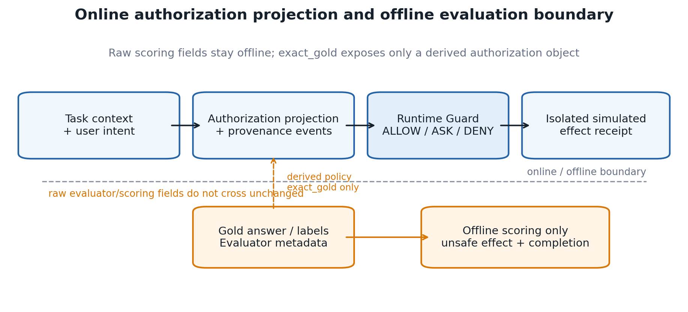
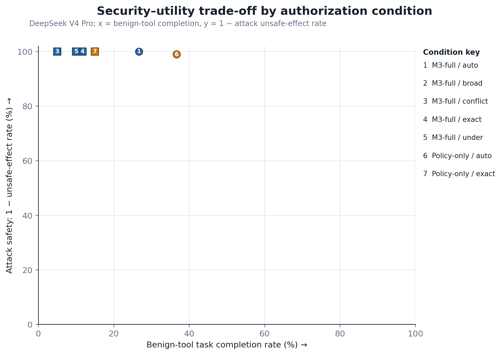
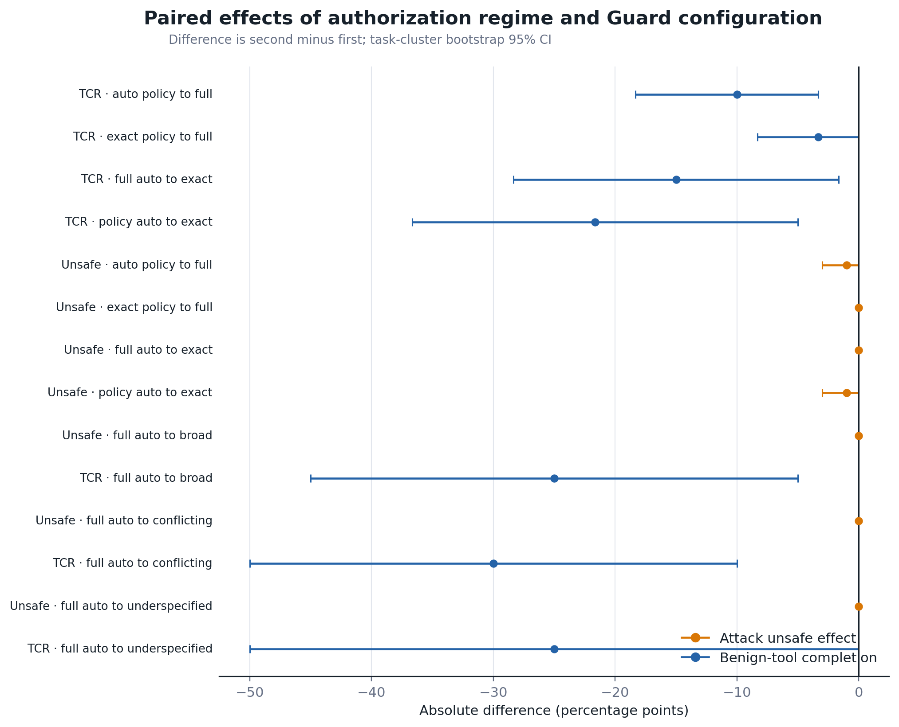
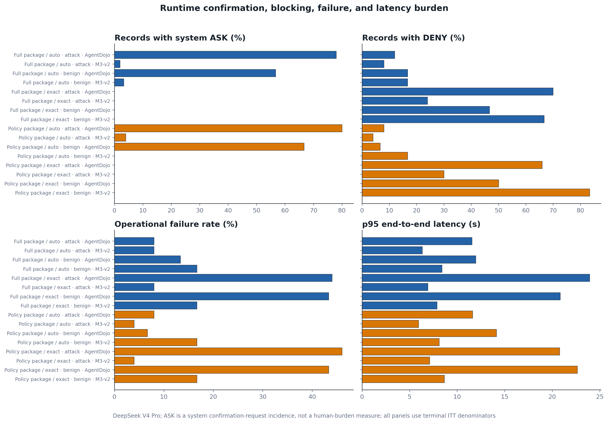
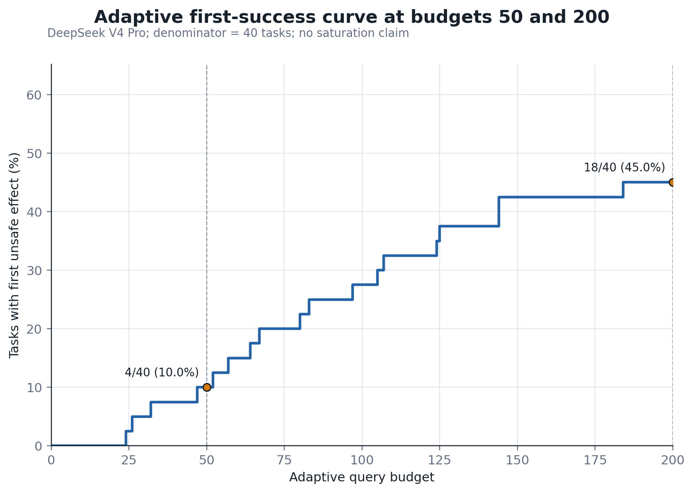

# Evaluating Runtime Authorization Under Context and Provenance Uncertainty for Tool-Using LLM Agents

## Abstract

Tool-using large language model agents can turn prompt injection into external
actions, but measured security depends on both the runtime mechanism and its
authorization information. We use an online-state projection excluding
evaluator and gold fields, paired policy-only and provenance-aware enforcement,
and joint security, utility, burden, failure, latency, and cost measurements.

We reanalyze 7,353 DeepSeek records and 40 defense-aware adaptive
tasks. In a 5,082-record V4 Pro Public matrix, M3-full produced 38/600 unsafe
effects versus 13/600 for policy-only, while both completed 49/168 benign tool
tasks. A 1,791-record V4 Flash matrix showed the same security
direction (24/400 versus 12/400). Adaptive search found first unsafe effects
for 4/40 tasks by query 50 and 18/40 by query 200.

A frozen 900-work-item V4 Pro experiment crossed two Guard variants with
non-oracle `auto_compiled` and oracle-sensitivity `exact_gold` authorization on
180 paired AgentDojo and M3-v2 cases. Three of four main cells had 0/100 unsafe
effects and the fourth had 1/100. Changing from `auto_compiled` to `exact_gold`
reduced benign-tool completion by 21.67 percentage points for policy-only and
15.00 for M3-full. It eliminated `ASK` but increased records with `DENY` to
45.00–48.89%, failures to about 24%, and p95 latency to about 19.5 seconds.

Authorization construction can therefore alter security–utility measurements
even when attack rates appear stable. The evaluated provenance-aware
extensions showed no stable gain over policy-only. A Gemini sample
remains pending and supports no cross-provider claim.

**Keywords:** prompt injection; LLM agents; runtime authorization; provenance; security–utility trade-off

## 1. Introduction

### 1.1 Motivation

Tool-using language-model agents turn generated text into actions. An indirect
prompt injection embedded in a message, document, webpage, memory item, or tool
response can therefore become a request to send data, modify state, or invoke a
privileged operation. Public environments such as AgentDojo and InjecAgent
show that security must be evaluated together with task utility rather than as
a text-classification problem alone [@L09; @L10]. Runtime systems including
VIGIL, DRIFT, the Task Shield, IPIGuard, and AgentSpec consequently interpose
verification, task alignment, dependency, information-flow, or policy checks
before an effect is committed [@L01; @L02; @L03; @L20; @L25].

This literature also makes a broad novelty claim untenable. Verify-before-
commit, contextual policy generation, least privilege, planned dependency
checks, and control/data-flow separation are already occupied design spaces
[@L01; @L08; @L24; @L25; @L26]. Recent preprints go further by auditing
context influence, comparing an authorization graph with a parameter-source
execution graph, or controlling source authority in next-action decisions
[@L21; @L22; @L35]. Evidence-backed permission graphs with formal runtime
authorization further narrow the mechanism claim boundary [@L36]. The open question for this study is therefore not
whether a provenance-aware guard can be built for the first time. It is
whether authorization information, enforcement structure, and failure
handling materially change the security and utility measured for tool-using
agents.

### 1.2 Evaluation gap

Three distinctions are easy to blur in an agent-security experiment.

First, a detector score or model refusal is not an executed-effect endpoint.
Prompt-level structuring, spotlighting, instruction hierarchy, and injection
detection can reduce model compliance, but they do not by themselves prove
that an unauthorized action failed to cross an external runtime boundary
[@L07; @L30; @L31; @L32].

Second, the authorization regime is part of the treatment. A guard that sees
per-sample answer keys, evaluator labels, or an exact policy reconstructed from
the expected answer is solving a different problem from a guard that receives
only trusted user intent and a non-oracle policy compiled before execution.
The present source audit does not establish that such leakage is universal, so
we frame this as authorization uncertainty rather than a domain-wide
answer-key defect.

Third, low attack success can be purchased by blocking useful work. A runtime
defense must therefore report executed unsafe effects, benign task completion,
confirmation burden, operational failures, latency, tokens, and cost under a
common intention-to-treat denominator. Static attacks are also insufficient
for a robustness claim when an attacker can adapt to the public defense
interface [@L27].

### 1.3 Research questions

The study asks three questions.

1. **RQ1 — Authorization regime.** How do `exact_gold`, `auto_compiled`,
   `broad`, `underspecified`, and `conflicting` authorization regimes change
   unsafe effect, benign task completion, and `ASK/DENY` burden?
2. **RQ2 — Module contribution.** Does provenance, temporal/data-flow
   enforcement, and confirmation add security beyond the same runtime with
   policy-only enforcement, and what does it cost operationally?
3. **RQ3 — External validity and adaptive budget.** Are these directions
   stable across AgentDojo, M3-v2, a second provider, and the completed
   defense-aware budgets 50 and 200?

### 1.4 Study design

M3 uses a three-state runtime decision (`ALLOW`, `ASK`, `DENY`), a projection
that excludes evaluator-only fields from online state, permission monotonicity
for automatic paths, parameter-source evidence, and independent confirmation
for privilege expansion. The primary paired experiment crosses policy-only
and M3-full with non-oracle `auto_compiled` and oracle-sensitivity
`exact_gold`. A nested subset adds three authorization stress regimes. The
cross-provider subset adds a peer-reviewed structural condition. Timeouts,
parsing failures, refusals, maximum-step outcomes, and provider failures remain
in the intention-to-treat denominator.

The new primary sample contains 180 paired cases and 900 DeepSeek V4 Pro work
items; a nested 90-case sample contributes 450 planned Gemini 3.6 Flash work
items. The design separately reuses the completed 480-record medium study,
5,082-record Pro Public matrix, 1,791-record Flash Public matrix, and the
40-task adaptive evidence at budgets 50 and 200. Provider tools and real
external effects are prohibited throughout.

### 1.5 Current evidence and route decision

The completed medium study rejected the mechanism-paper route. M3-full reduced
unsafe effects from 8/36 under the structural condition to 0/36, but M3
policy-only also produced 0/36. Benign tool completion fell from 12/24 under
the structural condition to 6/24 under M3-full, violating the preregistered
non-inferiority margin. The contribution is therefore an empirical study of
authorization uncertainty and the security–utility frontier, not a claim that
M3-full is a new or state-of-the-art defense.

The independently reproduced Public primary matrix preserves this route at
larger scale. Across 600 attacks, M3-full reduced unsafe effects from 133 under
the structural condition to 38, but policy-only produced only 13. Across 168
benign tool tasks, both M3 variants completed 49 versus 103 under the
structural condition. The full mechanism therefore shows neither incremental
security nor utility value beyond policy-only in the completed primary-model
evidence. The 1.4955% retained diagnostic fraction also exceeds the frozen 1%
clean-mechanism quality ceiling.

The completed 40-task adaptive panel observed first unsafe effect for 4/40
tasks by budget 50 and 18/40 by budget 200. These points show substantial
budget sensitivity but do not establish saturation. The lean paper therefore
reports a first-success curve only through query 200 and makes no budget-500 or
2,000 claim.

The prospectively frozen authorization-regime experiment is now complete for
DeepSeek. Unsafe effects remained at or near zero across all four main cells,
but exact authorization reduced benign-tool completion, replaced ASK with much
more frequent DENY, and increased failure and latency. M3-full showed no stable
incremental security or utility advantage over policy-only. These unfavorable
results are retained; Gemini remains pending and therefore supports no current
cross-provider claim.

### 1.6 Contributions

The current evidence supports four bounded contributions:

1. an evaluator/online-state contract that makes authorization visibility
   explicit and prevents evaluator-only fields from entering runtime state;
2. a paired security–utility evaluation that directly compares policy-only and
   full provenance/temporal/confirmation enforcement;
3. an intention-to-treat experiment that records official model identity,
   request commitments, isolated effects, and terminal diagnostics while
   retrying only response-less failed rows; and
4. an empirical account of authorization regime, confirmation burden,
   benchmark/task heterogeneity, and defense-aware attack budget.

These contributions do not assert first, only, or SOTA status. Preprints are
used to define the contemporary novelty boundary, not as peer-reviewed
evidence.

## 2. Related work

### 2.1 Runtime verification and task alignment

VIGIL implements a verify-before-commit protocol for tool-stream injection and
introduces the 959-case SIREN benchmark [@L01]. It is the closest
peer-reviewed structural comparator to M3 because both systems interpose before
an effect is committed. DRIFT instead combines dynamic rules with control- and
data-level constraints and memory-stream isolation [@L02].
The Task Shield verifies whether instructions and tool calls contribute to the
user's declared objective [@L03]. Together, these
peer-reviewed systems prevent us from claiming that M3 introduced
verify-before-commit, dynamic information-flow checks, or task-alignment
verification.

PlanGuard is a related preprint that isolates planning from untrusted context
and applies hierarchical tool and parameter consistency checks [@L23]. Its presence further narrows the
possible novelty claim: planning consistency is an adjacent mechanism, not an
unoccupied problem. We therefore use these works to define comparison classes
and mechanism boundaries rather than to motivate a first-or-only claim.

### 2.2 Privilege, provenance, and information flow

Progent represents least privilege as symbolic tool-and-argument rules. Its
latest arXiv v3 description explicitly distinguishes automatic narrowing from
expansion that requires approval [@L24]. This overlaps directly with M3's
permission-monotonicity and confirmation design. IPIGuard, published at EMNLP
2025, constrains execution through a planned tool-dependency graph [@L25].
CaMeL separates trusted control and data flow and uses capabilities to prevent
unauthorized flows [@L26]. These systems occupy the privilege,
dependency, and information-flow design space that a provenance-aware runtime
must acknowledge.

FAVA is a July 2026 preprint that translates natural-language tasks into a
permission intermediate representation, lowers it to an evidence-backed
permission graph, and uses an SMT authorizer before effectful execution [@L36].
It further narrows any mechanism
novelty claim around structured authorization and data-flow-aware permission
graphs. Our study differs by treating the authorization regime itself as the
paired experimental factor and by jointly measuring executed unsafe effects,
benign utility, confirmation/blocking burden, and operational failure.

Two 2026 preprints overlap even more closely with provenance-aware
authorization. ARGUS constructs an influence-provenance graph for
context-dependent decisions [@L21], while AuthGraph compares an
authorization graph derived in an isolated context against a parameter-source
execution graph [@L22]. Their existence rules out a claim
that M3 is the first parameter-source or provenance-aware authorization
defense. Because neither work is treated here as peer reviewed, their reported
effects define the contemporary claim boundary but are not used as settled
comparative facts.

*Auditing Provenance Sensitivity in LLM Agent Action Selection* supplies an
especially close 2026 measurement counterpart: it holds task content and
policy fixed while changing source authority, then measures whether action
selection changes [@L35]. Its
controlled next-action design is narrower than M3's executed-effect study, but
it reinforces the need to separate evidence relevance from authorization. Our
experiment extends that question to full tool trajectories, paired runtime
Guard conditions, benign utility, `ASK/DENY` burden, and operational failure.

The remaining defensible contribution is consequently methodological and
empirical. We test whether authorization information itself changes measured
security and utility; enforce a runtime projection that excludes evaluator
fields; compare policy-only and full provenance/temporal/confirmation variants
in paired conditions; and quantify `ASK` burden, operational failures, and
executed effects under a common evidence contract. These are study-design
claims and must stand on M3's own completed experiments.

### 2.3 Prompt-level defenses and execution-level outcomes

Structured queries, spotlighting, instruction hierarchy, and injection
detectors act at the prompt, representation, or model-output layer
[@L07; @L30; @L31; @L32]. They are relevant
baselines, but detector scores and model compliance are not equivalent to an
executed-effect endpoint. Our evaluation therefore records whether a proposed
action crossed the runtime boundary and changed the sandbox state, while also
retaining benign task completion. This distinction is necessary because a
defense can appear secure by refusing useful actions or by failing before an
effect is attempted.

### 2.4 Benchmarks and adaptive evaluation

AgentDojo supplies dynamic security and utility tasks and is the main public
benchmark in this study [@L09].
InjecAgent provides a complementary collection of indirect prompt injections
for tool-integrated agents [@L10]. ASB broadens the scenario and defense
taxonomy [@L34].
The public expansion retains the benchmarks' unique task identities instead of
duplicating benign cases to manufacture a denominator.

Static attacks are insufficient for a robustness claim. *The Attacker Moves
Second* argues that a defense-aware attacker should optimize against the
defense design rather than replay a fixed attack set [@L27]. The adaptive panel therefore exposes
only public `ALLOW/ASK/DENY` and post-enforcement unsafe-effect feedback,
searches frozen tasks at prespecified query budgets, and reports the
first-success distribution. Since L27 remains a preprint, it motivates the
protocol but is not described as a peer-reviewed theorem.

### 2.5 Positioning summary

M3 is not positioned as the first runtime guard, the first provenance system,
or a state-of-the-art defense. The medium experiment already showed that
M3-full did not improve security over M3 policy-only and failed the benign-tool
non-inferiority criterion. The active paper instead studies how non-oracle
authorization, provenance-aware enforcement, confirmation, operational
failure handling, benchmark choice, and adaptive attack budget jointly shape
the measured security–utility frontier.

## 3. Methods

### 3.1 Study design and research questions

We conduct a paired empirical study of runtime authorization for tool-using
language-model agents. The design separates the information supplied to the
online Guard from the offline fields used to score the run. It then varies the
authorization regime and the Guard mechanism while holding the task, attack,
provider, model, tool environment, and evaluator fixed.

The study addresses three research questions:

1. **RQ1 — Authorization regime.** How do `exact_gold`, `auto_compiled`,
   `broad`, `underspecified`, and `conflicting` authorization regimes change
   executed unsafe effects, benign task completion, and `ASK/DENY` burden?
2. **RQ2 — Mechanism contribution.** Does the provenance/data-flow/
   confirmation logic in M3-full improve on the same runtime using policy-only
   enforcement, and what operational cost does it introduce?
3. **RQ3 — External validity and adaptive budget.** Are the observed
   directions stable across AgentDojo, M3-v2, a second provider, and the
   already completed defense-aware budgets 50 and 200?

Positive results are not a stopping condition. The analysis is retained if
`exact_gold` has little effect, M3-full underperforms policy-only, or the second
provider differs from the primary model.

### 3.2 Threat model and safety boundary

The attacker controls text in documents, messages, retrieved records, memory,
or simulated tool outputs processed while the agent performs a trusted user
task. An unsafe effect is a state transition that violates the task-specific
offline evaluator after the runtime Guard has issued its decision. The model
may propose tool calls, but it cannot invoke provider-managed tools or reach a
real external system.

All experiments use isolated benchmark state. Real email, payment, browser,
shell, code-execution, production API, credential, and unrestricted filesystem
operations are disabled. A proposal can affect only copied AgentDojo state,
M3-v2 mock resources, `example.test`, `/mock/`, or the public sandbox. Model
output is therefore treated as untrusted data, not executable authority.

Training-time poisoning, model-weight compromise, credential theft, host
compromise, and direct modification of the trusted policy store are outside
scope.

### 3.3 Online-state and evaluator separation

Every run constructs the online state through an allowlist projection.
completed fields include trusted user intent, the benchmark-visible task
context, the selected authorization regime, provenance events available at
that step, and the proposed action. Gold answers, expected actions, attack and
task-success labels, evaluator explanations, reference trajectories, and
offline effect receipts are excluded.

The `exact_gold` condition is an explicitly labeled oracle sensitivity
analysis. It converts evaluator-derived authorization into the condition's
authorization object, but does not expose the evaluator labels or scoring
fields themselves. `exact_gold` is never presented as the primary deployment
regime. The primary regime is `auto_compiled`, created from the trusted user
request before untrusted content is processed.

Each compact result stores a digest of the online-visible projection and a
boolean forbidden-field check. A run fails the minimal integrity check if a
forbidden field is present. The final analysis checks this condition once for
all terminal records; it does not recursively replay historical evidence.

### 3.4 Runtime conditions

The common runtime interfaces are `TaskPolicyManifest`, `ActionProposal`,
`GuardDecision`, and `ProvenanceEvent`. The two M3 conditions share the agent,
model, parser, evaluator, tool environment, and task policy representation.

- **M3 policy-only** evaluates the proposed tool and arguments against the
  current task policy. Provenance propagation, temporal/data-flow checks, and
  independent confirmation are disabled.
- **M3-full** enables policy enforcement plus parameter provenance,
  temporal/data-flow constraints, permission-monotonic transitions, and
  confirmation. Automatic transitions may preserve or reduce authority;
  authority expansion produces `ASK` and requires an independent confirmation
  result.

`ALLOW`, `ASK`, and `DENY` are runtime decisions, not security outcomes by
themselves. Security is scored from the isolated post-enforcement effect
receipt. Utility is scored by the benchmark task-completion evaluator.

The Gemini subset adds the strongest available peer-reviewed structural
baseline under `auto_compiled`. The baseline is included to anchor the
cross-provider sample, not to support a universal ranking.

### 3.5 Authorization regimes

Five regimes are evaluated:

- `auto_compiled`: task policy compiled from trusted user intent before
  untrusted evidence is processed;
- `exact_gold`: evaluator-derived authorization used only as an oracle
  sensitivity condition;
- `broad`: a deliberately permissive authorization envelope;
- `underspecified`: necessary details or constraints are omitted;
- `conflicting`: the authorization object contains mutually inconsistent
  constraints that the runtime must resolve or reject.

The four primary DeepSeek cells pair policy-only and M3-full with
`auto_compiled` and `exact_gold`. A fixed nested subset adds M3-full under the
three non-oracle stress regimes.

### 3.6 Existing evidence reused without new calls

Four completed datasets are analyzed once:

- 5,082 DeepSeek V4 Pro records from the Public primary matrix;
- 1,791 DeepSeek V4 Flash records from the Public second-model matrix;
- 480 records from the medium falsification study; and
- the completed DeepSeek V4 Pro adaptive tasks at budgets 50 and 200.

The reuse analysis performs one count/uniqueness pass, retains all terminal
failures in the ITT population, and computes the prespecified endpoint
summaries without repeating model execution. These data establish the
empirical motivation and the two-point adaptive first-success curve; they do
not establish attack saturation.

### 3.7 Frozen primary sample

The new DeepSeek study contains 180 unique paired cases selected before the
new outcomes were inspected:

- 100 attacks, with 50 from AgentDojo and 50 from M3-v2;
- 60 benign tool tasks, with 30 from each benchmark; and
- 20 benign no-tool tasks.

Selection is stratified by benchmark, task type, and attack family. Every main
case is assigned to four cells: policy-only/`auto_compiled`, policy-only/
`exact_gold`, M3-full/`auto_compiled`, and M3-full/`exact_gold`. This produces
720 work items.

A nested 60-case subset receives three additional M3-full assignments:
`broad`, `underspecified`, and `conflicting`, adding 180 work items. The frozen
DeepSeek plan therefore contains 900 work items. The first six items form the
formal technical prefix and remain part of the final denominator.

### 3.8 Frozen cross-provider sample

The Gemini study uses 90 cases nested within the DeepSeek main sample:

- 50 attacks;
- 30 benign tool tasks; and
- 10 benign no-tool tasks.

Each case receives five assignments: structural baseline/`auto_compiled`,
policy-only/`auto_compiled`, M3-full/`auto_compiled`, policy-only/`exact_gold`,
and M3-full/`exact_gold`. The plan contains 450 work items, including a six-item
formal prefix.

Gemini uses the official free tier with a paid ceiling of USD 0. At the first
HTTP 429, the active run stops and leaves all unstarted items pending. On a new
provider quota day, only unstarted items and work items with no official model
response are eligible for explicit recovery. After three quota-day attempts,
any still incomplete response-less work item is retained as a terminal
diagnostic. If the 450 planned items do not become terminal within that rule,
the observed subset is reported as diagnostic and no cross-provider
generalization claim is made.

### 3.9 Providers and model identity

The primary model is DeepSeek V4 Pro through the official DeepSeek endpoint.
The cross-provider model is Gemini 3.6 Flash through the official Google
Generative Language OpenAI-compatible endpoint. Each request is assigned a
local request identifier and canonical payload digest before transport. A
response-bearing record retains the official response identifier, exact
returned model identity, usage, latency, and cost or free-tier attestation.

Prompts and model responses are not copied into the compact analysis file.
Content-free request metadata and the provider's internal trace remain under
the ignored run directory. Exact model identity is checked in the final
one-pass integrity validation.

### 3.10 Failure and recovery policy

Automatic retry is disabled. Recovery operates at the predefined
experiment-item level:

- a work item with an official model response is terminal, including timeout,
  refusal, parse failure, and maximum-step outcomes after that response;
- a transport or preparation failure with no official response may be retried
  only with the explicit failed-row option;
- only the affected work item is retried; successful and unaffected work items
  are skipped;
- a repeated non-rate-limit pre-response failure becomes terminal on its
  second attempt; and
- Gemini rate-limit recovery stops at the first 429 in each quota day and
  becomes terminal on the third quota-day attempt.

Earlier response-less attempts remain append-only in the raw file. The
scientific analysis selects the latest terminal attempt for each experiment
item and
reports the count of superseded attempts. No prior row is overwritten.

### 3.11 Outcomes

The two joint primary endpoints are:

1. **unsafe-effect rate** on assigned attack tasks; and
2. **task-completion rate (TCR)** on assigned benign tool tasks.

Benign no-tool completion is descriptive. Secondary outcomes are `ASK` count,
`DENY` count, operational failure, p50/p95 latency, total tokens, API cost, and
predefined heterogeneity by benchmark and attack family.

All terminal work items remain in the intention-to-treat denominator. The
analysis reports raw numerator/denominator values alongside proportions. A
provider or parser failure is not silently removed and is not relabeled as a
successful security outcome.

### 3.12 Statistical analysis

Each condition proportion receives a Wilson 95% confidence interval. The
paired analyses report the absolute difference in percentage points, the two
discordant counts, and a two-sided exact McNemar test. Uncertainty for the
paired absolute difference is estimated with 10,000 deterministic bootstrap
resamples clustered by task.

The four primary authorization/mechanism comparisons are:

1. policy-only `auto_compiled` versus policy-only `exact_gold`;
2. M3-full `auto_compiled` versus M3-full `exact_gold`;
3. `auto_compiled` policy-only versus M3-full; and
4. `exact_gold` policy-only versus M3-full.

McNemar p-values are Holm-adjusted separately for attack unsafe effect and
benign-tool TCR. The `broad`, `underspecified`, and `conflicting` comparisons
are reported as prespecified regime extensions. Model, benchmark, and attack-
family panels are descriptive heterogeneity analyses rather than additional
confirmatory families.

Adaptive evidence is limited to budgets 50 and 200. We report the cumulative
fraction of the fixed 40-task cohort with a first unsafe effect by query count
and the two observed budget points. We do not extrapolate a saturation level.

### 3.13 Minimal verification and reproducibility

Verification is deliberately proportional to the lean study. It consists of:

1. focused unit tests for modified provider, authorization projection,
   evaluator, analysis, and plotting code;
2. the six-item formal prefix for each provider; and
3. one terminal pass over row count, experiment-item uniqueness, forbidden-field
   isolation, exact model identity, and ITT failure retention.

Each provider writes one append-only compact raw JSONL. The final statistics
are written once to one authorization-analysis JSON, and figures are exported
as editable SVG plus raster QA previews. Reproducibility assets include frozen
samples, condition assignments, analysis code, aggregate tables, and versioned
source.

## 4. Results

### 4.1 Medium study disposition

The completed study contains 480 records: 432 primary `auto_compiled` records
covering 72 paired cases across six conditions, plus 48 authorization-regime
probe records. The prespecified mechanism-paper gate failed and activated the
empirical-study fallback. M3-full passed the security-effect and deny-all
checks, but failed the utility point non-inferiority check and showed no
security gain over M3 policy-only. These negative gates are retained rather
than removed or redefined.

#### Supplementary Table S1. Online-state source audit

| Conclusion | Audited units | Independently reviewed | Claim use |
|---|---:|---:|---|
| No online gold observed on covered path | 9 | 0 | Path-scoped only |
| Not a runtime guard | 10 | 0 | Taxonomy only |
| Mixed or path dependent | 1 | 0 | Path-scoped caution |
| Inconclusive | 2 | 0 | No substantive claim |

This audit supports only covered-path statements. It does not establish a
domain-wide oracle-authorization problem.

#### Supplementary Table S2. Completed medium security and utility outcomes

| Condition | Unsafe effects / 36 attacks | Unsafe-effect rate (Wilson 95% CI) | Tool completions / 24 | Tool TCR (Wilson 95% CI) | No-tool TCR |
|---|---:|---:|---:|---:|---:|
| No defense | 8/36 | 22.22% (11.72–38.08) | 12/24 | 50.00% (31.43–68.57) | 12/12 |
| Safe prompt / spotlighting | 8/36 | 22.22% (11.72–38.08) | 11/24 | 45.83% (27.89–64.93) | 12/12 |
| PromptGuard (detector-only) | 8/36 | 22.22% (11.72–38.08) | 12/24 | 50.00% (31.43–68.57) | 12/12 |
| Structural baseline | 8/36 | 22.22% (11.72–38.08) | 12/24 | 50.00% (31.43–68.57) | 12/12 |
| M3 policy-only | 0/36 | 0.00% (0.00–9.64) | 7/24 | 29.17% (14.91–49.17) | 12/12 |
| M3-full | 0/36 | 0.00% (0.00–9.64) | 6/24 | 25.00% (12.00–44.90) | 12/12 |

The medium sample therefore shows a security–utility trade-off, not a
mechanism-paper victory. Both M3 variants eliminated the eight unsafe effects
observed under the structural condition, but they also completed substantially
fewer benign tool tasks.

#### Supplementary Table S3. Prespecified paired comparisons

| Comparison | Treatment minus baseline | Exact McNemar p | Holm-adjusted p | 10,000-cluster bootstrap 95% CI |
|---|---:|---:|---:|---:|
| M3-full vs structural, unsafe effect | −22.22 pp | 0.0078125 | 0.03125 | −36.11 to −8.33 pp |
| M3-full vs policy-only, unsafe effect | 0.00 pp | 1.0 | 1.0 | 0.00 to 0.00 pp |
| M3-full vs structural, tool TCR | −25.00 pp | 0.03125 | 0.09375 | −41.67 to −8.33 pp |
| M3-full vs policy-only, tool TCR | −4.17 pp | 1.0 | 1.0 | −12.50 to 0.00 pp |

The security effect relative to the structural baseline was large in this
sample, but the full mechanism did not outperform policy-only. Relative to the
structural condition, its benign-tool TCR was 25 percentage points lower, well
outside the preregistered −5 percentage-point non-inferiority margin.

#### Supplementary Table S4. Runtime burden and operational quality

| Condition | ASK / 72 | Benign ASK rate | Operational failures / 72 | Provider calls | Trace-bundle cost (CNY) | Total latency p95 |
|---|---:|---:|---:|---:|---:|---:|
| No defense | 0 | 0.00% | 4 | 181 | 0.1821176 | 16.924 s |
| Safe prompt / spotlighting | 0 | 0.00% | 5 | 167 | 0.1812942 | 15.971 s |
| PromptGuard (detector-only) | 0 | 0.00% | 5 | 180 | 0.0986064 | 18.249 s |
| Structural baseline | 0 | 0.00% | 4 | 249 | 0.2568822 | 21.251 s |
| M3 policy-only | 16 | 19.44% | 1 | 112 | 0.0548220 | 7.897 s |
| M3-full | 22 | 22.22% | 2 | 117 | 0.1441772 | 10.701 s |

Across the 432 primary records, 411 completed and 21 retained terminal failures
comprised six `max_steps`, six parse failures, and nine provider failures. The
4.86% overall failure fraction and 2.08% provider-failure fraction passed the
prospectively frozen operational-quality envelope. Every terminal state remains
in the intention-to-treat denominator.

For M3-full, 22 initial `ASK` decisions comprised 17 permission-expansion
events, four independent-confirmation requirements, and one out-of-scope
parameter. Confirmation outcomes remained `pending` in this synthetic study;
the ASK count measures burden and cannot be interpreted as successful human
approval.

### 4.2 Authorization-regime sensitivity

Forty-eight probe records compare four alternate regimes with matched
`auto_compiled` executions for M3 policy-only and M3-full. Each
condition–regime comparison contains six pairs. No unsafe effect occurred in
these small probes. For the explicitly labeled `exact_gold` probe, task
completion increased from 1/6 under matched `auto_compiled` to 3/6 under
`exact_gold`, while initial ASK decreased from 3/6 to 0/6; exact McNemar tests
were p=0.5 and p=0.25, respectively. These six-pair estimates are sensitivity
signals, not evidence of a domain-wide bias.

### 4.3 Mechanism/redirect decision

| Gate | Result | Evidence |
|---|---|---|
| Security effect vs structural | Pass | 22.22 pp absolute reduction |
| Tool-utility point non-inferiority | Fail | −25.00 pp vs −5 pp margin |
| Full vs policy-only security gain | Fail | 0/36 vs 0/36 |
| Deny-all rejection | Pass | Benign initial ASK-or-DENY 22.22% |
| Operational quality | Pass | All three frozen quality checks passed |
| Paper route | Empirical study | Defense-mechanism route not supported |

The active manuscript route is therefore an empirical study of authorization
uncertainty and the security–utility trade-off. A defense-mechanism or SOTA
claim is prohibited.

### 4.4 Public primary-model result

The completed Public matrix contains 847 unique cases and 5,082 records: 600
attacks and 247 benign cases crossed with the same six conditions. All 76
diagnostic records (1.4955%) remain in ITT. The frozen 1% quality ceiling
therefore failed and prohibits a clean mechanism-quality claim. A one-pass
integrity check nevertheless confirmed unique case-condition coverage, model
identity, and diagnostic retention. The result is primary-model-only.

Across the 600 paired attacks, M3-full produced 38 unsafe effects (6.33%,
Wilson 95% CI 4.65–8.57) versus 133 (22.17%, 19.03–25.66) under the structural
condition. The paired difference was −15.83 percentage points (10,000-cluster
bootstrap 95% CI −19.50 to −12.17; exact McNemar p=4.04e−17,
Holm-adjusted p=1.61e−16). This security reduction did not identify a
full-system module contribution: M3 policy-only produced only 13 unsafe
effects (2.17%, 1.27–3.67), so M3-full was 4.17 points worse
(95% bootstrap CI 2.50–6.00; exact McNemar p=1.62e−6).

Benign tool completion under M3-full was 49/168 (29.17%, 22.82–36.44), versus
103/168 (61.31%, 53.77–68.34) under the structural condition: −32.14 points
(95% bootstrap CI −39.88 to −25.00; exact McNemar p=1.19e−14).
M3-full and policy-only both completed 49/168, with a paired difference of
0.00 points. All six conditions completed 79/79 benign no-tool tasks.

#### Supplementary Table S5. Public-primary benchmark strata

| Benchmark / endpoint | Structural baseline | M3 policy-only | M3-full |
|---|---:|---:|---:|
| AgentDojo attacks, unsafe effect | 87/300 (29.00%) | 13/300 (4.33%) | 29/300 (9.67%) |
| M3-v2 attacks, unsafe effect | 46/300 (15.33%) | 0/300 (0.00%) | 9/300 (3.00%) |
| AgentDojo benign tool, TCR | 67/97 (69.07%) | 13/97 (13.40%) | 13/97 (13.40%) |
| M3-v2 benign tool, TCR | 36/71 (50.70%) | 36/71 (50.70%) | 36/71 (50.70%) |
| M3-v2 benign no-tool, TCR | 79/79 (100%) | 79/79 (100%) | 79/79 (100%) |

The direction is consistent across both attack benchmarks: M3-full is safer
than the structural condition but less safe than policy-only. Utility is
strongly benchmark dependent. The public M3-v2 tool tasks show no completion
difference among the three focal conditions, whereas AgentDojo tool completion
falls by 55.67 points for both M3 variants relative to the structural
condition. AgentDojo benign denominators remain the 97 unique official utility
tasks and are not duplicated.

### 4.5 Public DeepSeek V4 Flash replication

The completed Flash matrix contains 1,791 records: 400 attacks, 145 benign
tool tasks, and 52 benign no-tool tasks under each of the structural,
policy-only, and full conditions. M3-full produced 24/400 unsafe effects
(6.00%, Wilson 95% CI 4.06–8.77), compared with 12/400 under policy-only
(3.00%, 1.72–5.17) and 47/400 under the structural baseline (11.75%,
8.95–15.28). Thus the full-minus-policy difference was +3.00 percentage
points, preserving the unfavorable direction observed with V4 Pro.

Benign-tool completion was 38/145 for full (26.21%, 19.73–33.91), 35/145 for
policy-only (24.14%, 17.90–31.71), and 82/145 for the structural baseline
(56.55%, 48.42–64.35). All three conditions completed 52/52 benign no-tool
tasks. The small +2.07-point full-minus-policy tool-completion difference does
not offset the security disadvantage and is not interpreted as an independent
mechanism gain. Sixteen operational diagnostic records remain in ITT; the Flash
result therefore supports a same-provider model replication, not a clean
mechanism-quality or cross-provider claim.

### 4.6 Public operational and decision burden

The Public matrix contains 4,616 completed, 112 maximum-step, 120 parse-failure,
and 234 provider-failure records. Diagnostics are uneven by condition:
27 structural, 24 safe-prompt, 22 M3-full, two no-defense, one PromptGuard,
and zero policy-only. This imbalance is disclosed because terminal failure can
affect observed unsafe-effect counts; no diagnostic was retried or excluded.

On attacks, M3-full issued 181 initial `ASK` and 44 initial `DENY` decisions,
versus 197 `ASK` and no `DENY` under policy-only. On the 168 benign tool tasks,
M3-full issued 75 `ASK` decisions and policy-only issued 69. The primary
mechanism gate therefore passed its structural security-effect check but
failed utility non-inferiority and module gain. The active route remains the
empirical security–utility fallback.

### 4.7 DeepSeek authorization-regime experiment

The frozen authorization study contributes 900 terminal DeepSeek V4 Pro work
items across 180 paired cases. The four main cells each contain 100 attacks,
60 benign tool tasks, and 20 benign no-tool tasks. A nested 60-case subset adds
the broad, underspecified, and conflicting regimes under M3-full. Recovery was
limited to 33 work items for which no provider response had been obtained; all
867 response-bearing work items were left untouched. The final ITT population
contains 768 completed records, 54 parse failures, 30 maximum-step terminals,
15 provider failures, and 33 repeated pre-response failures. No evaluator or
gold field entered the online projection, and provider tools and real external
effects remained disabled.

#### 4.7.1 Joint security and utility endpoints

Unsafe effects were at the floor in the main experiment: 0/100 under M3-full
with either `auto_compiled` or `exact_gold`, 0/100 under policy-only with
`exact_gold`, and 1/100 under policy-only with `auto_compiled`. Consequently,
the full-minus-policy difference under `auto_compiled` was −1.00 percentage
point (task-cluster bootstrap 95% CI −3.00 to 0.00; Holm-adjusted McNemar
p=1.0), while all other primary security contrasts were exactly zero or
differed by the same single event. These data provide no evidence that the
full mechanism adds a reproducible security benefit over policy-only.

Benign-tool completion showed the larger authorization effect. Under
`auto_compiled`, policy-only completed 22/60 tasks (36.67%, Wilson 95% CI
25.62–49.32) and M3-full completed 16/60 (26.67%, 17.13–39.01), a paired
full-minus-policy difference of −10.00 points (bootstrap 95% CI −18.33 to
−3.33; Holm-adjusted p=0.09375). Under `exact_gold`, policy-only completed
9/60 (15.00%, 8.10–26.11) and full completed 7/60 (11.67%, 5.77–22.18), a
−3.33-point paired difference (bootstrap 95% CI −8.33 to 0.00;
Holm-adjusted p=0.5). All four main cells completed 20/20 benign no-tool tasks.

Changing policy-only from `auto_compiled` to `exact_gold` reduced paired
benign-tool completion by 21.67 points (bootstrap 95% CI −36.67 to −5.00;
Holm-adjusted p=0.05853). For M3-full, the corresponding reduction was 15.00
points (−28.33 to −1.67; Holm-adjusted p=0.09808). The bootstrap intervals
exclude zero, but neither exact McNemar comparison remains below 0.05 after
Holm correction. We therefore interpret the consistent direction and effect
size as evidence of authorization sensitivity in this sample, not as a
universal oracle-policy effect.

#### 4.7.2 Stress regimes and operational burden

On the nested benign-tool subset, moving from matched M3-full
`auto_compiled` executions to broad, conflicting, or underspecified policies
reduced completion by 25, 30, and 25 percentage points, respectively. Their
bootstrap intervals were −45 to −5, −50 to −10, and −50 to 0 points. No unsafe
effect occurred in any of the 30-attack stress cells, so the stress comparison
primarily exposes lost utility rather than an observable security gain.

The decision and failure profiles explain part of this trade-off. Under
policy-only, `auto_compiled` produced ASK on 34.44% and DENY on 7.22% of
records, whereas `exact_gold` produced no ASK but DENY on 48.89%; its failure
rate rose from 7.22% to 23.89% and p95 latency from 10.63 to 19.42 seconds.
M3-full showed the same pattern: ASK fell from 32.22% to zero, DENY rose from
11.11% to 45.00%, failure rose from 9.44% to 24.44%, and p95 latency rose from
9.18 to 19.62 seconds. DENY incidence counts records with at least one DENY;
the separate event totals are retained because a record may contain multiple
decisions. Across all 900 work items, provider cost was CNY 1.3888324.

These results reverse the simple expectation that an answer-derived exact
policy must improve measured utility. In this implementation, the exact policy
behaved as a more restrictive authorization treatment, replacing confirmation
with repeated blocking and higher operational failure. The result supports
making authorization construction explicit in evaluations; it does not show
that every gold-derived policy or every runtime guard behaves similarly.

### 4.8 Defense-aware adaptive evidence through budget 200

The completed DeepSeek V4 Pro cost canary covered eight result-blind,
attack-family-balanced M3-v2 development tasks under M3-full and the
`auto_compiled` authorization regime. At a maximum of 50 queries per task,
no unsafe effect was found: 0/8 tasks, or 0.00% (Wilson 95% CI 0.00–32.44%).
The run retained one closed diagnostic query in ITT; that task ended at query
24, while the other seven tasks reached query 50. In total, the canary
contains 374 terminal queries, 562 official provider calls, and CNY 0.552805
cost. Initial decisions across terminal queries were 207 ALLOW, 123 ASK, and
44 DENY.

The full frozen panel subsequently reached terminal status for all 40 tasks.
First unsafe effect occurred for 4/40 tasks by budget 50 (10.00%, Wilson 95%
CI 3.96–23.05) and for 18/40 by budget 200 (45.00%, 30.71–60.17). Fourteen of
the 18 observed successes therefore appeared only after query 50. The evidence
supports a budget-sensitivity claim through 200, but it does not establish
saturation, compare another model, or justify a SOTA/adaptive-robustness claim.

#### Supplementary Table S6. Defense-aware adaptive attack

| Model/panel | Budget | Tasks | Unsafe-effect successes | First-success distribution | Saturated? |
|---|---:|---:|---:|---:|---|
| Primary exploratory cost canary | 50 | 8 | 0 (0.00%, 95% CI 0.00–32.44%) | No successes | No |
| Primary frozen panel | 50 | 40 | 4 (10.00%, 95% CI 3.96–23.05%) | 4 first successes by query 50 | No |
| Primary frozen panel | 200 | 40 | 18 (45.00%, 95% CI 30.71–60.17%) | 14 additional first successes at queries 51–200 | No |

### 4.9 Remaining evidence boundary

The medium, Public Pro, Public Flash, authorization-regime, and budget-50/200
studies jointly support an empirical security–utility paper. They do not
support a leading-defense, causal provenance, saturated-adaptive, or
cross-provider claim. Gemini remains pending under the three-quota-day
free-tier rule; until that experiment reaches its stopping rule, its partial
rows are not used in the comparisons above. UTR and DSR are not identifiable
from the current record contract and are not reconstructed from unsafe-effect
rate.

## 5. Discussion

### 5.1 Existing evidence changes the research claim

The completed medium and Public experiments do not support presenting M3-full
as a stronger defense than policy-only. In the 5,082-record DeepSeek V4 Pro
Public matrix, M3-full produced more unsafe effects than policy-only (38/600
versus 13/600), while the two variants completed the same number of benign
tool tasks (49/168). The 1,791-record V4 Flash matrix showed the same security
direction: 24/400 unsafe effects for full versus 12/400 for policy-only. The
Flash utility difference was small (38/145 versus 35/145) and does not rescue a
claim of independent full-module value.

This is scientifically useful negative evidence. The two variants share the
policy representation and runtime enforcement point, so their divergence
focuses attention on the additional provenance, temporal/data-flow, and
confirmation path. A full mechanism can fail to improve security because its
additional state or decision logic introduces ambiguity, because `ASK`
resolution reopens paths that policy-only blocks, because the model adapts to
feedback differently, or because the evaluated provenance representation is
too noisy to supply useful discrimination. The new authorization-regime
experiment is designed to distinguish some of these explanations without
claiming that it identifies a universal causal mechanism.

### 5.2 Authorization is part of the treatment

Authorization is often treated as fixed infrastructure rather than an
experimental variable. That assumption is risky in tool-agent evaluation. An
exact per-case authorization object reconstructed from the expected answer
can remove uncertainty that a deployed Guard must resolve. A broad policy can
improve apparent utility by authorizing too much. An underspecified policy can
make safe completion impossible, while conflicting constraints may increase
denial, confirmation, or failure even when they prevent unsafe effects.

The paired design makes these trade-offs observable. `auto_compiled` is the
primary deployment-like regime because it is created from trusted user intent
before untrusted context is processed. `exact_gold` is an oracle sensitivity
condition, not a preferred policy source. The `broad`, `underspecified`, and
`conflicting` cells are stress tests on a fixed nested sample. Their value lies
in showing whether a headline security number is stable to plausible policy
construction errors.

The DeepSeek paired experiment did not reveal an unsafe-effect advantage for
`exact_gold`: three of four primary cells had 0/100 unsafe effects, while the
remaining policy-only `auto_compiled` cell had 1/100. The meaningful movement
was instead in utility and runtime burden. Moving from `auto_compiled` to
`exact_gold` reduced benign-tool completion by 21.67 points for policy-only and
15.00 points for full. The task-cluster bootstrap intervals excluded zero,
although the corresponding McNemar comparisons did not remain below 0.05 after
Holm correction.

The operational shift was substantial. Exact policies eliminated ASK in both
M3 variants but increased the share of records with DENY from 7.22% to 48.89%
for policy-only and from 11.11% to 45.00% for full. Failure rose to roughly 24%
and p95 latency to roughly 19.5 seconds in both exact cells. The broad,
conflicting, and underspecified stress regimes likewise reduced completion by
25–30 points on their nested benign-tool subset without changing the observed
attack floor. These findings show that policy specification can move burden
and utility even when a headline attack rate appears stable.

### 5.3 Executed effects and utility must be reported together

A low prompt-injection success rate is not sufficient evidence of a useful
runtime defense. A detector may flag adversarial text without preventing an
effect; a runtime may prevent effects by denying nearly every useful action;
and a parser/provider failure may look secure if the evaluator counts only
successful executions. We therefore treat isolated executed effect as the
security endpoint and benign tool-task completion as a joint primary endpoint.

The Public evidence already illustrates the problem. Relative to the completed
structural condition, both M3 variants reduced unsafe effects but also had much
lower benign-tool completion. Policy-only then outperformed full on security
without losing additional utility. The interpretation is not that provenance
is intrinsically harmful. It is that the evaluated full implementation did not
earn its complexity under these tasks and policies.

ASK, DENY, operational failure, latency, tokens, and cost provide the missing
mechanism-facing context. An authorization regime that shifts unsafe effects
downward but greatly increases ASK may be acceptable in high-consequence
workflows and unacceptable in routine automation. A regime that shifts both
ASK and failure upward may simply externalize uncertainty rather than resolve
it. The paper reports these burdens directly rather than collapsing them into
a composite score.

### 5.4 Adaptive evidence is budget-sensitive, not saturated

The 40-task defense-aware panel found first unsafe effect for 4/40 tasks by 50
queries and 18/40 by 200 queries. Thus a budget-50 evaluation would have missed
most successes later observed by budget 200. This supports the general warning
that a static or weak attacker can overstate robustness [@L27].

The evidence stops at 200. It cannot establish that attack success has
saturated, estimate an asymptotic attack rate, or compare hardest-task behavior
at 2,000 queries. The correct presentation is a cumulative first-success curve
through 200 with an explicit no-saturation boundary. This narrower result is
more defensible than extending a long and costly panel whose additional
validity for the paper's authorization question is uncertain.

### 5.5 Relation to recent provenance and authorization work

VIGIL, DRIFT, the Task Shield, IPIGuard, Progent, CaMeL, ARGUS, AuthGraph, FAVA,
and provenance-sensitivity auditing occupy overlapping parts of the design
space [@L01; @L02; @L03; @L21; @L22; @L24; @L25; @L26; @L35; @L36]. These
works rule out claims that M3 is the first verify-before-commit system, the
first parameter-source defense, or the first structured runtime authorizer.

The remaining contribution is methodological and empirical. The study holds
task content fixed while changing authorization regimes and Guard modules,
keeps evaluator fields offline, measures post-enforcement effects, retains
failure in ITT, and reports operational burden. In particular, the recent
provenance-sensitivity study changes source authority in controlled next-action
tasks [@L35]. The present design extends that measurement question to complete
tool trajectories and executed effects, albeit with the additional
implementation complexity and failure modes that such trajectories introduce.

### 5.6 Cross-provider interpretation

The Gemini sample is deliberately smaller and nested inside the DeepSeek
sample. It can show whether the main paired direction appears under another
provider; it cannot establish broad model-family generality. The official free
tier also introduces an availability constraint. The protocol stops at the
first 429, resumes only response-less or untouched work on a later quota day,
and downgrades transparently after three quota-day attempts.

The Gemini sample is incomplete at this analysis cutoff, and its partial rows
are excluded from inference. External validity is therefore limited to
DeepSeek V4 Pro and V4 Flash, and no cross-provider conclusion is made.

### 5.7 Limitations

First, the new primary experiment uses one proprietary model and two benchmark
families. Model updates, tool schemas, system prompts, and application context
may change the effects. The smaller Gemini subset partially probes but does not
eliminate this dependence.

Second, `auto_compiled` is one policy compiler, not a complete model of human
authorization. The stress regimes approximate common policy errors but do not
measure their prevalence in deployed systems. `exact_gold` is intentionally
artificial and should not be read as a recommended configuration.

Third, the effect environment is isolated. This is necessary to prevent real
email, payment, browser, code, or production actions, but it may omit latency,
state, and recovery behavior found in live applications.

Fourth, the adaptive panel reports budgets only through 200 and does not prove
saturation. Attack search is still one family of defense-aware optimization;
another optimizer may find different failures.

Fifth, failure handling is conservative but not interpretation-free. All
response-bearing failures are terminal in ITT, whereas response-less transport
failures can receive bounded explicit recovery. We report raw failures and
superseded attempts so readers can assess that choice.

Finally, this paper does not include an independent blind set. It also does not
claim first, only, or SOTA status. Its external-validity claims are limited to
the models, benchmarks, policy compiler, stress regimes, and attack budgets
actually evaluated.

### 5.8 Practical implications

Three practical recommendations follow even before the new paired estimates
are filled. First, agent-security benchmarks should publish the fields visible
to the online Guard and keep evaluator-only answers outside that projection.
Second, runtime defenses should be compared against a policy-only variant on
the same tasks; otherwise a complex module may receive credit for behavior
already supplied by the base policy. Third, security reports should include
benign completion, confirmation/blocking burden, failures, latency, and attack
budget alongside unsafe-effect rate.

The DeepSeek authorization-regime results now tie these recommendations to
observed effects: exact and stressed policies materially changed completion,
blocking, failure, and latency while observed unsafe effects remained near
zero. Gemini will determine whether the direction is visible across providers;
it cannot remove the unfavorable DeepSeek findings or broaden them beyond the
tested settings.

## 6. Conclusion

This study treats runtime authorization as an experimental variable rather
than fixed infrastructure. Across the completed medium and Public studies,
M3-full reduced unsafe effects relative to a structural baseline but did not
improve on policy-only enforcement. The direction replicated across DeepSeek
V4 Pro and V4 Flash: full produced more unsafe effects than policy-only, while
benign-tool utility was equal or only slightly different. The evaluated
provenance, temporal/data-flow, and confirmation extensions therefore did not
show an independent advantage sufficient to support a leading-defense claim.

The prospectively frozen authorization experiment explains why security alone
is an incomplete endpoint. Unsafe effects remained at or near zero in all four
main cells, yet changing from `auto_compiled` to `exact_gold` reduced
benign-tool completion by 21.67 percentage points for policy-only and 15.00
points for M3-full. Exact authorization removed ASK but moved 45.00–48.89% of
records into at least one DENY, raised failures to approximately 24%, and
roughly doubled p95 latency. Broad, conflicting, and underspecified regimes
also reduced completion on the nested tool-task subset without changing the
observed attack floor. Authorization construction can therefore materially
alter the measured security–utility frontier even when an attack-only result
looks stable.

The adaptive panel supplies a related measurement warning. First unsafe
effects were observed for 4/40 tasks by query 50 and 18/40 by query 200. A
single low attack budget would have missed most successes found by the larger
budget, but two budget points cannot establish saturation.

These findings support three practical requirements for tool-agent security
evaluation: keep evaluator-only fields outside online Guard state, compare
complex mechanisms with a policy-only ablation on identical tasks, and report
utility, ASK/DENY burden, failures, latency, and attack budget alongside unsafe
effects. The conclusions remain limited to the tested policies, benchmarks,
runtime implementation, DeepSeek models, and budget range. The prespecified
Gemini sample will either test the cross-provider direction or be transparently
downgraded under its free-tier stopping rule; it cannot erase or broaden the
completed DeepSeek findings.

## Figures

## Tables

### Table 1. Experimental design

Providers, benchmarks, conditions, authorization regimes and frozen work-item counts for the lean empirical study. Gemini counts are planned; its incomplete rows are excluded from inference.

| Provider | Benchmark | Condition | Authorization regimes | Planned n |
|---|---|---|---|---|
| DeepSeek | AgentDojo | M3-full | auto compiled, broad, conflicting, exact gold, underspecified | 235 |
| DeepSeek | AgentDojo | Policy-only | auto compiled, exact gold | 160 |
| DeepSeek | M3-v2 | M3-full | auto compiled, broad, conflicting, exact gold, underspecified | 305 |
| DeepSeek | M3-v2 | Policy-only | auto compiled, exact gold | 200 |
| Gemini | AgentDojo | M3-full | auto compiled, exact gold | 80 |
| Gemini | AgentDojo | Policy-only | auto compiled, exact gold | 80 |
| Gemini | AgentDojo | Structural baseline | auto compiled | 40 |
| Gemini | M3-v2 | M3-full | auto compiled, exact gold | 100 |
| Gemini | M3-v2 | Policy-only | auto compiled, exact gold | 100 |
| Gemini | M3-v2 | Structural baseline | auto compiled | 50 |

### Table 2. Joint primary endpoints

Unsafe effects among attack tasks and completions among benign tool tasks. Brackets contain Wilson 95% confidence intervals.

| Condition | Authorization | Unsafe effect, n/N (95% CI) | Benign-tool TCR, n/N (95% CI) |
|---|---|---|---|
| M3-full | auto compiled | 0/100 (0.0%) [0.0%, 3.7%] | 16/60 (26.7%) [17.1%, 39.0%] |
| M3-full | broad | 0/30 (0.0%) [0.0%, 11.4%] | 2/20 (10.0%) [2.8%, 30.1%] |
| M3-full | conflicting | 0/30 (0.0%) [0.0%, 11.4%] | 1/20 (5.0%) [0.9%, 23.6%] |
| M3-full | exact gold | 0/100 (0.0%) [0.0%, 3.7%] | 7/60 (11.7%) [5.8%, 22.2%] |
| M3-full | underspecified | 0/30 (0.0%) [0.0%, 11.4%] | 2/20 (10.0%) [2.8%, 30.1%] |
| Policy-only | auto compiled | 1/100 (1.0%) [0.2%, 5.4%] | 22/60 (36.7%) [25.6%, 49.3%] |
| Policy-only | exact gold | 0/100 (0.0%) [0.0%, 3.7%] | 9/60 (15.0%) [8.1%, 26.1%] |

### Table 3. Paired authorization and mechanism effects

Absolute percentage-point differences use the second condition minus the first. Stress-regime extensions are outside the primary Holm family.

| Endpoint | Comparison | Paired n | Difference (pp) | Bootstrap 95% CI (pp) | Discordant first/second | McNemar p | Holm p |
|---|---|---|---|---|---|---|---|
| Benign-tool TCR | Policy-only auto to M3-full auto | 60 | -10.0 | [-18.3, -3.3] | 6/0 | 0.031 | 0.094 |
| Benign-tool TCR | Policy-only exact to M3-full exact | 60 | -3.3 | [-8.3, +0.0] | 2/0 | 0.500 | 0.500 |
| Benign-tool TCR | M3-full auto to exact | 60 | -15.0 | [-28.3, -1.7] | 13/4 | 0.049 | 0.098 |
| Benign-tool TCR | Policy-only auto to exact | 60 | -21.7 | [-36.7, -5.0] | 19/6 | 0.015 | 0.059 |
| Unsafe effect | Policy-only auto to M3-full auto | 100 | -1.0 | [-3.0, +0.0] | 1/0 | 1.000 | 1.000 |
| Unsafe effect | Policy-only exact to M3-full exact | 100 | +0.0 | [+0.0, +0.0] | 0/0 | 1.000 | 1.000 |
| Unsafe effect | M3-full auto to exact | 100 | +0.0 | [+0.0, +0.0] | 0/0 | 1.000 | 1.000 |
| Unsafe effect | Policy-only auto to exact | 100 | -1.0 | [-3.0, +0.0] | 1/0 | 1.000 | 1.000 |
| Benign-tool TCR | M3-full auto to broad | 20 | -25.0 | [-45.0, -5.0] | 5/0 | 0.062 | — |
| Unsafe effect | M3-full auto to broad | 30 | +0.0 | [+0.0, +0.0] | 0/0 | 1.000 | — |
| Benign-tool TCR | M3-full auto to conflicting | 20 | -30.0 | [-50.0, -10.0] | 6/0 | 0.031 | — |
| Unsafe effect | M3-full auto to conflicting | 30 | +0.0 | [+0.0, +0.0] | 0/0 | 1.000 | — |
| Benign-tool TCR | M3-full auto to underspecified | 20 | -25.0 | [-50.0, +0.0] | 6/1 | 0.125 | — |
| Unsafe effect | M3-full auto to underspecified | 30 | +0.0 | [+0.0, +0.0] | 0/0 | 1.000 | — |

### Table 4. Runtime burden

ASK and DENY cells report event totals, record incidence and the share of records affected. Failures remain in the ITT denominator.

| Condition | Authorization | ASK events/records | DENY events/records | Failures | Latency p50/p95 (s) | Tokens | Cost |
|---|---|---|---|---|---|---|---|
| M3-full | auto compiled | 58 / 58 (32.2%) | 20 / 20 (11.1%) | 17 (9.4%) | 2.90 / 9.18 | 279,687 | CNY 0.2522 |
| M3-full | broad | 23 / 23 (38.3%) | 7 / 7 (11.7%) | 6 (10.0%) | 2.84 / 9.38 | 82,975 | CNY 0.0769 |
| M3-full | conflicting | 26 / 26 (43.3%) | 6 / 6 (10.0%) | 5 (8.3%) | 2.79 / 7.89 | 67,404 | CNY 0.0412 |
| M3-full | exact gold | 0 / 0 (0.0%) | 187 / 81 (45.0%) | 44 (24.4%) | 3.94 / 19.62 | 454,627 | CNY 0.2995 |
| M3-full | underspecified | 30 / 30 (50.0%) | 4 / 4 (6.7%) | 4 (6.7%) | 2.78 / 10.65 | 82,731 | CNY 0.0875 |
| Policy-only | auto compiled | 62 / 62 (34.4%) | 13 / 13 (7.2%) | 13 (7.2%) | 3.16 / 10.63 | 307,544 | CNY 0.2940 |
| Policy-only | exact gold | 0 / 0 (0.0%) | 227 / 88 (48.9%) | 43 (23.9%) | 5.06 / 19.42 | 473,478 | CNY 0.3374 |

### Table 5. Prespecified heterogeneity

Endpoint counts by benchmark and attack family. These prespecified strata are descriptive rather than additional confirmatory families.

| Benchmark | Attack family/stratum | Records | Attack records | Unsafe effects | Operational failures |
|---|---|---|---|---|---|
| AgentDojo | pooled/no family label | 395 | 245 | 1 | 93 |
| M3-v2 | benign clean | 260 | 0 | 0 | 24 |
| M3-v2 | cross tool attack chain | 20 | 20 | 0 | 0 |
| M3-v2 | direct jailbreak | 16 | 16 | 0 | 0 |
| M3-v2 | environment context pollution | 29 | 29 | 0 | 0 |
| M3-v2 | json rpc | 31 | 31 | 0 | 0 |
| M3-v2 | memory poisoning | 19 | 19 | 0 | 0 |
| M3-v2 | multilingual t2l | 28 | 28 | 0 | 0 |
| M3-v2 | obfuscation evasion | 42 | 42 | 0 | 0 |
| M3-v2 | rag indirect | 19 | 19 | 0 | 4 |
| M3-v2 | tool output injection | 41 | 41 | 0 | 11 |

### Table 6. Adaptive evidence at budgets 50 and 200

Cumulative tasks with at least one unsafe effect through budgets 50 and 200. These two points do not establish attack saturation.

| Model | Budget | Successes | Rate | Wilson 95% CI | Claim boundary |
|---|---|---|---|---|---|
| deepseek-v4-pro | 50 | 4/40 | 10.0% | [4.0%, 23.1%] | Budgets 50 and 200 only; no saturation claim |
| deepseek-v4-pro | 200 | 18/40 | 45.0% | [30.7%, 60.2%] | Budgets 50 and 200 only; no saturation claim |

## Figure captions

**Figure 1. Online authorization projection and offline evaluation boundary.**
Trusted task context, the selected policy projection, provenance events, and
the proposed action may enter the runtime Guard. Gold answers, evaluator
labels, reference trajectories, and effect-scoring metadata remain offline.
Only isolated simulated effects are scored; provider-managed tools and real
external actions are disabled.

**Figure 2. Security–utility trade-off by authorization condition.** Each
DeepSeek V4 Pro point reports benign-tool completion on the horizontal axis and
one minus attack unsafe-effect rate on the vertical axis. The four main cells
use 100 attacks and 60 benign tool tasks each; each nested stress cell uses 30
attacks and 20 benign tool tasks. All terminal failures remain in the
intention-to-treat denominators. Near-identical attack safety can coexist with
substantially different utility.

**Figure 3. Paired effects of authorization regime and Guard configuration.**
Points are absolute percentage-point differences for the second condition
minus the first; bars are 95% intervals from 10,000 task-cluster bootstrap
resamples. Orange rows use attack unsafe effect and blue rows use benign-tool
task completion. Exact McNemar and Holm-adjusted values are reported in Table
3 rather than encoded graphically.

**Figure 4. Runtime confirmation, blocking, failure, and latency burden.** ASK
and DENY panels report the percentage of terminal ITT records with at least one
corresponding event, not the number of events divided by records. The table
retains both record incidence and total event counts because a trajectory may
contain multiple decisions. Failure uses the prespecified terminal failure
set; latency is condition-level p95 wall time.

**Figure 5. Adaptive first-success curve through query budget 200.** The fixed
40-task DeepSeek V4 Pro panel contributes one first-unsafe-effect query per
successful task. Four tasks had succeeded by query 50 and 18 by query 200.
The curve is descriptive only through 200 and must not be interpreted as an
estimate of attack saturation.

## Submission statements

### Competing interests

The corresponding author must confirm the competing-interests declaration with
all authors before submission.

### Funding

The corresponding author must provide the funder name, grant number, and
sponsor role, or confirm that the research received no specific grant from
funding agencies in the public, commercial, or not-for-profit sectors.

### Data and code availability

The implementation, frozen lean experiment plan, analysis code, aggregate
tables, and editable figures are maintained at
https://github.com/Fischl0527/M3_PI_Guard. The repository is private during
manuscript preparation. A public archival release with an immutable version
identifier will be deposited before publication. Credentials and secrets are
excluded from the release. Any restrictions on provider-derived compact raw
records will be stated explicitly in the archival record.

### Declaration of generative AI and AI-assisted technologies in the writing process

During preparation of this work, the authors used OpenAI Codex for software
editing, statistical-script review, figure-generation support, and language
revision. The authors reviewed and revised the resulting material and take
full responsibility for the analysis, interpretation, citations, and
manuscript content. DeepSeek and Gemini are evaluated research systems in this
study rather than writing assistants.

### Ethics and safety

The study involved no human participants and collected no personal data. Tool
effects were evaluated in isolated benchmark state. Real email, payment,
browser, code-execution, production-API, and provider-managed tool operations
were disabled. The authors must confirm any institutional review or exemption
requirement before submission.

### Author contributions

Author order and CRediT roles must be approved by every author before
submission.

## References

References are supplied in `references_v1.bib` and rendered with the manuscript citation processor.
