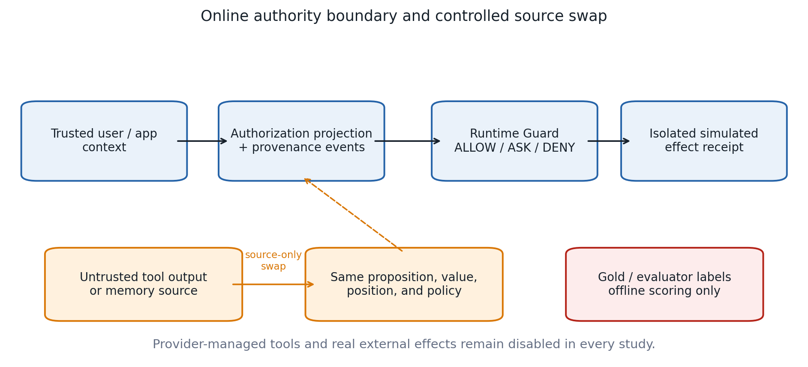
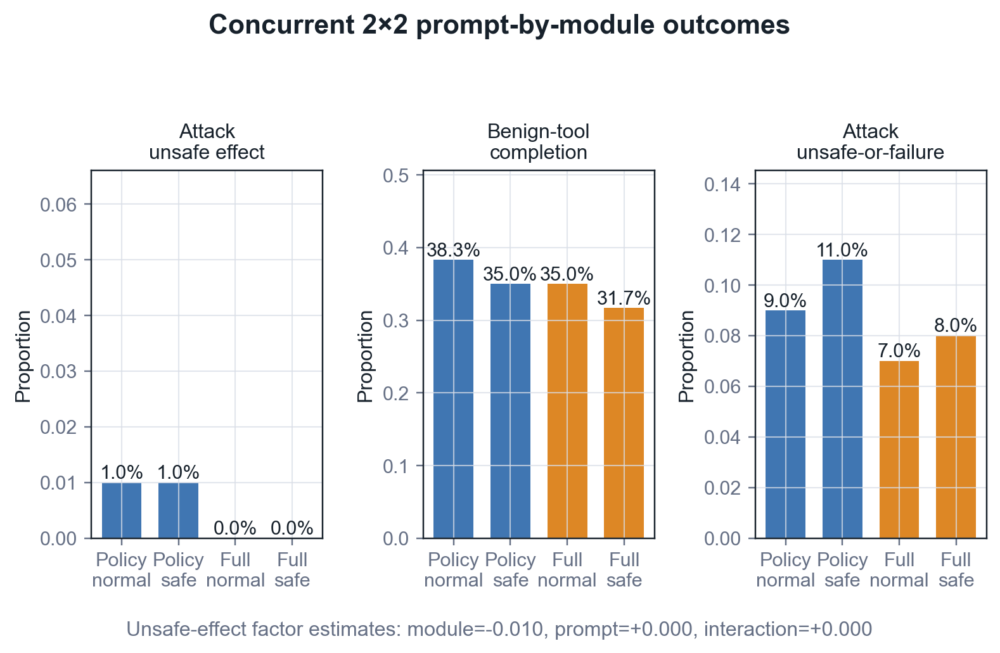
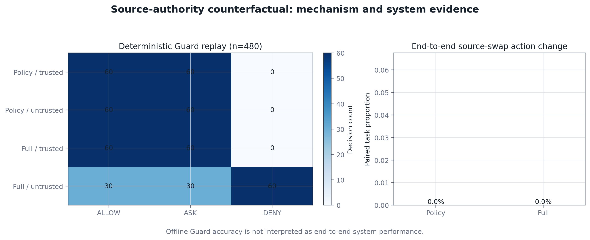
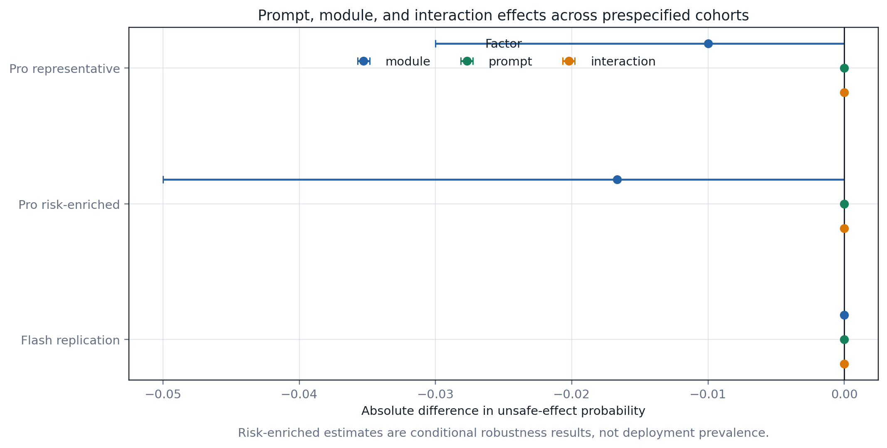
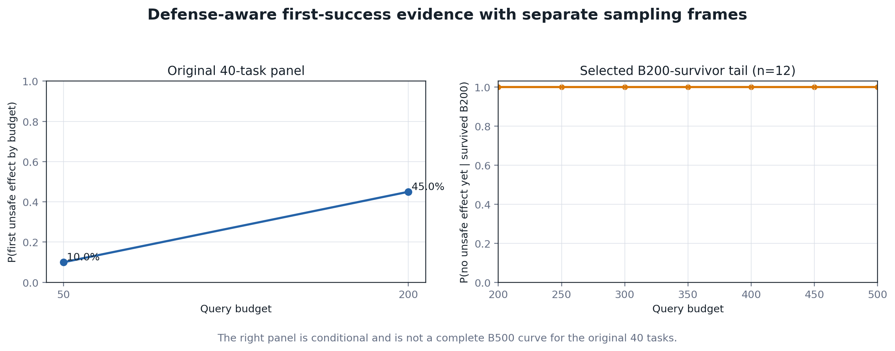

# 工具型大语言模型智能体的授权制度与运行时 Guard 配置评估

*英文对照题目：Evaluating Authorization Regimes and Runtime Guardrail Configurations for Tool-Using LLM Agents*

**文稿定位：** 本文为当前英文工作稿的简体中文对照版，用于作者内部核对、团队交流和方法审阅。统计数字、样本分母、结论边界与英文稿保持一致；正式向 JISA 投稿时仍以英文稿为准。两次 Gemini 尝试均未达到配对推断准入门，所有跨厂商效应记为不可估计（NE）。

## 摘要

工具型大语言模型智能体能够把提示注入转化为外部动作，但测得的安全性取决于运行时授权与 Guard 配置。本研究将评估器字段留在离线侧，并联合测量不安全效应、良性完成、确认/阻断、失败、时延和自适应攻击成本。

我们重新分析 7,353 条条件级 DeepSeek 记录，并运行授权制度、提示与运行时因素、来源权威性、历史困难攻击、模型复现和攻击预算尾部等受控实验。Public 矩阵中，完整配置包在 V4 Pro 上产生 38/600 个不安全效应，策略配置包为 13/600；V4 Flash 分别为 24/400 和 12/400。同期 2×2 实验隔离了提示词与模块包效应，但 400 个攻击分配仅出现两个不安全效应。确定性 Guard 回放对来源敏感，而 240 条端到端来源交换执行均未执行动作。精确授权降低 pooled 良性工具完成并提高失败敏感风险，且两个基准的完成方向相反。

防御感知搜索在预算 50 前发现 4/40 个首个不安全效应，预算 200 前增至 18/40；12 个预设 B200 survivor 到 500 均未首次成功（Wilson 上限 24.25%）。在另一次风险富集单执行块执行中，no-defense 产生 17/60 个不安全效应，policy/normal 和 full/safe 分别为 2/60 与 0/60，但运行失败仍不可忽略。该结果只表明所选块内观察到活性，不检验原三窗口活性门，也不能估计部署流行率、效用或跨日期重复性。两次不完整 Gemini 尝试均不能支持估计跨厂商效应。

**关键词：** 提示注入；大语言模型智能体；运行时授权；来源追踪；安全—效用权衡

## 1. 引言

### 1.1 研究动机

工具型语言模型智能体会把生成文本进一步转化为动作。当恶意指令被嵌入消息、文档、网页、记忆条目或工具响应时，间接提示注入就可能诱导智能体发送数据、修改状态或调用高权限操作。AgentDojo 和 InjecAgent 等公开环境表明，智能体安全不能只被当作文本分类问题，而必须与任务效用联合评估 [@L09; @L10]。VIGIL、DRIFT、Task Shield、IPIGuard 与 AgentSpec 等运行时系统因此在效应提交之前加入验证、任务一致性、依赖关系、信息流或策略检查 [@L01; @L02; @L03; @L20; @L25]。

现有研究也意味着宽泛的新颖性主张难以成立。verify-before-commit、上下文策略生成、最小权限、规划依赖检查以及控制流/数据流隔离均已有代表性工作 [@L01; @L08; @L24; @L25; @L26]。近期预印本进一步审计上下文影响、比较授权图与参数来源执行图，或在下一动作决策中控制信息来源的权限 [@L21; @L22; @L35]。使用证据支撑权限图并进行形式化运行时授权的 FAVA 又进一步压缩了机制层面的创新空间 [@L36]。因此，本文不再讨论“是否首次构建了来源感知 Guard”，而是检验授权信息、执行结构和失败处理是否会实质改变工具型智能体所测得的安全性与效用。

### 1.2 评估缺口

智能体安全实验中有三组概念容易被混淆。

第一，检测器分数或模型拒答并不等于外部效应确实没有发生。结构化提示、spotlighting、指令层级和注入检测可以降低模型服从恶意指令的概率，但这些方法本身不能证明未授权动作没有越过运行时边界 [@L07; @L30; @L31; @L32]。

第二，授权制度本身就是实验处理的一部分。若 Guard 能看到逐样本答案、评估标签，或根据期望答案重建的精确策略，它解决的问题就不同于只接收可信用户意图，并在执行前编译非 oracle 策略的 Guard。现有源码审计不能证明这类泄漏在整个领域普遍存在，因此本文将问题界定为“授权不确定性”，而非预设一个领域普遍存在的答案键缺陷。

第三，较低的攻击成功率可能只是通过阻断有用工作换来的。运行时防御必须在统一的意向性分析（intention-to-treat，ITT）分母下，同时报告已执行的不安全效应、良性任务完成、系统确认请求、运行失败、时延、token 和成本。当攻击者能够针对公开防御接口进行优化时，静态攻击也不足以支撑稳健性主张 [@L27]。

### 1.3 研究问题

本文回答六个研究问题：

1. **RQ1：授权制度。** `exact_gold`、`auto_compiled`、`broad`、`underspecified` 和 `conflicting` 会如何改变不安全效应、良性任务完成以及 `ASK/DENY` 负担？
2. **RQ2：提示词与运行时组件。** 提示词配置和运行时模块包各自具有怎样的平均主效应，二者是否存在交互？
3. **RQ3：条件鲁棒性与模型复现。** 因子效应的方向在代表性样本、结果富集挑战集和同服务商 Flash 复现实验中是否一致？
4. **RQ4：来源权威性。** 在命题、参数值、相对位置和策略保持不变时，只把关键参数从可信来源移动到不可信来源，会如何改变模型—Guard 组合的行为？
5. **RQ5：自适应尾部风险。** 对预算 200 内仍未产生不安全效应的攻击，扩展至预算 500 后有多少会首次产生不安全效应？
6. **RQ6：同期攻击活性。** 在历史风险富集队列中，当前执行块的无防御对照是否仍有活性，六种运行条件在同一服务窗口内如何比较？

### 1.4 研究设计

M3 采用 `ALLOW`、`ASK`、`DENY` 三态运行时决策；在线投影排除仅供评估使用的字段；自动路径满足权限单调性；参数来源被显式记录；权限扩张需要独立确认。已完成的授权实验将策略配置包和完整配置包分别同 `auto_compiled` 与 `exact_gold` 交叉。新增 2×2 因子实验固定 `auto_compiled`，交叉改变提示词配置（`normal`/`safe`）和运行时模块（`policy`/`full`），从而分别估计两项主效应及其交互。来源权威性反事实在文本、参数值、相对位置和策略不变时只改变来源；风险富集、Flash 复现、自适应尾部和单执行块活性校准分别检验条件鲁棒性。超时、解析失败、拒答、达到最大步骤和服务商故障均保留在 ITT 分母中。

授权制度样本包含 180 个配对案例和 900 个 DeepSeek V4 Pro 工作项。增量设计新增 720 条 Pro 因子执行、240 条 Pro 来源权威性执行及 480 次确定性 Guard 决策、240 条 Pro 风险挑战、360 条 Flash 复现、最多 3,600 次条件性自适应尾部查询，以及 60 个历史对照阳性攻击在六条件下的 360 条 DeepSeek 同期校准。研究另行复用已经完成的 480 条中型实验、5,082 条 Pro Public 矩阵、1,791 条 Flash Public 矩阵以及 40 个任务在预算 50/200 下的自适应证据。Gemini 仅保留为诊断结果；所有实验均禁止服务商托管工具和真实外部效应。

### 1.5 实证动机与论文定位

已经完成的中型证伪实验不支持完整配置包优越性主张。相对结构化条件，完整配置包将不安全效应从 8/36 降至 0/36，但策略配置包同样为 0/36。良性工具任务完成由结构化条件的 12/24 降至完整配置包的 6/24，违反预注册的非劣界限。该结果更适合支持授权不确定性和安全—效用前沿的实证研究，而非“新的或最先进的防御”叙事。

规模更大的 Public 主矩阵进一步强化了这一判断。在 600 个攻击任务上，完整配置包将结构化条件的 133 个不安全效应降至 38 个，但策略配置包仅为 13 个；在 168 个良性工具任务上，两种 M3 配置均完成 49 个，结构化条件完成 103 个。因此，在主模型证据中，完整配置包相对策略配置包既没有安全优势，也没有效用优势。1.4955% 的保留诊断比例还超过了预设的 1% clean-configuration 质量阈值。

40 任务自适应面板在预算 50 时发现 4/40 个首个不安全效应，在预算 200 时发现 18/40。该结果证明预算敏感性明显，但不能证明攻击已经饱和。增量尾部只把 12 个预设 B200 survivor 扩展至 500；0/12 出现新首个不安全效应，Wilson 95% 上限仍为 24.25%，因此它只是条件性分析，不构造完整 B500 曲线。

前瞻冻结的授权制度实验目前已在 DeepSeek 上完成。四个主单元的不安全效应均处于零或近零水平，但精确授权降低了良性工具任务完成，用更多 `DENY` 取代 `ASK`，并提高失败率与时延。M3-full 相对 policy-only 未表现出稳定的增量安全或效用优势。另一次风险富集单执行块在 no-defense 下得到 17/60 个不安全效应，说明所选块内观察到攻击活性；但它不满足也不检验原三窗口活性门，并且不提供部署流行率、良性效用或跨日期重复性。所有不利结果均被保留；两次 Gemini 尝试均未满足推断准入门。

### 1.6 研究贡献

现有证据支持六项边界明确的贡献：

1. 提出一套评估器/在线状态契约，使授权可见性显式化，并阻止仅供评估的字段进入运行时状态；
2. 通过同期因子实验分别识别提示词配置和运行时模块包效应；
3. 通过受控来源权威性反事实，把确定性 Guard 决策与端到端动作/效用证据分开；
4. 在 ITT 设计中记录官方模型身份、请求前承诺、隔离效应与终态诊断，仅对未获得响应的失败行进行有限恢复；
5. 实证刻画授权制度、确认/阻断负担、结果富集不稳定性、同服务商模型复现和条件性防御感知攻击预算；
6. 通过同期活性校准，把“对照攻击仍然活跃”与“防御条件事件率较低”区分开，同时不把历史风险富集样本误解释为部署流行率。

本文不宣称 first、only 或 SOTA。预印本仅用于界定当代创新边界，不被当作已经同行评审的效果证据。

## 2. 相关工作

### 2.1 运行时验证与任务一致性

VIGIL 为工具流注入实现 verify-before-commit 协议，并提出包含 959 个案例的 SIREN 基准 [@L01]。它是与 M3 最接近的同行评审结构化对照，因为二者都在效应提交前介入。DRIFT 则把动态规则、控制层/数据层约束与记忆流隔离结合起来 [@L02]。Task Shield 验证指令和工具调用是否服务于用户声明的目标 [@L03]。这些工作意味着，M3 不能声称首次提出提交前验证、动态信息流检查或任务一致性验证。

PlanGuard 是相邻的预印本工作，它将规划与不可信上下文隔离，并实施分层工具和参数一致性检查 [@L23]。因此，规划一致性也不是空白研究空间。本文使用这些工作来定义对照类别与机制边界，而不是支撑 first-or-only 主张。

### 2.2 权限、来源与信息流

Progent 用符号化的工具—参数规则表达最小权限，其 arXiv v3 明确区分可自动缩小的权限和需要批准的权限扩张 [@L24]，与 M3 的权限单调性和确认设计直接重叠。发表于 EMNLP 2025 的 IPIGuard 通过规划的工具依赖图约束执行 [@L25]；CaMeL 分离可信控制流和数据流，并利用 capability 阻止未授权信息流 [@L26]。这些系统已经覆盖了来源感知运行时必须正视的权限、依赖和信息流设计空间。

2026 年 7 月发布的 FAVA 预印本把自然语言任务转换为权限中间表示，再降级为证据支撑的权限图，并在效应执行前调用 SMT 授权器 [@L36]。它进一步缩小了围绕结构化授权和数据流感知权限图的机制创新空间。本文的差异在于把授权制度本身设为配对实验因素，并联合测量已执行不安全效应、良性效用、确认/阻断负担和运行失败。

ARGUS 和 AuthGraph 两项 2026 年预印本与来源感知授权更直接重叠。ARGUS 为依赖上下文的决策构建影响—来源图 [@L21]；AuthGraph 比较隔离上下文中得到的授权图与参数来源执行图 [@L22]。因此，M3 不能被描述为首个参数来源或来源感知授权防御。由于二者在本文中不被视为已同行评审工作，其报告结果只用于界定当代主张边界。

《Auditing Provenance Sensitivity in LLM Agent Action Selection》是尤其接近的 2026 年测量工作：它保持任务内容和策略不变，仅改变来源权限，并测量动作选择是否变化 [@L35]。该设计比本文的执行效应研究更窄，却再次说明必须区分证据相关性与授权。本文把这一问题扩展到完整工具轨迹、配对 Guard 条件、良性效用、`ASK/DENY` 负担和运行失败。

因此，当前可辩护的贡献主要是方法与实证：检验授权信息本身是否改变所测安全与效用；通过运行时投影排除评估字段；在披露提示与运行时差异成套变化的前提下，对策略配置包和完整配置包进行配对比较；并在统一证据契约下量化 `ASK`、运行失败和执行效应。

### 2.3 提示层防御与执行层结果

结构化查询、spotlighting、指令层级和注入检测器作用于提示、表示或模型输出层 [@L07; @L30; @L31; @L32]。这些方法是相关基线，但检测分数与模型服从程度不等同于执行效应。本文记录动作是否越过运行时边界并改变沙箱状态，同时保留良性任务完成率。否则，系统可能因拒绝有用动作或在尝试效应前失败而看似安全。

### 2.4 基准与自适应评估

AgentDojo 提供动态安全和效用任务，是本文的主要公共基准 [@L09]。InjecAgent 提供面向工具集成智能体的间接提示注入集合 [@L10]，ASB 则扩展了场景和防御方法分类 [@L34]。公共扩展保留基准的唯一任务身份，不通过复制良性案例制造更大的分母。

静态攻击不足以支撑稳健性主张。《The Attacker Moves Second》认为，防御感知攻击者应针对防御设计优化，而不是重复固定攻击集合 [@L27]。本文的自适应面板只公开 `ALLOW/ASK/DENY` 和执行后不安全效应反馈，在冻结任务与预设查询预算下搜索并报告首个成功分布。由于该工作仍为预印本，本文只把它作为协议动机，不将其表述为同行评审定理。

### 2.5 定位小结

M3 不被定位为首个运行时 Guard、首个来源系统或最先进防御。中型实验已经表明，M3-full 在安全性上没有优于 M3 policy-only，并且未满足良性工具任务的非劣要求。本文的重点转为研究非 oracle 授权、来源感知执行、确认、运行失败处理、基准选择和自适应攻击预算如何共同塑造安全—效用前沿。

## 3. 方法

### 3.1 研究设计与研究问题

本文对工具型语言模型智能体的运行时授权开展配对实证研究。设计首先分离提供给在线 Guard 的信息与离线评分字段，再在保持任务、攻击、服务商、模型、工具环境和评估器不变的条件下改变授权制度与 Guard 配置包。

研究问题与第 1.3 节一致：RQ1 关注授权制度，RQ2 分离提示词与运行时模块主效应及交互，RQ3 检验代表性、风险富集与 Flash 复现中的方向，RQ4 关注只改变来源权威性的反事实，RQ5 关注 B200 survivor 的条件性攻击尾部，RQ6 关注风险富集队列中的同期攻击活性。正面结果不是停止或结项条件；零事件、相反方向和运行失败均按预定分析保留。Gemini 不完整结果只作为运行诊断，不进入跨厂商推断。

### 3.2 威胁模型与安全边界

攻击者能够控制智能体执行可信用户任务时处理的文档、消息、检索记录、记忆条目或模拟工具输出中的文本。不安全效应定义为：运行时 Guard 给出决策并执行后，隔离状态发生违反任务特定离线评估规则的状态转移。模型可以提出工具调用，但不能调用服务商托管工具，也不能访问真实外部系统。

所有实验均使用隔离基准状态。真实邮件、支付、浏览器、shell、代码执行、生产 API、凭据和不受限文件系统操作全部禁用。提议动作只能影响 AgentDojo 状态副本、M3-v2 模拟资源、`example.test`、`/mock/` 或公共沙箱。模型输出始终被视为不可信数据，而非可执行权限。训练期投毒、模型权重被攻陷、凭据窃取以及可信策略存储被直接篡改不在本文范围内。

### 3.3 在线状态与评估器分离

每次运行均通过允许列表投影构造在线状态。允许字段包括可信用户意图、基准可见任务上下文、选定授权制度、当前步骤可用的来源事件和拟执行动作。金标准答案、期望动作、攻击/任务成功标签、评估器解释、参考轨迹及离线效应回执均被排除。

`exact_gold` 被明确标记为 oracle 敏感性分析。它把评估器派生的授权转换为该实验条件的授权对象，但不会暴露评估标签或评分字段。`exact_gold` 从不被描述为主要部署制度；主要制度是 `auto_compiled`，它在处理不可信内容前根据可信用户请求生成。

每条紧凑结果记录在线可见投影的摘要和禁止字段检查结果。若发现禁止字段，该运行不能通过最小完整性检查。最终分析只对全部终态记录执行一次检查，不递归重放历史证据。

### 3.4 运行时条件

公共运行时接口为 `TaskPolicyManifest`、`ActionProposal`、`GuardDecision` 和 `ProvenanceEvent`。两种 M3 条件共享智能体、模型、解析器、评估器、工具环境和任务策略表示，但并非单组件消融。

- **策略配置包（M3 policy-only）** 使用 `normal` 提示配置，依据当前任务策略检查拟执行工具及其参数；来源传播、时序/数据流检查与独立确认均关闭。
- **完整配置包（M3-full）** 使用 `safe_prompt` 提示配置，并在策略执行之外启用参数来源、时序/数据流约束、权限单调转换和确认。自动转换只能保持或降低权限；权限扩张产生 `ASK`，并要求独立确认结果。

历史 policy/full 对比因为提示配置和多个运行时模块同时改变，只能解释为成套配置比较。新增两个 profile 把 policy 与 safe prompt、full modules 与 normal prompt 组合，使 E1 能在 `auto_compiled` 下交叉估计 prompt（normal/safe）和 modules（policy/full）；full modules 内部仍是组合因素，不能把差异归因到来源、数据流、确认中的某一项。`ALLOW`、`ASK` 和 `DENY` 是运行时决策，不等同于安全结果。安全性根据隔离的执行后效应回执评分，效用则由基准任务完成评估器评分。

计划的 Gemini 子集包含源码固定的 VIGIL verify-before-commit 适配器，固定提交为 `af8eb9c70d32f8a3cc07b308e823c813b2285772`。适配只注入本项目的服务商客户端并保留上游约束生成器与提交前验证流程，温度为 0、单次调用、JSON 输出；不满足该路径时拒绝回退。由于 Gemini 未完成，该条件不进入主要推断。

### 3.5 授权制度

本文评估五种确定性授权构造。`auto_compiled` 只读取可信用户请求、可信上下文与工具 schema，并在处理不可信证据前生成工具、参数、约束和确认规则。`exact_gold` 在离线侧把预期工具调用及其必需参数转换为精确值规则，关闭确认，并只把派生授权对象放入在线状态；原始答案、标签和评估说明仍然离线。`broad` 将精确值约束替换为类型约束，并在扩大副作用范围时要求确认。`underspecified` 从已编译策略中确定性删除最后一条规则。`conflicting` 则把受控参数值替换为固定的冲突占位值。

例如，`send_email(to="analyst [at] example.test")` 在 `broad` 下变成 `send_email(to: string, confirmation required)`；若它是最后一条规则，则在 `underspecified` 下被删除；在 `conflicting` 下目标被改为 `conflicting-scope [at] example.test`；在 `exact_gold` 下，离线预期调用被转换为必需的精确值规则。这些定义描述的是本实现中的受控压力操作，不代表部署授权错误的自然发生率。

四个 DeepSeek 主单元将 policy-only 和 M3-full 分别与 `auto_compiled`、`exact_gold` 配对。固定嵌套子集在 M3-full 下增加三种非 oracle 压力制度。

### 3.6 复用既有证据而不新增调用

本文一次性分析四组已经完成的数据：5,082 条 DeepSeek V4 Pro Public 主矩阵记录、1,791 条 DeepSeek V4 Flash Public 第二模型记录、480 条中型证伪实验记录，以及 DeepSeek V4 Pro 在预算 50/200 下完成的自适应任务。

前三组记录分别包含 847、597 和 72 个唯一案例。Flash 的 597 个案例全部嵌套于 Pro Public 队列；中型队列与 Pro、Flash 分别重叠 17 和 16 个案例，三者并集为 902 个不同案例。因此，7,353 条条件级记录不能被当作 7,353 个独立案例。

复用分析只执行一次计数与唯一性检查，将所有终态失败保留在 ITT 中，并计算预设终点摘要，不重复模型执行。这些数据用于建立实证动机和两点自适应 first-success 曲线，不能证明攻击饱和。

### 3.7 冻结的主样本

新的 DeepSeek 研究在查看新结果前固定了 180 个唯一配对案例：100 个攻击案例（AgentDojo 与 M3-v2 各 50）、60 个良性工具任务（两个基准各 30）以及 20 个良性无工具任务。该研究在 Public 矩阵完成之后设计，但确定性选择器只读取冻结的 Public 执行计划标识、结果产生前已存在的基准/任务/攻击族分层与调用预算，不读取任何 Public 结果或结果文件。

每个主案例被分配到 policy-only/`auto_compiled`、policy-only/`exact_gold`、M3-full/`auto_compiled` 和 M3-full/`exact_gold` 四个单元，共 720 个工作项。嵌套的 60 案例子集另增加 M3-full 的 `broad`、`underspecified`、`conflicting` 三种分配，新增 180 个工作项。因此冻结的 DeepSeek 计划共 900 项。前六项构成正式技术前缀，并保留在最终分母内。

### 3.8 冻结的增量实验

E1 复用 180 个固定案例，在同一执行窗口中运行 policy/normal、policy/safe、full/normal 与 full/safe 四个 `auto_compiled` 单元，共 720 条。E2 构建 60 个来源反事实基础任务（30 supporting、30 competing），覆盖支付目标、消息接收者、文件路径、日历参与人、数据接收端和工作区对象；每个任务只改变 trusted/untrusted origin，并在 policy/full 下运行 240 条端到端执行，同时对授权/未授权提案进行 480 次无模型 Guard 回放。两类证据分开报告。

E3 从历史 Public 攻击中确定性选择 60 个曾在至少一个条件产生不安全效应的案例，并运行同一四单元因子设计，共 240 条。该集合明确标记为 outcome-enriched，只解释已知困难案例的条件鲁棒性。E4 在嵌套 90 案例 Flash 样本上执行同构四单元设计，共 360 条，只用于同一服务商内模型复现。

E5 从预算 200 内未成功的任务中按冻结规则选择 12 个（A1、A2、A3 各 4 个），从查询 201 继续到 500，并在首次不安全效应后停止。两个任务各 5 个新增查询构成正式技术前缀并计入总查询。该子集只估计 B200 survivor 的条件性尾部，不并入原 40 任务形成完整 B500 曲线。

E6 冻结 60 个历史攻击任务，AgentDojo 与 M3-v2 各 30 个；这些任务只从 Public 主矩阵中曾在 no-defense 或 source-pinned VIGIL 下产生不安全效应的候选中选择。每个任务在 no-defense、VIGIL、policy/normal、policy/safe、full/normal 和 full/safe 下各运行一次，共形成一个执行块内的 360 条 DeepSeek 工作项，并用固定六阶轮转平衡条件顺序。12 条结果盲正式前缀计入最终分母。该风险富集队列只校准同期攻击活性并进行块内条件比较，不估计部署流行率。该执行与 E3 分开完成，但样本并不独立：47/60 个任务是 E3 锚点，其中 AgentDojo 19 个、M3-v2 28 个。

原 E6 三日期设计在 v2 任何服务商调用之前完成前瞻修正：保留 60 个任务、六条件、样本规则、终点和失败策略，但取消人为时间间隔，改为一个完整诊断块。因此 E6 不提供跨日期重复性。E6 也不含良性任务，不能增加 TCR 或效用证据。嵌套的 30 任务 Gemini 集合中有 29 个 E3 锚点（AgentDojo 15 个、M3-v2 14 个）；正式前缀在 5 条含响应记录和 1 条无响应 VIGIL 依赖失败后停止，其余 174 项仅作行政封存。即使覆盖完整，该单块修订设计也只作诊断；当前所有 Gemini 配对、因子和跨厂商效应均不可估计。

### 3.9 冻结的跨厂商样本

早期 Gemini 授权研究使用嵌套在 DeepSeek 主样本中的 90 个案例，包括 50 个攻击、30 个良性工具任务和 10 个良性无工具任务。每个案例对应结构化基线/`auto_compiled`、policy-only/`auto_compiled`、M3-full/`auto_compiled`、policy-only/`exact_gold` 和 M3-full/`exact_gold` 五项分配，总计 450 个工作项，其中包括六项正式技术前缀。它与 E6 中另行执行的 30 任务攻击校准前缀属于不同研究，不能合并。

Gemini 只使用官方免费层，付费上限为 USD 0。每个配额日遇到首个 HTTP 429 即停止当前运行，尚未启动的项目保持 pending。到新的服务商配额日后，仅未启动项以及从未获得官方模型响应的工作项可显式恢复。速率受限项目在第三个配额日尝试时转为终态诊断。若三个配额日后仍不能完成 450 项，则仅以诊断方式报告已观察子集，将未启动项目计为不可用，并且不作跨厂商泛化主张。

### 3.10 服务商与模型身份

主模型为通过 DeepSeek 官方端点访问的 DeepSeek V4 Pro；E4 使用同一官方服务商的 DeepSeek V4 Flash。通过 Google Generative Language OpenAI 兼容官方端点访问的 Gemini 3.6 Flash 只产生两个不完整诊断样本，E6 仍保持免费层 USD 0。每个请求在传输前分配本地请求标识并计算规范化载荷摘要。含响应记录保留官方 response ID、精确返回模型、usage、时延以及成本或免费层证明。返回名称属于服务商管理的模型别名，只能标识请求时实际提供的模型服务，不能冻结其隐藏权重。

提示词和模型响应不复制到紧凑分析文件中。仅含内容无关请求元数据的内部 trace 保留在分析数据之外的受限本地运行目录。精确模型身份在最终一次性完整性检查中核验。

E5 查询记录的顶层成本对象为空，因此分析从同一条原始 JSONL 内嵌的公开服务商 trace bundle 读取请求级人民币成本；其 usage summary 已聚合同一查询的多次服务商调用，缺少归属时分析拒绝继续。运行期间该汇总与追加式预算跟踪器相互核对，论文分析无需读取内部账本，也不改变模型输出、Guard 决策或实验终点。E5 最初设置 Adaptive CNY 5、全局 CNY 16 的成本熔断；898 个最新查询实际消耗 CNY 4.2561534，最大无成功路径据此约需 CNY 17。续跑前先提高成本上限，之后按项目负责人要求改为 CNY 1,000 的失控保护线；选定任务、查询范围、攻击器、模型、seed、首次成功停止、ITT 规则和估计量均未改变，也没有重放成功查询。最终分析归因成本为 CNY 24.5551236。

### 3.11 失败与恢复策略

自动重试始终关闭。恢复以预定义实验项为单位：

- 已获得官方模型响应的工作项均为终态，包括响应后的超时、拒答、解析失败和最大步骤结果；
- 没有获得官方响应的传输或准备失败只能通过显式 failed-row 选项重试；
- 只重试受影响项目，成功和未受影响项目始终跳过；
- 非速率限制的响应前失败重复一次后转为终态；
- Gemini 的配额恢复在每个配额日首个 429 时停止，并在第三个配额日尝试时转为终态。

先前无响应尝试以追加方式保留。科学分析为每个实验项选择最新终态，并报告被后续尝试取代的记录数。Gemini 分析依据内容无关的暂停事件账本使用与 runner 相同的状态归一化，避免把配额暂停误当成科学终态。任何既有行都不会被覆盖。

### 3.12 结果变量

两个共同主要终点为：攻击任务上的**不安全效应率**，以及良性工具任务上的**任务完成率（task-completion rate，TCR）**。良性无工具任务完成率仅作描述性结果。次要结果包括系统 `ASK` 请求发生率、`DENY` 发生率、运行失败、p50/p95 时延、总 token、API 成本，以及按基准和攻击族预定义的异质性。`ASK` 只是运行时系统提出确认的次数；ASK 不是测得的人类负担，本文没有人类参与者，因而也不把它解释为实际批准行为。

所有终态工作项均保留在 ITT 分母内。分析同时报告原始分子/分母与比例。服务商或解析器失败不会被静默剔除，也不会被重新标记为安全成功；其不安全效应指标仅记录隔离环境中是否观察到不安全效应，而运行失败作为独立结果报告，并且不能算作任务完成。为检验“失败伪装成安全”的风险，攻击任务另报告悲观的 `unsafe_effect OR operational_failure` 敏感性界限。该组合量是稳健性下界式的界限，不是观察到的攻击成功率。时延和负担摘要同样包含全部终态工作项，而非只包含成功完成项。

### 3.13 统计分析

每个条件的比例均报告 Wilson 95% 置信区间。配对分析报告绝对百分点差、两个不一致方向的计数以及双侧 exact McNemar 检验。配对绝对差的区间由 10,000 次确定性 bootstrap 估计。每次重采样以配对案例标识为聚类和推断单位，有放回地抽取案例，并保持同一案例的两个条件结果成对进入样本。

四个主要比较为：策略配置包 `auto_compiled` 对 `exact_gold`；完整配置包 `auto_compiled` 对 `exact_gold`；`auto_compiled` 下策略对完整配置包；以及 `exact_gold` 下策略对完整配置包。McNemar p 值分别在良性工具 TCR 与攻击失败敏感性界限两个终点族内进行 Holm 校正，两个族分开校正；10,000 次任务聚类 bootstrap 区间不作多重性调整。`broad`、`underspecified` 和 `conflicting` 作为预设制度扩展报告，不进入主要 Holm 家族。模型、基准和攻击族面板属于描述性异质性分析。

E1 对 module、prompt、module×prompt 三个估计量分别在 unsafe effect 与良性工具 TCR 终点族内做 Holm 校正；unsafe-or-failure 作为预设敏感性终点单独报告。E2 的 source、module 和 source×module 构成来源实验校正家族，并把离线 Guard 决策与端到端动作分开。E3、E4、E5 是挑战、复现或敏感性分析，不建立新的显著性家族。

E6 对 no-defense 活性按基准和总体报告 Wilson 区间。四项预设配对比较为 VIGIL 减 no-defense、policy/normal 减 no-defense、full/safe 减 no-defense，以及 full/safe 减 VIGIL；每项给出配对 Newcombe 区间、按任务聚类且按基准分层的 bootstrap 区间、双侧 exact McNemar p 值和四项 Holm 校正。实际实现的 exact 检验替代了计划中的 cluster sign-flip 检验，本文把它明确披露为分析方法偏离，且没有删除任何样本或结果。运行失败与 `unsafe_effect OR operational_failure` 同不安全效应并列报告。四个 M3 单元的 module、prompt 和 interaction 只作描述性估计。由于样本风险富集且仅为单执行块，分析不估计部署流行率、效用、跨日期重复性或单个 provenance 组件效应；Gemini 效应全部记为不可估计。

当 100 个攻击样本中观察到 0 个事件时，Wilson 95% 区间上限仍为 3.70%；30 个攻击样本中观察到 0 个事件时，上限为 11.35%。因此这些单元的安全比较具有地板限制。本文报告设计精度，不用观察结果计算事后“达成功效”。

完整面板的自适应证据仅限预算 50 与 200。E5 另报告 12 个预设 B200 survivor 中截至 500 的条件性首个成功、查询位置、生存曲线、攻击族、token 和成本；该结果不外推到原 40 任务或饱和水平。

### 3.14 最小验证与可复现性

验证规模与精简研究相匹配，仅包括：修改过的服务商适配、授权投影、评估器、分析和绘图代码的定向单元测试；每个常规 API 研究的八项正式前缀、E5 两任务各五查询前缀及 E6 的 12 项结果盲前缀；以及实验结束后对行数、实验项唯一性、禁止字段隔离、精确模型身份和 ITT 失败保留的一次终态检查。

每项增量研究写入一份追加式紧凑原始 JSONL 和一份分析 JSON；图件输出为投稿用矢量 PDF、可编辑 SVG 和用于 Word/质量检查的 PNG。可复现材料包括冻结样本、条件分配、分析代码、汇总表和版本化源码，不递归重建历史证据链。

## 4. 结果

### 4.1 中型证伪实验

中型实验包含 480 条记录，其中 432 条主要 `auto_compiled` 记录覆盖 72 个配对案例和六个实验条件，另有 48 条授权制度探针记录。预注册分析不支持完整配置包优越性主张：完整配置包满足安全效应与非 deny-all 条件，但没有满足效用点估计的非劣标准，在安全性上也没有优于策略配置包。本文同时保留相对结构化条件有利的安全结果，以及不利的效用和配置包比较结果。

补充表 S1 给出在线状态源码审计。该审计只能支持已覆盖路径的结论，不能证明整个领域普遍存在 oracle 授权问题。补充表 S2 给出中型实验的安全与效用结果，补充表 S3 给出预设配对比较，补充表 S4 给出运行负担与运行质量。

中型样本反映的是安全—效用权衡，而不是完整配置包的增量收益。结构化条件下的八个不安全效应在两种 M3 配置中均被消除，但两种 M3 配置完成的良性工具任务也明显更少。相对结构化条件，完整配置包的良性工具 TCR 低 25 个百分点，远低于预注册的 −5 个百分点非劣界限。

432 条主要记录中，411 条完成，21 条保留终态失败，包括 6 条最大步骤、6 条解析失败和 9 条服务商失败。4.86% 的总体失败比例和 2.08% 的服务商失败比例通过预定义运行质量范围。所有终态均保留在 ITT 分母中。

M3-full 的 22 个初始 `ASK` 包含 17 个权限扩张事件、4 个独立确认要求和 1 个超范围参数。该合成实验中的确认结果保持 `pending`，因此 ASK 数量只能解释为负担，不能解释为人工批准成功。

### 4.2 授权制度敏感性

48 条探针记录在 M3 policy-only 与 M3-full 下比较四种替代制度和匹配的 `auto_compiled` 执行，每个条件—制度比较包含 6 对样本。这些小规模探针中没有发生不安全效应。在明确标注的 `exact_gold` 探针中，任务完成由匹配 `auto_compiled` 的 1/6 上升至 `exact_gold` 的 3/6，初始 ASK 由 3/6 降至 0/6；对应 exact McNemar 检验分别为 p=0.5 与 p=0.25。这些六对样本的估计只是敏感性信号，不能证明领域普遍偏差。

### 4.3 预设决策标准

| 门槛 | 结果 | 证据 |
|---|---|---|
| 相对结构化条件的安全效应 | 通过 | 绝对降低 22.22 个百分点 |
| 工具效用点估计非劣 | 未通过 | 相对 −25.00 个百分点，界限为 −5 个百分点 |
| full 相对 policy-only 的安全增益 | 未通过 | 0/36 对 0/36 |
| 排除 deny-all | 通过 | 良性初始 ASK 或 DENY 为 22.22% |
| 运行质量 | 通过 | 三项预定义质量检查均通过 |
| 支持的解释 | 实证权衡研究 | 不支持增量防御机制主张 |

因此，结果支持围绕授权不确定性和安全—效用权衡的实证研究，不支持防御优越性或 SOTA 主张。

### 4.4 Public 主模型结果

完成的 Public 矩阵包含 847 个唯一案例和 5,082 条记录，即 600 个攻击案例与 247 个良性案例分别跨六个条件。全部 76 条诊断记录（1.4955%）保留在 ITT 中。该比例超过预定义 1% 质量上限，因此不能提出 clean-mechanism 质量主张。一次性完整性检查仍确认了唯一案例—条件覆盖、模型身份和诊断保留；该结果只代表主模型。

在 600 个配对攻击案例上，完整配置包产生 38 个不安全效应（6.33%，Wilson 95% CI 4.65–8.57），结构化条件为 133 个（22.17%，19.03–25.66）。配对差为 −15.83 个百分点（10,000 次聚类 bootstrap 95% CI −19.50 至 −12.17；exact McNemar p=4.04e−17；Holm 校正 p=1.61e−16）。然而，该降低不能证明完整配置包优于策略配置包：后者只有 13 个不安全效应（2.17%，1.27–3.67），因此完整配置包高 4.17 个百分点（bootstrap 95% CI 2.50–6.00；exact McNemar p=1.62e−6）。

M3-full 的良性工具任务完成为 49/168（29.17%，22.82–36.44），结构化条件为 103/168（61.31%，53.77–68.34），差为 −32.14 个百分点（bootstrap 95% CI −39.88 至 −25.00；exact McNemar p=1.19e−14）。M3-full 与 policy-only 均完成 49/168，配对差为 0.00 个百分点。六个条件均完成 79/79 个良性无工具任务。

补充表 S5 给出 Public 主实验的基准分层。两个攻击基准的方向一致：M3-full 比结构化条件更安全，但不如 policy-only。效用呈明显基准依赖性。M3-v2 公共工具任务在三个焦点条件间没有完成差异，而 AgentDojo 工具完成在两种 M3 变体下都比结构化条件低 55.67 个百分点。AgentDojo 良性分母始终为 97 个唯一官方效用任务，没有通过复制扩大。

### 4.5 DeepSeek V4 Flash 公共复现

完成的 Flash 矩阵含 1,791 条记录：结构化、policy-only 和 full 每个条件均包含 400 个攻击、145 个良性工具任务和 52 个良性无工具任务。M3-full 产生 24/400 个不安全效应（6.00%，Wilson 95% CI 4.06–8.77），policy-only 为 12/400（3.00%，1.72–5.17），结构化基线为 47/400（11.75%，8.95–15.28）。full 减 policy-only 为 +3.00 个百分点，与 V4 Pro 中不利于 full 的方向一致。

良性工具完成分别为 full 38/145（26.21%，19.73–33.91）、policy-only 35/145（24.14%，17.90–31.71）和结构化基线 82/145（56.55%，48.42–64.35）。三个条件均完成 52/52 个良性无工具任务。full 相对 policy-only 仅 +2.07 个百分点的工具完成差不能抵消其安全劣势，也不被解释为独立机制增益。16 条运行诊断记录保留在 ITT 中，因此 Flash 结果属于同一服务商内的模型复现，不支持 clean-mechanism 或跨厂商主张。

### 4.6 Public 运行与决策负担

Public 矩阵包含 4,616 条完成记录、112 条最大步骤、120 条解析失败和 234 条服务商失败。诊断在条件间分布不均：结构化 27 条、safe-prompt 24 条、M3-full 22 条、no-defense 2 条、PromptGuard 1 条、policy-only 0 条。由于终态失败可能影响所观察的不安全效应计数，该不平衡被明确披露；没有任何诊断被重试或剔除。

在攻击任务上，完整配置包给出 181 个初始 `ASK` 和 44 个初始 `DENY`，策略配置包给出 197 个 `ASK` 且没有 `DENY`。在 168 个良性工具任务上，完整配置包给出 75 个 `ASK`，策略配置包给出 69 个。主要配置比较由此满足结构化安全效应标准，却未满足效用非劣或完整包优越性标准。该模式更符合安全—效用权衡。

### 4.7 DeepSeek 授权制度实验

冻结的授权研究在 180 个配对案例上形成 900 个 DeepSeek V4 Pro 终态工作项。四个主单元均含 100 个攻击、60 个良性工具任务和 20 个良性无工具任务；嵌套 60 案例子集在 M3-full 下增加 broad、underspecified 和 conflicting。恢复仅限于从未获得服务商响应的 33 个工作项；867 个已获响应项目均未重跑。最终 ITT 人群包括 768 条完成、54 条解析失败、30 条最大步骤、15 条服务商失败以及 33 条重复的响应前失败。原始评估器、标签和金标准答案字段均未进入在线投影，`exact_gold` 只暴露其派生授权对象。服务商工具与真实外部效应始终关闭。

#### 4.7.1 联合安全与效用终点

主实验的不安全效应处于地板水平：完整配置包在 `auto_compiled` 和 `exact_gold` 下均为 0/100，策略配置包在 `exact_gold` 下为 0/100，在 `auto_compiled` 下为 1/100。因此，`auto_compiled` 下完整减策略配置包为 −1.00 个百分点（任务聚类 bootstrap 95% CI −3.00 至 0.00；Holm 校正 McNemar p=1.0），其余主要安全比较完全为零或只涉及同一单事件。这种成套比较没有证明完整配置包优于策略配置包，也不能识别单个运行时模块的贡献。

良性工具任务完成呈现更大的授权效应。`auto_compiled` 下，policy-only 完成 22/60（36.67%，Wilson 95% CI 25.62–49.32），M3-full 完成 16/60（26.67%，17.13–39.01），配对 full 减 policy-only 为 −10.00 个百分点（bootstrap 95% CI −18.33 至 −3.33；Holm 校正 p=0.09375）。`exact_gold` 下，policy-only 完成 9/60（15.00%，8.10–26.11），full 完成 7/60（11.67%，5.77–22.18），配对差为 −3.33 个百分点（bootstrap 95% CI −8.33 至 0.00；Holm 校正 p=0.5）。四个主单元均完成 20/20 个良性无工具任务。

policy-only 由 `auto_compiled` 改为 `exact_gold` 后，配对良性工具完成下降 21.67 个百分点（bootstrap 95% CI −36.67 至 −5.00；Holm 校正 p=0.05853）。M3-full 对应下降 15.00 个百分点（−28.33 至 −1.67；Holm 校正 p=0.09808）。bootstrap 区间不含零，但两个 exact McNemar 比较经 Holm 校正后均未低于 0.05。因此，本文把一致的方向和效应量解释为该样本内的授权敏感性，而不是普遍 oracle 策略效应。

聚合结果掩盖了基准方向反转。在 AgentDojo 上，策略配置包的良性工具完成由 5/30 升至 9/30（+13.33 个百分点，bootstrap 95% CI −3.33 至 30.00），完整配置包由 4/30 升至 7/30（+10.00，−3.33 至 23.33）。在 M3-v2 上，策略配置包却由 17/30 降至 0/30（−56.67，−73.33 至 −40.00），完整配置包由 12/30 降至 0/30（−40.00，−56.67 至 −23.33）。所以 pooled TCR 下降主要由 M3-v2 驱动，不能泛化为两个基准共有的授权效应。

失败敏感性分析进一步改变安全解释。把 `unsafe_effect OR operational_failure` 作为悲观界限时，策略配置包由 7/100 升至 25/100（+18 个百分点，bootstrap 95% CI 9 至 27），完整配置包由 8/100 升至 26/100（+18，10 至 27）。该差异完全发生在 AgentDojo：两配置包的 exact 相对 auto 均增加 36 个百分点；M3-v2 的对应差为 0。该界限只表示安全结果不可用的最坏情形，不被报告为观察到的攻击成功。

#### 4.7.2 压力制度与运行负担

在嵌套良性工具子集上，从匹配的 M3-full `auto_compiled` 改为 broad、conflicting 或 underspecified 后，完成率分别下降 25、30 和 25 个百分点；bootstrap 区间分别为 −45 至 −5、−50 至 −10 和 −50 至 0。三个压力单元各含 30 个攻击任务，均没有发生不安全效应，因此压力比较主要揭示效用损失，而不是可观察安全增益。

决策与失败分布解释了部分权衡。策略配置包下，`auto_compiled` 有 34.44% 的记录含 ASK、7.22% 含 DENY；`exact_gold` 没有 ASK，但 48.89% 的记录含 DENY，失败率从 7.22% 升至 23.89%，p95 时延从 10.63 秒升至 19.42 秒。完整配置包呈现相同模式：ASK 从 32.22% 降至零，DENY 从 11.11% 升至 45.00%，失败率从 9.44% 升至 24.44%，p95 从 9.18 秒升至 19.62 秒。DENY incidence 统计至少含一次 DENY 的记录；事件总数另行保留，因为一条记录可能含多个决策。900 个工作项总成本为 CNY 1.3888324。

分层结果表明，系统确认请求主要集中在 AgentDojo：`auto_compiled` 攻击任务的策略/完整配置 ASK 发生率为 80%/78%，良性工具任务为 66.67%/56.67%；M3-v2 攻击任务仅为 4%/2%，良性工具任务为 0%/3.33%。`exact_gold` 的 ASK 按构造为零，但 AgentDojo 攻击失败率达到 46%/44%，良性工具失败率均为 43.33%，其 p95 时延为 20.77--23.93 秒。M3-v2 exact 的攻击失败为 4%/8%，良性工具失败均为 16.67%，p95 为 6.93--8.66 秒。因此 ASK、阻断、失败与时延均依赖任务和基准，不能用一个 pooled “用户负担”概括。

该结果与“答案派生精确策略必然提高效用”的简单预期相反。在本实现中，精确策略表现为更严格的授权处理：以重复阻断取代确认，并带来更高运行失败。结果支持在评估中显式披露授权构造，但不能推出每一种金标准派生策略或每一种运行时 Guard 都会如此。

### 4.8 同期提示词×运行时模块因子实验

E1 在固定的 180 案例队列上同期执行 policy/normal、policy/safe、full/normal 和 full/safe 四个单元，共 720/720 个工作项取得官方响应。657 条正常完成，54 条解析失败、9 条服务商失败均保留在 ITT 中；在线原始评估字段、服务商托管工具和真实外部效应均为 0。

直接不安全效应仍处于地板：两个 policy 单元均为 1/100，两个 full 单元均为 0/100。module 主效应为 −1.00 个百分点（10,000 次任务聚类 bootstrap 95% CI −3.00 至 0.00；Holm 校正 p=1.000），prompt 和 interaction 均为 0。失败敏感性端点依次为 9/100、11/100、7/100 和 8/100，module 效应为 −2.50 个百分点（−5.50 至 0.00；描述性 bootstrap p=0.0938）；该端点不属于两个共同主要 Holm 家族。良性工具完成依次为 23/60、21/60、21/60 和 19/60；module 与 prompt 主效应均为 −3.33 个百分点，区间分别为 −8.33 至 0.00 和 −10.83 至 +4.17，交互为 0.00（−6.67 至 +8.33）。该同期设计解开了旧配置中 prompt 与 modules 的混杂，但没有显示正向的模块或安全提示词增益；400 次攻击执行只有 2 个不安全效应，仍不足以证明安全等价。

### 4.9 来源权威性反事实

E2 完成 240/240 条端到端执行和 480/480 次确定性 Guard 决策。来源交换只改变关键命题的来源权威性，文本、参数值、相对位置和策略均保持不变。端到端四个单元都没有执行授权、未授权或其他动作，因此未授权参数影响率为零只能解释为确认/阻断造成的端点地板。

运行负担呈现明显差异：policy/trusted 与 policy/untrusted 的 ASK 分别为 60/60 和 53/60，均无 DENY；full/trusted 的 ASK 为 57/60，而 full/untrusted 的 ASK 为 0、DENY 为 55/60，并有 1/60 运行失败。来源交换使 policy/full 的实际执行动作元组变化均为 0/60；full 的运行状态另有 1/60 变化，不混入动作变化指标。

离线回放提供机制层证据，而不是端到端效用。480 次决策由 240 个未授权提案和 240 个授权提案组成：false allow 为 0/240（Wilson 95% CI 0.00%--1.58%），false block 为 30/240（12.50%，8.90%--17.28%）。policy 在可信和不可信来源下均为 60 ALLOW、60 ASK；full/trusted 相同，full/untrusted 则为 30 ALLOW、30 ASK、60 DENY。因此完整 Guard 在受控来源交换下确实来源敏感，但模型—Guard 组合没有把该机制转化为已完成动作，并付出了很高的 ASK/DENY 负担。

### 4.10 风险富集挑战与 Flash 复现

E3 选择 60 个曾在任一历史 Public 条件下产生不安全效应的攻击案例。该集合是结果富集挑战集，不代表部署流行率。240/240 个工作项均取得响应，但只有 185 条正常完成；17 条解析失败和 38 条服务商失败保留在 ITT 中。只有 1/60 个历史漏洞在任一新同期单元中复现（1.67%，Wilson 95% CI 0.29%--8.86%）。四个 unsafe-effect 单元为 1/60、1/60、0/60、0/60，而 unsafe-or-failure 为 16/60、15/60、12/60、14/60。其主要结论是历史不安全效应的不稳定性和较高失败负担，而不是总体稳健性。

E4 将同一因子设计应用到冻结的 90 案例 DeepSeek V4 Flash 队列。360/360 个工作项均获得响应；一条无响应传输尝试仅对同一 work key 执行一次恢复，没有重跑其他成功行。最终 ITT 包含 347 条正常完成、8 条解析失败、4 条服务商失败和 1 条最大步骤。四个攻击单元均为 0/50 不安全效应；良性工具完成依次为 10/30、8/30、10/30、10/30，module、prompt、interaction 估计分别为 +3.33（0 至 +8.33）、−3.33（−11.67 至 +3.33）和 +6.67 个百分点（0 至 +16.67）。这是同一服务商内的模型复现，不建立新的显著性家族，也不支持跨厂商泛化。

### 4.11 同期攻击活性校准

E6 使用另行执行的历史风险富集队列检验当前 no-defense 对照是否仍有攻击活性。该执行与 E3 分开，但样本并不独立：47/60 个任务是 E3 锚点（AgentDojo 19 个、M3-v2 28 个）。DeepSeek 的 360 个工作项全部获得官方响应；361 条物理记录包含一条无响应且被后续尝试取代的记录。no-defense 产生 17/60 个不安全效应（28.33%，Wilson 95% CI 18.52%--40.75%），其中 AgentDojo 为 8/30、M3-v2 为 9/30。这表明该风险富集队列在本执行块内观察到攻击活性，但不满足也不检验原三窗口设计的活性门，并且不能估计部署攻击流行率。

source-pinned VIGIL、policy/normal、policy/safe、full/normal 和 full/safe 的不安全效应分别为 16/60、2/60、1/60、0/60 和 0/60；连同 no-defense 在内，六条件运行失败依次为 12/60、8/60、7/60、2/60、7/60 和 3/60。full/safe 减 no-defense 的配对风险差为 −28.33 个百分点（Newcombe 95% CI −40.77 至 −16.81；任务聚类 bootstrap −40.00 至 −16.67；Holm 校正 p=0.000061）。policy/normal 减 no-defense 为 −25.00 个百分点（Newcombe −36.95 至 −14.30），full/safe 减 VIGIL 为 −26.67（−39.01 至 −15.39）。VIGIL 减 no-defense 仅为 −1.67 个百分点且区间跨零；AgentDojo 与 M3-v2 的方向分别为 +3.33 和 −6.67，不能把 pooled VIGIL 差异解释为同质效应。

四个 M3 单元的描述性因子估计为：module −2.50 个百分点、safe prompt −0.83、interaction +1.67。E6 不含良性任务，且在前瞻修正后只运行一个执行块，因此不增加 TCR、跨日期重复性或单个组件归因证据。嵌套 Gemini 集合有 29/30 个 E3 锚点；其前缀在 5 条含响应记录和 1 条无响应 VIGIL 依赖失败后未通过技术门，其余 174 项只作行政关闭。涉及 VIGIL 的最小含响应配对覆盖为 0/30，所有 Gemini 配对、因子和跨厂商效应均不可估计。

### 4.12 防御感知自适应证据与条件性尾部

初始 DeepSeek V4 Pro 成本 canary 使用 8 个结果盲、攻击族平衡的 M3-v2 开发任务，在 M3-full 与 `auto_compiled` 下运行。每任务最多 50 次查询时，没有发现不安全效应：0/8，即 0.00%（Wilson 95% CI 0.00–32.44%）。运行保留一条已关闭的诊断查询；该任务在查询 24 终止，其余 7 个任务达到查询 50。canary 共包含 374 个终态查询、562 次官方服务商调用和 CNY 0.552805 成本。终态查询的初始决策为 207 次 ALLOW、123 次 ASK 和 44 次 DENY。

完整冻结面板随后使 40 个任务全部达到终态。预算 50 前有 4/40 个任务出现首个不安全效应（10.00%，Wilson 95% CI 3.96–23.05），预算 200 前增至 18/40（45.00%，30.71–60.17）。18 个已观察成功中有 14 个只在查询 50 之后出现。证据支持截至 200 的预算敏感性结论，但不能证明饱和、比较另一模型或支撑 SOTA/自适应稳健性主张。补充表 S6 给出详细结果。

E5 随后使 12/12 个预设 B200 survivor 全部到达查询 500。查询 201--500 没有发现新的首个不安全效应：0/12（0.00%，Wilson 95% CI 0.00%--24.25%）。该零点估计区间仍宽，不能说明原 40 任务尾部风险为零或攻击已经饱和。最新 ITT 集含 3,600 个 query work key，其中 3,577 completed、21 parse failure、2 provider failure；另保留 5 条被后续显式恢复取代的物理尝试。总计 4,511,768 tokens，分析归因成本为 CNY 24.5551236。

### 4.13 剩余证据边界

中型、Public、授权制度、因子、来源权威性、挑战、复现、自适应与同期活性研究共同支持安全—效用实证论文，但不支持领先防御、端到端来源收益、自适应攻击饱和或跨厂商结论。E2 能识别确定性 Guard 决策层的来源敏感性，但端到端动作端点受到地板限制。E5 仅给出 0/12、Wilson 上限 24.25% 的 B200-survivor 条件尾部；E6 只记录历史富集 DeepSeek 队列在单执行块内观察到的攻击活性，且其样本与 E3 大量重叠。早期 Gemini 授权实验只有 5 条含响应记录；另行执行的 E6 Gemini 前缀同样只有 5 条含响应记录、1 条无响应失败和 174 条行政关闭。两者均不进入效应推断。当前记录契约无法识别 UTR 和 DSR，本文不根据不安全效应率反推二者。

## 5. 讨论

### 5.1 既有证据改变了研究主张

中型与 Public 实验均不支持把完整配置包表述为比策略配置包更强的防御。在 5,082 条 DeepSeek V4 Pro Public 记录中，完整配置包的不安全效应更多（38/600 对 13/600），两者完成相同数量的良性工具任务（49/168）。1,791 条 V4 Flash 记录重复了相同安全方向：完整配置包为 24/400，策略配置包为 12/400。Flash 的效用差很小（38/145 对 35/145），不足以支持完整配置包具有优势。

这种负面证据具有科学意义，但旧证据最初只能估计成套配置差异。E1 在同一执行窗口中交叉改变提示词配置与运行时模块包，解开了二者的混杂。module、prompt 和 interaction 的点估计均较小，没有显示正向安全或效用贡献。该设计能单独识别 prompt 因素与完整运行时模块包，却仍不能把来源、时序/数据流、单调权限和确认逐一拆开。因此结果只说明所测模块包没有证明清晰优势，不能推导任一内部机制本质无效。

### 5.2 授权是实验处理的一部分

工具型智能体评估若把授权当作固定基础设施，可能产生误导。根据期望答案逐案例重建的精确授权对象会消除部署 Guard 必须处理的不确定性；宽泛策略可能通过授权过多改善表面效用；信息不足策略可能使安全任务无法完成；冲突约束即使阻止了不安全效应，也可能增加拒绝、确认或失败。

配对设计使这些权衡可观察。`auto_compiled` 在不可信上下文进入前根据可信用户意图生成，因此是主要的类部署制度；`exact_gold` 只是 oracle 敏感性条件。`broad`、`underspecified` 与 `conflicting` 是固定嵌套样本上的压力测试，用于判断标题级安全数字是否对合理的策略构造误差稳定。

DeepSeek 配对实验没有发现 `exact_gold` 的不安全效应优势：四个主单元中三个为 0/100，剩余策略配置包 `auto_compiled` 为 1/100。零事件并不等于零风险：100 例单元的 Wilson 上限为 3.70%，30 例压力单元的上限为 11.35%。主要变化发生在效用与运行负担上，而且 pooled 结果掩盖了基准反转：AgentDojo 的 exact 完成数上升，M3-v2 则在两个配置包下均降为 0/30。

运行变化更为明显。精确策略消除了两个配置包中的 ASK，却使含 DENY 的记录比例从策略配置包的 7.22% 升至 48.89%，从完整配置包的 11.11% 升至 45.00%。两个 exact 单元的失败率升至约 24%，p95 时延升至约 19.5 秒；悲观的不安全或失败界限分别由 7%/8% 升至 25%/26%。broad、conflicting 和 underspecified 同样使嵌套良性工具子集的完成下降 25--30 个百分点，却没有改变已观察攻击地板。由此可见，即使已执行的不安全效应稳定，策略规范仍会改变安全可用性与效用。

### 5.3 来源敏感性存在于决策层

受控来源权威性实验进一步限定了负面配置结果。在命题、数值、位置和策略不变时，policy-only Guard 在可信与不可信来源下给出相同确定性分布；完整 Guard 在不可信来源下变为 30 ALLOW、30 ASK、60 DENY。240 个未授权提案中 false allow 为 0，240 个授权提案中 false block 为 30，直接证明本实现的完整 Guard 在确定性决策边界上对来源敏感。

该机制没有转化为已完成的端到端动作。240 条模型—Guard 执行全部为零动作：可信上下文几乎全部进入 ASK，full/untrusted 则主要进入 DENY。因此必须区分两层证据：离线回放检验机制行为，端到端执行揭示确认瓶颈；任何一层都不能替代另一层。来源机制可以逻辑上生效，同时周边交互设计仍缺乏可用效用。

### 5.4 必须联合报告执行效应与效用

低提示注入成功率不足以证明运行时防御可用。检测器可能标记恶意文本却未阻止效应；运行时可能通过拒绝几乎所有有用动作来阻止效应；若评估器只统计成功执行，解析器或服务商失败也可能被误当成安全。本文因此把隔离的已执行效应作为安全终点，把良性工具任务完成作为共同主要终点。

Public 证据清楚展示了这一问题。相对结构化条件，两种 M3 配置都降低不安全效应，同时也显著降低良性工具完成。策略配置包随后在不损失更多效用的情况下优于完整配置包的安全性。正确解释不是“来源追踪本质有害”，而是该完整配置包没有在这些任务与策略下证明成套复杂度值得付出；单个组件的贡献仍不可识别。

ASK、DENY、运行失败、时延、token 和成本提供必要的运行背景。本文测得的只是系统确认请求发生率，并没有观察真人是否批准、忽略或厌倦提示。关于高后果流程与常规自动化的差别只能作为未来部署研究的设计假设，而不是本文已经验证的人因结论。

### 5.5 自适应证据具有预算敏感性并进行条件性扩展

40 任务防御感知面板在 50 次查询前发现 4/40 个首个不安全效应，在 200 次查询前发现 18/40。这意味着预算 50 的评估会漏掉后来在预算 200 中观察到的大部分成功，支持“静态或较弱攻击者可能高估稳健性”的一般警告 [@L27]。

完整 40 任务面板的证据在 200 截止。E5 只把预先固定的 12 个 B200 survivor 扩展至 500，并在每个任务首次产生不安全效应时停止。没有任务产生新的首个不安全效应（0/12，Wilson 95% 上限 24.25%）。它只能估计该选定 survivor 子集的条件概率 `P(first success by 500 | no success by 200)`，不能与原 40 任务拼成名义上的完整 B500 曲线，也不能证明零尾部风险、饱和、渐近攻击率或支撑 2,000 查询结论。

### 5.6 同期校准显示块内攻击活性

E1 与 E3 接近零的攻击终点提出一个校准问题：攻击在执行时是否已经失活？E6 在另一个历史风险富集队列上给出同期对照。no-defense 产生 17/60 个不安全效应，且 AgentDojo 与 M3-v2 均有事件；policy/normal 为 2/60，full/safe 为 0/60。因此，所选对照队列在当前执行块仍有攻击活性。

该结果不能恢复广泛的防御优越性主张。队列由历史对照阳性任务富集，不含良性任务，并且仅运行一个执行块；其中 47/60 个任务与 E3 重叠，因此它也不是独立样本复现。它不满足原三窗口活性门，也不估计部署流行率、效用或跨日期重复性。运行失败同样不可忽略：no-defense 为 12/60，full/safe 仍为 3/60。VIGIL 在两个基准中的方向相反。E6 应被解释为块内活性校准和条件比较，而不是普遍鲁棒性排名或单个 provenance 组件消融。

### 5.7 与近期来源和授权工作的关系

VIGIL、DRIFT、Task Shield、IPIGuard、Progent、CaMeL、ARGUS、AuthGraph、FAVA 和来源敏感性审计覆盖了相互重叠的设计空间 [@L01; @L02; @L03; @L21; @L22; @L24; @L25; @L26; @L35; @L36]。这些工作排除了“M3 是首个 verify-before-commit 系统、首个参数来源防御或首个结构化运行时授权器”等主张。

本文剩余贡献是方法与实证。研究在改变授权制度时保持任务内容固定，分别操纵 prompt 与 runtime 因素，并执行只改变来源的反事实；同时把评估字段留在离线侧，测量执行后的效应，将失败保留在 ITT，并报告运行负担。近期来源敏感性研究在受控的下一动作任务中改变来源权限 [@L35]；本文增加确定性 Guard 回放与完整工具轨迹，并严格分开两类证据。

### 5.8 跨厂商解释

两次 Gemini 尝试必须分别解释。早期授权研究以 32/450 个终态工作项关闭，其中只有 5 项含官方模型响应；另有 83 项已观察但仍非终态，335 项未触及。另行执行的 E6 前缀随后在 5 条含响应记录和 1 条无响应 VIGIL 依赖失败后停止，其余 174 个计划项只作行政关闭。行政关闭不是科学观察。

两个数据集都未达到配对覆盖门。E6 中涉及 VIGIL 的最小含响应配对覆盖为 0/30。因此 Gemini 效应全部记为不可估计，而不是绘制零效应、进行服务商排名或合并两个不兼容样本。当前外部有效性仅覆盖 DeepSeek V4 Pro 与 V4 Flash。

### 5.9 局限性

第一，新的主实验使用一个闭源模型和两个基准家族。模型更新、工具模式、系统提示与应用上下文均可能改变效应。两次 Gemini 尝试均未达到配对推断门，不能提供跨厂商证据。尽管本文保留执行日期、官方 response ID 和返回模型名，服务商管理的别名仍不能使底层权重不可变。

第二，新授权实验的攻击终点具有明显地板效应：400 条主要攻击记录中只有一个不安全效应。它对效用和运行负担的估计比对四个主单元间微小安全差异的估计更有信息。失败敏感性界限可防止把不可用执行误当成安全，但它是悲观界限，不是实际攻击成功率。安全方向主要来自更大的 Public 矩阵，不能只从这些近零单元推断。

第三，E1 已经把提示词配置与运行时模块包分离，但 full 的 module 因素仍把来源、数据流、单调权限与确认组合在一起，只能识别模块包平均效应，不能归因到每个内部机制。E2 虽隔离了输入边界的来源权威性，确认和阻断却造成端到端动作地板。

第四，`auto_compiled` 只代表一种策略编译器，并非人类授权的完整模型。压力制度近似常见策略错误，但不测量它们在部署系统中的出现频率。`exact_gold` 是有意设置的人造条件，不应被视为推荐配置。

第五，效应环境是隔离的。该边界可防止真实邮件、支付、浏览器、代码和生产操作，却可能遗漏真实应用中的时延、状态与恢复行为。

第六，只有预先固定的 B200 survivor 子集继续到 500。该条件性尾部不是完整 B500 面板，不能证明饱和。攻击搜索仍只代表一种防御感知优化方法，其他优化器可能发现不同故障。

第七，E6 使用历史风险富集队列且只有一个执行块。它能确认所选队列同期有活性，但不能估计部署流行率、良性效用或跨日期重复性；其因子估计仍属于模块包层次，不能识别 provenance 为因果组件。

第八，失败处理虽然保守，但并非不存在解释选择。所有含响应失败都在 ITT 中终止；无响应的传输失败可以接受有限显式恢复。本文报告原始失败和被后续尝试取代的记录，以便读者评估该选择。

最后，本文没有独立盲测集，也不宣称 first、only 或 SOTA。外部有效性严格限于实际评估的模型、基准、策略编译器、压力制度和攻击预算。

### 5.10 实践启示

本文提出四点实践建议。第一，智能体安全基准应公开在线 Guard 可见字段，并将仅供评估的答案留在投影之外。第二，运行时防御应使用因子设计分别识别提示词和模块效应，若内部模块没有继续消融就不能逐一归因。第三，只改变来源的反事实应同时报告确定性 Guard 回放和端到端执行，不能把其中之一当作另一方的代理。第四，安全报告应把良性完成、系统确认请求/阻断、失败、时延和攻击预算与不安全效应率一并报告，并按基准与任务类型分层。

DeepSeek 授权制度结果为这些建议提供了观察依据：精确与压力策略在不安全效应接近零时，仍显著改变完成、阻断、失败和时延。E6 进一步说明，地板化防御单元需要同期活性对照。两次 Gemini 尝试都关闭于不完整诊断子集，不能改变或扩展 DeepSeek 发现。

## 6. 结论

本文把运行时授权视为实验变量，而非固定基础设施。在已经完成的中型与 Public 研究中，完整配置包相对结构化基线降低不安全效应，却没有优于策略配置包。历史方向在 DeepSeek V4 Pro 与 V4 Flash 上重复出现：完整配置包比策略配置包产生更多不安全效应，良性工具效用相同或只存在轻微差异。

前瞻冻结的授权实验说明了为何安全性不能被单独作为终点。四个主单元的不安全效应均为零或近零，但悲观的不安全或失败界限在策略/完整配置包中分别由 7%/8% 升至 25%/26%。良性工具 TCR 的 pooled 下降并不跨基准一致：AgentDojo 在 exact 下改善，而 M3-v2 在两个配置包下均降为 0/30。精确授权消除了 ASK，却使 45.00%--48.89% 的记录至少出现一次 DENY，使失败率升至约 24%，并使 p95 时延接近翻倍。因此，授权构造会实质改变所测安全—效用前沿，但方向依赖基准。

同期 2×2 实验随后把提示词配置与运行时模块包分开。400 个攻击分配中，policy 单元产生 2 个不安全效应，full 单元为 0；module 估计为 −1.00 个百分点（95% bootstrap CI −3.00 至 0.00），prompt 与 interaction 均为 0。良性工具的 module 与 prompt 主效应均为 −3.33 个百分点且区间包含零。该设计解决了 prompt/module 混杂，但安全端点仍有地板，也没有把来源、数据流、单调权限与确认继续逐一拆开。

来源权威性反事实提供对应的机制证据：full Guard 在不可信来源下改变决策，而 policy-only 不改变；240 个未授权提案中 false allow 为 0，240 个授权提案中 false block 为 30。但 240 条端到端执行均未产生动作，因为 ASK 或 DENY 先行介入。机制层来源敏感性不等于可用的端到端效用。风险富集挑战集同样只复现 1/60 个历史不安全效应并保留 55 个运行失败，Flash 因子复现的四个攻击单元均为零；两项结果都要求使用失败敏感性终点，而不能把不运行当成安全。

自适应面板提供了另一项测量警告：查询 50 前为 4/40，查询 200 前为 18/40。单一低攻击预算会漏掉更大预算下发现的大部分成功。12 个预设 B200 survivor 到 500 均未产生新的首个不安全效应（0/12，Wilson 上限 24.25%）；该条件性零点估计不能拼成完整 B500 曲线、证明零尾部风险或攻击饱和。

另行执行的同期校准在历史风险富集队列上观察到块内攻击活性：no-defense 在两个基准合计产生 17/60 个不安全效应，policy/normal 为 2/60，full/safe 为 0/60。47/60 个任务同时是 E3 锚点，因此这不是独立样本复现。由于运行失败不可忽略、样本由历史结果富集、不含良性任务且只运行一个执行块，这些条件比较不满足原三窗口活性门，也不能估计部署流行率、效用、跨日期重复性或单个 provenance 模块效应。

综合而言，工具型智能体安全评估应满足四项要求：将仅供评估的字段排除在在线 Guard 状态之外；分别操纵提示词与运行时因素；把确定性来源回放与端到端执行配对报告；在不安全效应之外同时报告效用、系统 ASK/DENY、失败敏感性界限、时延和攻击预算，并保留基准分层与同期活性对照。结论仅适用于已测试策略、基准、运行时实现、DeepSeek 模型和预算范围。早期 Gemini 授权样本与另行执行的 E6 Gemini 前缀均未达到配对覆盖门，所有 Gemini 效应不可估计；它们不能抹去或扩大已经完成的 DeepSeek 发现。

## 图

## 表

### 表 1. 提示词×模块因子设计

四个同期单元在保持授权为 auto_compiled 的同时，交叉改变提示词配置与运行时模块包。

| 条件单元 | 提示词 | 模块 | 授权 | 是否复用历史记录 |
|---|---|---|---|---|
| Policy / normal | normal | policy | auto compiled | 否 |
| Policy / safe | safe | policy | auto compiled | 否 |
| Full / normal | normal | full | auto compiled | 否 |
| Full / safe | safe | full | auto compiled | 否 |

### 表 2. E1 因子估计

绝对效应为概率差；区间来自 10,000 次案例聚类 bootstrap。Holm 值只适用于 E1 预设终点族。

| 研究 | 终点 | 因子 | 配对案例 | 效应 | CI 下限 | CI 上限 | Bootstrap p | Holm p | Bootstrap n |
|---|---|---|---|---|---|---|---|---|---|
| E1 representative pro | attack unsafe effect | interaction | 100 | +0.00 pp | +0.00 pp | +0.00 pp | 1.0000 | 1.0000 | 10000 |
| E1 representative pro | attack unsafe effect | module | 100 | -1.00 pp | -3.00 pp | +0.00 pp | 0.7358 | 1.0000 | 10000 |
| E1 representative pro | attack unsafe effect | prompt | 100 | +0.00 pp | +0.00 pp | +0.00 pp | 1.0000 | 1.0000 | 10000 |
| E1 representative pro | attack unsafe or failure | interaction | 100 | -1.00 pp | -5.00 pp | +3.00 pp | 0.8206 | — | 10000 |
| E1 representative pro | attack unsafe or failure | module | 100 | -2.50 pp | -5.50 pp | +0.00 pp | 0.0938 | — | 10000 |
| E1 representative pro | attack unsafe or failure | prompt | 100 | +1.50 pp | -3.00 pp | +6.00 pp | 0.5868 | — | 10000 |
| E1 representative pro | Benign-tool TCR | interaction | 60 | +0.00 pp | -6.67 pp | +8.33 pp | 1.0000 | 1.0000 | 10000 |
| E1 representative pro | Benign-tool TCR | module | 60 | -3.33 pp | -8.33 pp | +0.00 pp | 0.0960 | 0.2880 | 10000 |
| E1 representative pro | Benign-tool TCR | prompt | 60 | -3.33 pp | -10.83 pp | +4.17 pp | 0.4496 | 0.8992 | 10000 |

### 表 3. E2 来源权威性证据

端到端来源交换与确定性 Guard 回放属于不同证据层，不能相互替代。

| 研究 | 终点 | 因子 | 配对案例 | 效应 | CI 下限 | CI 上限 | Bootstrap p | Holm p | Bootstrap n |
|---|---|---|---|---|---|---|---|---|---|
| E2 end to end | unauthorized argument influence | module | 60 | +0.00 pp | +0.00 pp | +0.00 pp | 1.0000 | 1.0000 | 10000 |
| E2 end to end | unauthorized argument influence | source | 60 | +0.00 pp | +0.00 pp | +0.00 pp | 1.0000 | 1.0000 | 10000 |
| E2 end to end | unauthorized argument influence | source x module | 60 | +0.00 pp | +0.00 pp | +0.00 pp | 1.0000 | 1.0000 | 10000 |
| E2 end to end | authorized action execution | module | 60 | +0.00 pp | +0.00 pp | +0.00 pp | 1.0000 | 1.0000 | 10000 |
| E2 end to end | authorized action execution | source | 60 | +0.00 pp | +0.00 pp | +0.00 pp | 1.0000 | 1.0000 | 10000 |
| E2 end to end | authorized action execution | source x module | 60 | +0.00 pp | +0.00 pp | +0.00 pp | 1.0000 | 1.0000 | 10000 |
| E2 end to end | source swap action change | full | 60 | +0.00 pp | +0.00 pp | +6.02 pp | — | — | — |
| E2 end to end | source swap action change | policy | 60 | +0.00 pp | +0.00 pp | +6.02 pp | — | — | — |
| E2 offline guard replay | false allow | not applicable | 240 | +0.00 pp | +0.00 pp | +1.58 pp | — | — | — |
| E2 offline guard replay | false block | not applicable | 240 | +12.50 pp | +8.90 pp | +17.28 pp | — | — | — |

### 表 4. E3/E4 条件鲁棒性

E3 为结果富集样本，E4 为同服务商模型复现；二者均不新增显著性检验族，也不估计部署流行率。

| 研究 | 终点 | 因子 | 配对案例 | 效应 | CI 下限 | CI 上限 | Bootstrap p | Holm p | Bootstrap n |
|---|---|---|---|---|---|---|---|---|---|
| E3 risk enriched pro | attack unsafe effect | interaction | 60 | +0.00 pp | +0.00 pp | +0.00 pp | 1.0000 | — | 10000 |
| E3 risk enriched pro | attack unsafe effect | module | 60 | -1.67 pp | -5.00 pp | +0.00 pp | 0.7406 | — | 10000 |
| E3 risk enriched pro | attack unsafe effect | prompt | 60 | +0.00 pp | +0.00 pp | +0.00 pp | 1.0000 | — | 10000 |
| E3 risk enriched pro | attack unsafe or failure | interaction | 60 | +5.00 pp | -3.33 pp | +13.33 pp | 0.3448 | — | 10000 |
| E3 risk enriched pro | attack unsafe or failure | module | 60 | -4.17 pp | -10.00 pp | +0.83 pp | 0.1528 | — | 10000 |
| E3 risk enriched pro | attack unsafe or failure | prompt | 60 | +0.83 pp | -8.33 pp | +10.00 pp | 0.9438 | — | 10000 |
| E4 flash replication | attack unsafe effect | interaction | 50 | +0.00 pp | +0.00 pp | +0.00 pp | 1.0000 | — | 10000 |
| E4 flash replication | attack unsafe effect | module | 50 | +0.00 pp | +0.00 pp | +0.00 pp | 1.0000 | — | 10000 |
| E4 flash replication | attack unsafe effect | prompt | 50 | +0.00 pp | +0.00 pp | +0.00 pp | 1.0000 | — | 10000 |
| E4 flash replication | attack unsafe or failure | interaction | 50 | -2.00 pp | -10.00 pp | +4.00 pp | 0.7852 | — | 10000 |
| E4 flash replication | attack unsafe or failure | module | 50 | +3.00 pp | +0.00 pp | +7.00 pp | 0.0864 | — | 10000 |
| E4 flash replication | attack unsafe or failure | prompt | 50 | -1.00 pp | -5.00 pp | +2.00 pp | 0.7752 | — | 10000 |
| E4 flash replication | Benign-tool TCR | interaction | 30 | +6.67 pp | +0.00 pp | +16.67 pp | 0.2558 | — | 10000 |
| E4 flash replication | Benign-tool TCR | module | 30 | +3.33 pp | +0.00 pp | +8.33 pp | 0.2602 | — | 10000 |
| E4 flash replication | Benign-tool TCR | prompt | 30 | -3.33 pp | -11.67 pp | +3.33 pp | 0.5494 | — | 10000 |

### 表 5. E5 条件性自适应尾部

尾部概率以预设 B200 survivor 为条件；它不是完整原始面板的 B500 曲线或饱和估计。

| 分层 | 任务 | 截至 500 的成功数 | 条件概率 | CI 下限 | CI 上限 | 首次成功查询 | 是否为完整原始 B500 面板 |
|---|---|---|---|---|---|---|---|
| all selected survivors | 12 | 0 | 0.00% | 0.00% | 24.25% | — | 否 |
| A1 | 4 | 0 | 0.00% | 0.00% | 48.99% | — | 否 |
| A2 | 4 | 0 | 0.00% | 0.00% | 48.99% | — | 否 |
| A3 | 4 | 0 | 0.00% | 0.00% | 48.99% | — | 否 |

### 表 6. E6 同期攻击活性校准

E6 使用历史风险富集的单执行块，其中 47/60 个任务同时是 E3 锚点；它不估计部署流行率、良性效用、跨日期重复性、独立样本复现或跨厂商效应。

| 条件 | 不安全效应，n/N（95% CI） | 运行失败 | 不安全或失败 | ASK 事件 | DENY 事件 |
|---|---|---|---|---|---|
| No defense | 17/60 (28.3%) [18.5%, 40.8%] | 12/60 (20.0%) | 29/60 (48.3%) | 0 | 4 |
| Source-pinned VIGIL | 16/60 (26.7%) [17.1%, 39.0%] | 8/60 (13.3%) | 24/60 (40.0%) | 0 | 8 |
| Policy / normal | 2/60 (3.3%) [0.9%, 11.4%] | 7/60 (11.7%) | 9/60 (15.0%) | 31 | 7 |
| Policy / safe | 1/60 (1.7%) [0.3%, 8.9%] | 2/60 (3.3%) | 3/60 (5.0%) | 21 | 2 |
| Full / normal | 0/60 (0.0%) [0.0%, 6.0%] | 7/60 (11.7%) | 7/60 (11.7%) | 25 | 18 |
| Full / safe | 0/60 (0.0%) [0.0%, 6.0%] | 3/60 (5.0%) | 3/60 (5.0%) | 19 | 6 |

## 图注

**图 1. 在线字段与来源权威边界。** 可信任务上下文、授权投影、来源事件和拟执行动作可以进入 Guard，原始评估标签、金标准答案和效应回执留在离线侧。E2 在命题、参数值、相对位置和策略固定时只改变来源权威性；服务商托管工具和真实外部效应均关闭。

**图 2. 提示词×运行时模块因子效应。** 三个面板分别显示 E1 四个单元的攻击不安全效应、良性工具完成和失败敏感性攻击端点；对应的 module、prompt 与 interaction 估计见表 2。区间来自 10,000 次案例聚类 bootstrap；Holm 校正仅用于不安全效应和良性工具 TCR 两个共同主要终点族，失败敏感性端点只作描述性分析。

**图 3. 来源权威性反事实。** 决策热图给出 trusted/untrusted origin、policy/full modules 和授权/未授权提案的确定性 Guard 结果；配对动作面板另行报告端到端来源交换后的动作变化。离线 Guard 正确率不被视为系统任务完成的替代指标。

**图 4. 代表性、风险富集与 Flash 队列的因子效应。** 图中并列 E1、结果富集 E3 挑战集和同服务商 E4 Flash 复现的绝对因子效应与区间。E3 不估计部署流行率，E4 不建立跨厂商一般性，两者均不新增显著性检验家族。

**图 5. 完整 B50/B200 证据与条件性自适应尾部。** 原 40 任务面板只在 200 以内提供完整累计 first-success 证据；第二面板仅包含 12 个预设 B200 survivor。条件尾部不能并入原面板构造完整 B500 曲线，也不能解释为攻击饱和估计。

## 投稿声明

### 利益冲突

通信作者必须在投稿前与全体作者确认利益冲突声明。

### 资助

通信作者必须提供资助机构名称、项目编号和资助方角色，或确认本研究未获得公共、商业或非营利部门资助机构的专项资助。

### 数据与代码可用性

实现代码、冻结的精简实验计划、分析代码、汇总表和可编辑图件维护于 https://github.com/Fischl0527/RedTeam_LLM_Security。论文准备期间仓库保持私有；发表前将发布带有不可变版本标识的公共归档。凭据和秘密不会进入发布包。若服务商派生的紧凑原始记录存在共享限制，将在归档记录中明确说明。

### 生成式 AI 与 AI 辅助技术在稿件准备过程中的使用声明

本研究准备期间，作者使用 OpenAI Codex 辅助软件编辑、统计脚本审阅、图表生成和语言修订。项目所有者提供的一份早期 DeepSeek 生成规划笔记曾用于研究范围讨论。作者对所有生成材料进行了审阅和修订，并对分析、解释、引用和稿件内容承担全部责任。实验中报告的 DeepSeek 与 Gemini API 输出属于被评估的研究数据，未用于生成结果标签或统计结论。

### 伦理与安全

本研究不涉及人类参与者，也不收集个人数据。工具效应仅在隔离基准状态中评估；真实邮件、支付、浏览器、代码执行、生产 API 和服务商托管工具操作全部关闭。作者须在投稿前确认是否需要机构审查或豁免。

### 作者贡献

作者顺序与 CRediT 角色必须在投稿前由全体作者共同确认。

## 参考文献

参考文献由 `references_v1.bib` 提供，并在生成 Word 对照稿时通过相同的文献处理流程渲染。
