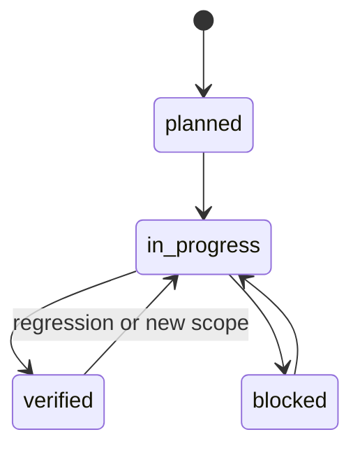

# Agent Workflow

This workflow is binding for all coding agents working in this repository.

## Phase 1: Understand Requirements

Inputs:

- User request.
- `AGENTS.md`.
- `harness/state/current-task.md`.
- Relevant product specs.

Actions:

- Restate the goal.
- Identify the related feature.
- Define acceptance criteria.
- Define non-goals.
- Update `harness/state/current-task.md`.

Exit criteria:

- Goal and scope are clear.
- Related feature is identified or created.

## Phase 2: Analyze Codebase

Inputs:

- `harness/docs/architecture.md`.
- `harness/specs/technical-spec.md`.
- Relevant source files and tests.

Actions:

- Inspect existing code before editing.
- Identify patterns and boundaries.
- Identify tests and verification commands.
- Note risks.

Exit criteria:

- Affected files and constraints are known.

## Phase 3: Plan

Actions:

- Create a short implementation plan.
- Define allowed and forbidden modifications.
- Define verification commands.
- Set feature status to `in_progress`.

Exit criteria:

- Plan is recorded in the task record.

## Phase 4: Implement

Actions:

- Make focused changes.
- Follow existing code style.
- Update tests and docs when needed.
- Record decisions if architecture changes.

Exit criteria:

- Implementation is ready for verification.

## Phase 5: Verify

Actions:

- Run targeted checks during iteration.
- Run full verification when appropriate:

```bash
bash harness/scripts/verify.sh
```

Required verification categories:

- Unit tests
- Integration tests
- Type checks
- Lint checks
- Build checks

Exit criteria:

- Results are recorded.
- Failures are fixed or documented.

## Phase 6: Summarize And Update State

Actions:

- Update `harness/state/progress.md`.
- Update `harness/state/task-history.md`.
- Update `harness/features/feature_list.json`.
- Update `harness/state/session-handoff.md`.
- Write final report with evidence.

Exit criteria:

- Next session can resume from repository files.

## Feature Status Transitions



Rules:

- `planned` means known but not started.
- `in_progress` means implementation or verification is active.
- `blocked` means progress requires external input or dependency.
- `verified` means implementation, acceptance criteria, and required checks passed.

## Multi-Agent Execution

Planner Agent:

- Understands requirements.
- Creates task plan.
- Defines acceptance criteria.

Builder Agent:

- Implements scoped changes.
- Updates task implementation notes.

Reviewer Agent:

- Reviews correctness, maintainability, safety, and missing tests.
- Records review findings.

Verifier Agent:

- Runs verification commands.
- Records evidence.
- Confirms whether feature status may become `verified`.

All agents write to shared repository state files.
