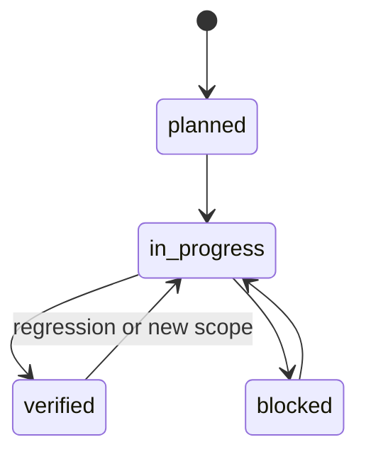

# 智能体工作流

本工作流对仓库内工作的所有编程智能体均有约束力。

## 阶段 1：理解需求

输入：

- 用户请求。
- `AGENTS.md`.
- `harness/state/current-task.md`.
- 相关产品规格。

动作：

- 重述目标。
- 识别相关功能。
- 定义验收标准。
- 定义非目标。
- 更新 `harness/state/current-task.md`。

退出标准：

- 目标和范围清楚。
- 已识别或创建相关功能。

## 阶段 2：分析代码库

输入：

- `harness/docs/architecture.md`.
- `harness/specs/technical-spec.md`.
- 相关源码和测试。

动作：

- 编辑前检查现有代码。
- 识别模式和边界。
- 识别测试和验证命令。
- 记录风险。

退出标准：

- 已知受影响文件和约束。

## 阶段 3：计划

动作：

- 创建简短实施计划。
- 定义允许和禁止的改动。
- 定义验证命令。
- 将功能状态设为 `in_progress`。

退出标准：

- 计划已记录在任务文件中。

## 阶段 4：实施

动作：

- 实施聚焦改动。
- 遵循现有代码风格。
- 按需更新测试和文档。
- 架构变化时记录决策。

退出标准：

- 实现已准备好验证。

## 阶段 5：验证

动作：

- 迭代期间运行针对性检查。
- 适当时运行完整验证：

```bash
bash harness/scripts/verify.sh
```

必需验证类别：

- 单元测试
- 集成测试
- 类型检查
- 代码规范检查
- 构建检查

退出标准：

- 结果已记录。
- 失败已修复或记录。

## 阶段 6：总结并更新状态

动作：

- Update `harness/state/progress.md`.
- Update `harness/state/task-history.md`.
- Update `harness/features/feature_list.json`.
- Update `harness/state/session-handoff.md`.
- 编写带证据的最终报告。

退出标准：

- 下一会话可以从仓库文件恢复。

## 功能状态转换



规则：

- `planned` 表示已知但尚未开始。
- `in_progress` 表示实现或验证进行中。
- `blocked` 表示需要外部输入或依赖才能继续。
- `verified` 表示实现、验收标准和必需检查均已通过。

## 多智能体执行

规划智能体：

- 理解需求。
- 创建任务计划。
- 定义验收标准。

构建智能体：

- 实施范围内改动。
- 更新任务实施记录。

复核智能体：

- 复核正确性、可维护性、安全性和缺失测试。
- 记录复核发现。

验证智能体：

- 运行验证命令。
- 记录证据。
- 确认功能状态是否可以变为 `verified`。

所有智能体都将状态写入共享仓库文件。

## 精简实证阶段的 Git 检查点

2026-10-11 用户选择独立科研仓库后，正式 GitHub 远程 `origin` 指向
`https://github.com/Fischl0527/M3_PI_Guard.git`，默认研究分支仍为
`codex/q2-empirical-study`。`m3-guard` 保留为同一独立仓库的兼容远程；
`competition-origin` 保留原 `Fischl0527/RedTeam_LLM_Security` 关联，仅供历史参考。
不改朋友仓库、旧 PR、可见性、许可证或原提交作者，不 force-push。

当前开发分支 `codex/claude-review-repairs` 同步到独立仓库的同名分支，
并跟踪 `origin/codex/claude-review-repairs`；科研里程碑发布时显式使用
`git push origin HEAD:refs/heads/codex/q2-empirical-study`，禁止默认推回比赛仓库。
后续分支切换仍应先保留正在进行的本地工作，不通过丢弃未提交内容换分支。

按以下研究里程碑提交，避免在每条记录或每次失败后制造提交：

1. API 实验前：提交精简研究协议、Harness 状态和当前源码基线；
2. 固定样本与六条正式前缀通过后：提交选择清单、实现和定向测试；
3. 每个 provider 的计划行达到终态后：提交代码、紧凑统计和图表，不提交原始
   provider trace、API 凭据或临时验证目录；
4. 统计/图表定稿及英文稿完成后各提交一次。

Git 检查点必须满足：

- 只暂存本阶段相关的源码、测试、协议、文档和 Harness 状态；
- `config/project.local.env*`、`.env`、密钥、原始 API 输出和 `outputs/verification/`
  永不进入索引；
- 提交前运行受影响模块的定向测试和 staged secret-format 检查；
- 已成功且未受修复影响的实验行不得为了提交或获得绿色状态而重跑；
- 不运行 Full Harness，不递归重放历史证据，不生成额外哈希包。
