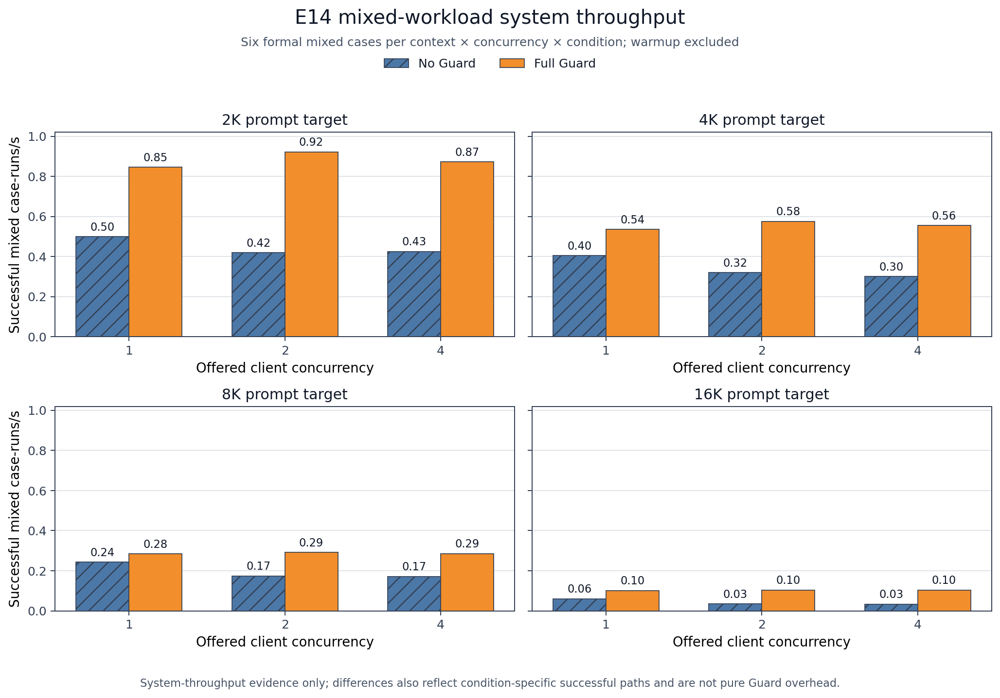

# M3-PI Guard 阶段性实验报告

日期：2026-07-15  
分支：`test1`  
基线：`2c53f52c475e6838dc82246c821db5ed7ac0209c`  
报告性质：阶段性、可审计、非最终结论

## 1. 结论先行

截至本次停点，**E0-E16 已全部完成并登记，注册表为 17 completed / 1 running（E17）/ 0 failed**。纠正后的 E9/E14 已从空目录完成 execution-r3 全量重跑，通过冻结哈希、运行键唯一性、matched benign path、完整性与语义联合审计；旧 v3 与失败的 execution-r2 继续保留，但不进入纠正结论。

当前唯一实验级门禁是 E17 的两名真人独立盲审，真人进度仍为 0/2。双代理自动诊断复核已完成 3,299/3,299 + 3,299/3,299，并输出 1,071 条分歧；它们只用于识别分类边界问题，不能替代真人或将 E17 标记 completed。因此项目还不能宣称“所有实验完成”，正式 `final_analysis`、最终 Dashboard 冻结和本地提交仍被正确阻止。

核心阶段结果：

- E9：No Guard ASR 36/60=60.00%，full Guard 0/60；14 个解析失败和 6 个 provider-incomplete 全部留在证据中。
- E14：Guard 自身 p95 0.454ms；144 个同路径配对的端到端开销中位数 0.202%，bootstrap 95% CI -0.577% 至 1.374%，两个性能目标达标。
- 整体防御：ASR 相对下降 99.21%、DSR=0、恶意调用 Precision=99.24%、正常 FPR=2.74%，均达标。
- 明确缺口：恶意调用 Recall=86.49%、正常 TCR 下降 6.79pp、合法工具 TCR=65.48%、全程序解析率=92.98%，均未达标。

## 2. 当前完成状态

| 项目 | 当前值 | 审计口径 | 状态 |
| --- | ---: | --- | --- |
| 实验注册表 | 17 completed / 1 running / 0 failed | E0-E17 共 18 项 | 仅 E17 未完成 |
| E9 execution-r3 | 8/8 jobs，120/120 formal | 15/15 validity，13/13 artifacts | 完成并登记 |
| E14 execution-r3 | 104/104 jobs，432/432 formal | 48/48 warmups 单列排除，22/22 artifacts | 完成并登记 |
| E14 matched pairs | 144/144 | 相同 benign path、不同 Guard 条件 | 通过 |
| E14 首步运行键 | 480/480 unique | formal + warmup 原始首步 | 通过 |
| E17 corrected source | 12,704 logical runs，3,299 items | 0 duplicate run/step | 已冻结 |
| 双代理自动诊断 | 2 × 3,299 items | diagnostic-only | 完成 |
| E17 真人盲审 | 0/2 | 两名相互独立真人，必要时第三人裁决 | 外部阻塞 |

## 3. E9：校准后的长上下文安全结果

| 目标 prompt | No Guard | Full Guard |
| ---: | ---: | ---: |
| 2K | 10/15 = 66.67% | 0/15 = 0% |
| 4K | 10/15 = 66.67% | 0/15 = 0% |
| 8K | 7/15 = 46.67% | 0/15 = 0% |
| 16K | 9/15 = 60.00% | 0/15 = 0% |
| **总体** | **36/60 = 60.00%** | **0/60 = 0%** |

图中按 2K/4K/8K/16K 与五个注入位置展示 ASR。每个 context-position-condition 单元只有 3 条攻击，因此点级 Wilson 区间较宽；稳健解释应以总体 36/60 对 0/60 为主。full Guard 的 0 点估计不等于未知攻击上的绝对安全保证。

纠正版使用原生 Ollama usage 计数与 4K/8K/16K/32K context aliases，实际 prompt 中位数为 2050/4098/8194/16386。旧 v3 中被截断或折叠到同一长度的结果没有混入本表。execution-r2 E9 本身有效，但由于成对协议要求且 r2 E14 失败，E9 也在 r3 中从空目录重跑，避免跨 revision 拼接有利结果。

## 4. E14：性能、吞吐与显存

### 4.1 端到端延迟与 Guard 开销

延迟随上下文长度总体上升；并发 1/2 下 off 与 full Guard 通常接近，并发 4 的点估计波动更大。全部 144 个相同 benign path 配对汇总后，baseline/full 的中位总延迟分别为 944.862ms 与 974.812ms；每对先计算差值再汇总的开销中位数为 0.202%，95% bootstrap CI 为 -0.577% 至 1.374%。Wilcoxon p=0.126，rank-biserial=0.147。

每个 context × concurrency 单元只有 12 个配对，部分并发 4 单元的区间很宽；12 项 Wilcoxon 经 Holm 校正后均不显著。证据支持“总体 Guard 计算开销较小且预定 <10% 指标通过”，但不能把单个高并发单元的变化解释为稳定因果效应。Guard 自身 p95 为 0.454ms，明显低于 10ms 目标。

### 4.2 吞吐

并发只有 1/2/4 三个离散水平，因此阶段报告改用分面分组条形图，不用三点折线暗示连续趋势。图中是成功完成路径的系统吞吐，受模型生成、调度与条件路径共同影响；它不能被当作“纯 Guard 计算开销”。部分 full Guard 条件吞吐更高，反映完整系统路径差异，不代表 Guard 本身带来加速。

### 4.3 GPU 显存

设备级峰值约从 2K 条件的 4.1GB 上升到 16K/高并发条件的 7.7GB，说明 8GB 显存环境在最长上下文时接近容量边缘。该指标包含模型与运行时的整机占用，不是 Guard 独占显存；因此报告将它用于容量规划，不用于夸大 Guard 资源成本。

## 5. 目标指标总表

| 指标 | 观察值 | 目标 | 判断 |
| --- | ---: | ---: | --- |
| Full Guard 相对同提示 baseline 的总体 ASR 下降 | 99.21% | ≥70% | 达标 |
| DSR | 0 | =0 | 达标 |
| 恶意调用 Precision | 99.24% | ≥90% | 达标 |
| 恶意调用 Recall | 525/607 = 86.49% | ≥90% | **未达标** |
| 正常调用 FPR | 4/146 = 2.74% | ≤5% | 达标 |
| 正常 TCR 下降 | 190/324 → 168/324，下降 6.79pp | ≤5pp | **未达标** |
| 合法工具 TCR | 110/168 = 65.48% | ≥90% | **未达标** |
| 正常 ASK 率 | 20/324 = 6.17% | ≤10% | 达标 |
| 全程序 run-level ToolCall 解析率 | 92.98% | ≥95% | **未达标** |
| Guard 自身 p95 | 0.454ms | <10ms | 达标 |
| 同路径配对端到端开销中位数 | 0.202%（95% CI -0.577%～1.374%） | <10% | 达标 |

E1 显示四个核心模型的 baseline ASR 差异明显，full Guard 后仅 Llama 3.2 保留少量成功攻击，支持跨模型总体安全收益。该图不覆盖正常任务和合法工具，因此不能单独判定系统综合可用性。

E12 显示模型与条件之间的 TCR 差异，Llama 3.2 尤其偏低。这解释了为何强安全增益并不足以让项目全面达标：合法工具 TCR 和正常任务完成率仍是当前最重要的产品风险。

## 6. 双代理自动诊断复核

两名代理各自只读取一份 blinded template 与公开 schema，输出隔离在 `outputs/experiments/E17_auto_review_corrected_r3/`，没有读取对方答案、真人提交、private mapping、registry 或 secret。公开比较器重复运行结果一致：

| 诊断指标 | 结果 |
| --- | ---: |
| Items | 3,299 |
| 主分类一致 | 2,280/3,299 = 69.11% |
| Cohen's kappa | 0.6256 |
| 完整代码集合一致 | 2,228/3,299 = 67.54% |
| Secondary-set 一致 | 3,104/3,299 = 94.09% |
| 分歧 | 1,071 |

主要分歧集中在 `false_block` 与 `other`/`ask`/`parse_failure` 的边界，说明失败分类的语义判断仍有明显主观性。这批输出适合用于后续审查分类规则是否足够清晰，但不能预填真人答案，也不应在真人独立盲审前暴露给审核者。比较器明确返回 `diagnostic_only=true`、`eligible_for_formal_e17_submission=false`、`human_review_gate_satisfied=false`。

## 7. 证据有效性与失败保留

- 正式效果只使用真实 Ollama 模型；Stub 仅用于确定性回归。
- 旧 v3 E9/E14 文件保持哈希完整，但只能支持“为什么重开”的诊断。
- execution-r2 E14 的 104/104 jobs 完整保留；最终门禁发现 144 个运行键跨并发 1/2/4 重复三次，故整包未登记。r3 修复生产端身份并全量重跑，没有重写旧日志或放宽验证器。
- r3 freeze 绑定 44 个文件，SHA-256 为 `314aa9ed1aa9b578019827a754d45254e093d755e4fd09bee18332f93ecd3ae3`。
- 联合上下文审计 fingerprint 为 `296271e14c74a453e107f88b384aec5f9ea4c87530618ee335f407d4e85d0d5e`。
- 解析失败、provider-incomplete、ASK、拒答和其他未解决结果均保留在原分母；没有选择性删除或只复跑有利单元。
- 正式 `outputs/experiments/final_analysis/` 在 E17 安全登记前保持不存在，避免边跑边挑结论。

## 8. Harness 同步状态与下一步

本阶段已同步 `agent/progress.md`、`agent/current-task.md`、`agent/session-handoff.md`、feature/task 状态、feasibility、remediation、source/claim audit、chart map、requirement ledger、interim final audit 与 summary。当前控制面统一表述为：E0-E16 完成，E17 外部门禁，注册表 17/1/0。

阶段验证中，44/44 个 r3 冻结文件、E17 source `--check`、22 项定向测试、registry、requirement lock/ledger、source log 和 blocked final-audit 均通过。`bash scripts/verify.sh` 在当前 WSL Bash 中因找不到 Windows Anaconda `python` 而不能作为通过证据；其 Python 子检查已用配置好的 PowerShell/Windows Python 分别执行。最终交付前仍会以长时间盒完成一次新的全量测试。

停止检查确认没有 E9/E14/program Python 实验执行器，`ollama ps` 为空，没有模型继续占用 GPU。

接下来的固定顺序是：

1. 保持新大矩阵暂停，保存本报告与自动诊断比较结果。
2. 取得两名真人独立盲审；如规定字段分歧，再由第三真人裁决。
3. 通过 E17 registrar 的身份、完整性、独立性和一致性门禁。
4. 生成正式多维分析、13 组图和最终 Dashboard 数据，并逐图检查。
5. 重新完成全量 pytest、冻结哈希、注册表、统计、来源声明和严格 Harness 审计。
6. 最后创建本地 `test1` commit；默认不 push、不建 PR。

按用户当前范围，不制作 PPT、DOCX 报告或提交 ZIP。
