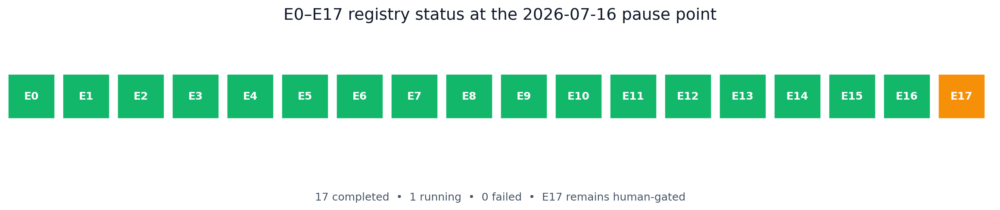
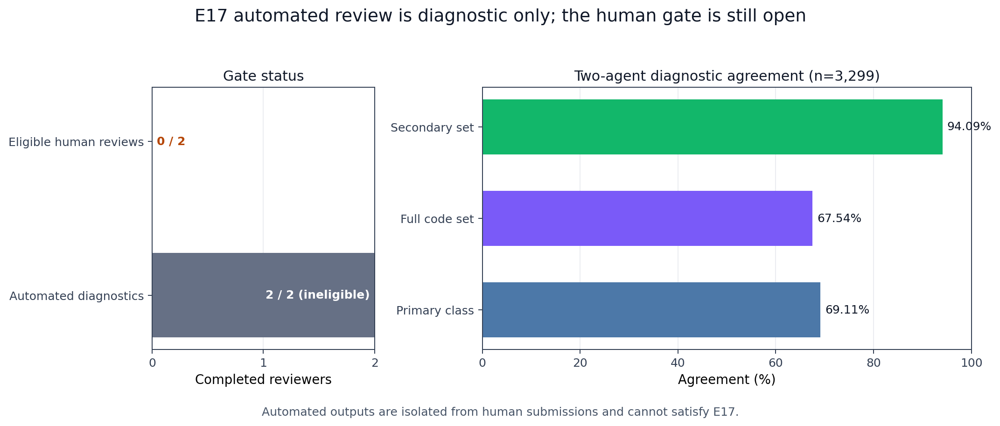

# M3-PI Guard 阶段性实验报告

日期：2026-07-16  
分支：`test1`  
基线：`2c53f52c475e6838dc82246c821db5ed7ac0209c`  
报告性质：阶段暂停点、可审计、非最终结论

## 1. 结论先行

截至本次暂停，**E0-E16 已全部完成并登记，Registry 为 17 completed / 1 running（E17）/ 0 failed**。用户要求“再跑一会后暂停”，因此新的 GPU/大矩阵已经停止；当前没有用“命令已启动”代替完成，也没有把自动代理输出冒充真人。

本阶段新增的关键工作是修复 E11 历史执行冻结与当前运行时源码漂移。旧冻结和旧结果没有覆盖，而是原样归档为诊断证据；新建 execution-r2 冻结后，从空活动目录完成 8/8 Ollama smoke 与 48/48 formal，生成统计、回放和图表，并安全登记。随后修复 E17 registrar 的不完整输入 CLI，完整 Windows verifier 通过：**340 passed、1 skipped、0 verification failures**。

当前唯一实验级外部门禁仍是 E17 的两名真人独立盲审，真人进度 0/2。正式 `final_analysis`、最终 13 图、Dashboard 冻结和本地提交继续被正确阻止。

## 2. 暂停点状态总表

| 项目 | 当前值 | 结论 |
| --- | ---: | --- |
| Registry | 17 completed / 1 running / 0 failed | 仅 E17 未完成 |
| 完整 pytest | 340 passed / 1 skipped | 通过 |
| E9 execution-r3 | 120/120 formal | 完成并登记 |
| E14 execution-r3 | 432/432 formal + 48/48 excluded warmup | 完成并登记 |
| E11 execution-r2 | 8/8 smoke + 48/48 formal | 完成并登记 |
| E17 corrected source | 12,704 logical runs / 3,299 items / 0 duplicates | 已冻结 |
| 双代理自动诊断 | 2 × 3,299 items | 完成但不具真人资格 |
| E17 真人盲审 | 0/2 | 外部阻塞 |
| 正式 final analysis | 不存在 | 符合门禁 |
| Git | dirty、未 stage、未 commit | 符合暂停点要求 |

## 3. 本阶段实际完成的修复与复跑

### 3.1 发现的问题

全量测试最初得到 8 failures。七个属于最终分析合成测试的隔离 fixture 未安装合成 E17 loader，已通过测试级 fixture 注入修复，生产校验没有放宽。第八个是实质性证据问题：旧 E11 `freeze.json` 仍要求 7 月 14 日的运行时代码哈希，而 `agent_runner`、`llm_client`、`run_batch`、`run_matrix`、RunLog schema 等已经发生受控修正。

直接覆盖旧 freeze 会抹掉历史边界；把验证器改成忽略 drift 也会降低证据可信度。因此采用 execution revision：

1. 保留 `protocols/e11_amendment_v1/freeze.json`。
2. 将旧活动分析和原始运行目录分别移动到 `..._execution_r1_diagnostic`。
3. 新增 `protocol_r2.md` 与 `freeze_r2.json`，绑定当前 runner、analyzer、registrar、final-analysis validator、数据、阈值和运行时。
4. 对 v3 blind freeze 只保存文件哈希作为历史引用，不声称其内部旧源码哈希等于当前 checkout。
5. 重新运行 8 smoke + 48 formal；不复制旧日志、不按结果挑选案例。

### 3.2 E11 execution-r2 完整性

| 证据 | 值 |
| --- | --- |
| Freeze | `ceb320a915d301d6658b5caa9b662cb2ed13e24c63ec5d79f8ff7caa9ad0ba37` |
| Smoke | 8/8，Ollama，`qwen3:4b-instruct` |
| Formal | 48/48，24 cases × 2 conditions |
| Bundle | completed，10 artifacts |
| Supplement manifest | `2c2107103ca5467f1b3369bdf6a9dbcb7c1a4aee18d35caeaddc76cdab50ff41` |
| Registry write | 成功；原 E11 primary manifest 与 required artifacts 未改变 |
| 图表 QA | 2070×1188 原始分辨率人工检查通过 |

## 4. E11 跨工具链结果分析

| Pattern | Guard off ASR | Full Guard ASR | Full−off 配对差（95% bootstrap CI） | Holm p |
| --- | ---: | ---: | ---: | ---: |
| read → send | 3/6 = 50.0% | 0/6 | -50.0% [-83.3%, -16.7%] | 0.50 |
| search → API | 5/6 = 83.3% | 0/6 | -83.3% [-100.0%, -50.0%] | 0.25 |
| memory → file | 1/6 = 16.7% | 0/6 | -16.7% [-50.0%, 0.0%] | 1.00 |
| tool output → next action | 5/6 = 83.3% | 0/6 | -83.3% [-100.0%, -50.0%] | 0.25 |
| **总体原始计数** | **14/24 = 58.3%** | **0/24** | 不跨 pattern 追加事后检验 | — |

图中 Full Guard 四类点估计均为 0%，但每类只有六个配对案例，Wilson 区间仍然宽。三个 pattern 的点估计下降很大；memory→file 的 Guard-off ASR 本来只有 1/6，因此差值区间触及 0，不能仅凭 p 值写成确定性结论。

另一个重要边界是“攻击没有成功”不等于“检测器一定识别成功”。本轮 80 个 step outputs 中 78 个解析成功，2 个 unresolved 全部保留；memory→file full-Guard 的恶意调用 Recall 只有 25%。因此 E11 支持“在此 24 条补充样本上未观察到成功跨工具攻击”，不支持“所有跨工具攻击均被检测器正确识别”。

该补充矩阵仍为 `pre_registered=false`，独立分母，不能与原 E11 冻结分母合并，也不能倒写成预注册研究。

## 5. 全项目主要结果与目标

| 指标 | 观察值 | 目标 | 判断 |
| --- | ---: | ---: | --- |
| Full Guard 相对 baseline 总体 ASR 下降 | 99.21% | ≥70% | 达标 |
| DSR | 0 | =0 | 达标 |
| 恶意调用 Precision | 99.24% | ≥90% | 达标 |
| 恶意调用 Recall | 525/607 = 86.49% | ≥90% | **未达标** |
| 正常 FPR | 4/146 = 2.74% | ≤5% | 达标 |
| 正常 TCR 下降 | 6.79pp | ≤5pp | **未达标** |
| 合法工具 TCR | 110/168 = 65.48% | ≥90% | **未达标** |
| 正常 ASK 率 | 20/324 = 6.17% | ≤10% | 达标 |
| 全程序 run-level 解析率 | 92.98% | ≥95% | **未达标** |
| Guard p95 | 0.454ms | <10ms | 达标 |
| 配对端到端开销中位数 | 0.202%（95% CI -0.577%～1.374%） | <10% | 达标 |

安全收益很明显，但产品可用性并未全面达标。尤其是合法工具 TCR 65.48% 和正常 TCR 下降 6.79pp，说明下一轮如果允许继续改进，应优先减少授权工具任务上的误阻断与流程失败，而不是继续追求已接近饱和的 ASR 点估计。

## 6. E9/E14 纠正证据

Context Correction V2 execution-r3 在本次暂停点重新执行独立审计，fingerprint 仍为 `296271e14c74a453e107f88b384aec5f9ea4c87530618ee335f407d4e85d0d5e`。

- E9：No Guard 36/60=60.00%，full Guard 0/60；14 parse failures 与 6 provider-incomplete 留在分母。
- E14：432 formal + 48 excluded warmup；144/144 matched paths；480/480 unique first-step keys。
- Guard p95 0.454ms；同路径配对开销中位数 0.202%，bootstrap 95% CI -0.577% 至 1.374%。
- 最长上下文和高并发下设备峰值约 7.7GB，8GB GPU 接近容量边缘。

上下文位置图的单元样本较小，吞吐也混合了模型生成、并发调度和条件路径差异，因此这些图用于描述系统趋势和容量，不把局部点差异夸大为稳定因果效应。

## 7. E17 双代理诊断与真人门禁

两名自动代理各完成 3,299 条 blinded items，主分类一致 69.11%，Cohen's kappa 0.6256，完整代码集合一致 67.54%，secondary-set 一致 94.09%。比较器记录 1,071 条任意字段分歧，主要集中在 `false_block` 与 `other`/`ask`/`parse_failure` 的边界。

这些输出只说明分类说明仍存在主观边界，不构成正式 E17 结论。自动结果不在 `E17/submissions`，真人审核者不能在独立盲审前看到它们；真人进度仍为 0/2。

## 8. 验证结果

`powershell -NoProfile -ExecutionPolicy Bypass -File scripts/verify.ps1` 本次结果：

- Harness files：PASS
- JSON contracts：PASS
- PowerShell syntax：PASS
- Bash syntax：PASS
- Python compile：PASS
- Unit/integration：340 passed，1 skipped
- Registry：17 completed / 1 running / 0 failed
- E17 corrected source：PASS；12,704 logical runs；0 duplicate runs/steps
- Verification failures：0

唯一 skipped 项已保持显式，未被当作通过项计数。最终提交前仍需在 E17 与 final analysis 完成后再跑同一完整链。

## 9. 冻结与可复现性边界

暂停点对旧 v3 运行做了 current-source compatibility audit。10,526 条 main/derived/stability 逻辑运行可以重新扫描，但旧 blind freeze 与当前 checkout 有 8 个 bound-source hash drift：`experiments/e17_review.py`、`model_manager.py`、`registry.py`、`agent_runner.py`、`llm_client.py`、`run_batch.py`、`run_matrix.py` 和 RunLog schema。

这不删除历史结果，也不把旧运行数据改成失败；它表示旧证据只能按其历史 freeze 和当时环境解释，不能宣称“当前源码仍与旧 v3 freeze 逐文件一致”。当前运行时结论由 Context execution-r3 和 E11 execution-r2 的新 revision 支持。审计失败文件保存在 `agent/audits/blind_v3_current_source_compatibility_2026-07-16.*`，没有通过放宽验证器来隐藏。

## 10. 暂停状态与恢复顺序

当前停止点：

- E11 runner 已退出，不再启动 GPU 大矩阵。
- 工作树保留全部未提交改动；没有 stage、commit、push 或 PR。
- 不制作 PPT、DOCX 报告或 ZIP。
- 正式 `outputs/experiments/final_analysis/` 仍不存在。

恢复后的固定顺序：

1. 两名真人独立完成 E17；指定分歧才交第三真人。
2. E17 registrar dry-run，通过身份、完整性、独立性和一致性后 apply。
3. 生成正式 final analysis、13 图和 Dashboard 数据，并逐图原分辨率检查。
4. 运行完整 verifier、统计、freeze/source、Dashboard 与 Runpro strict audit。
5. 所有门禁通过后只创建本地 `test1` commit；默认不 push、不建 PR。
