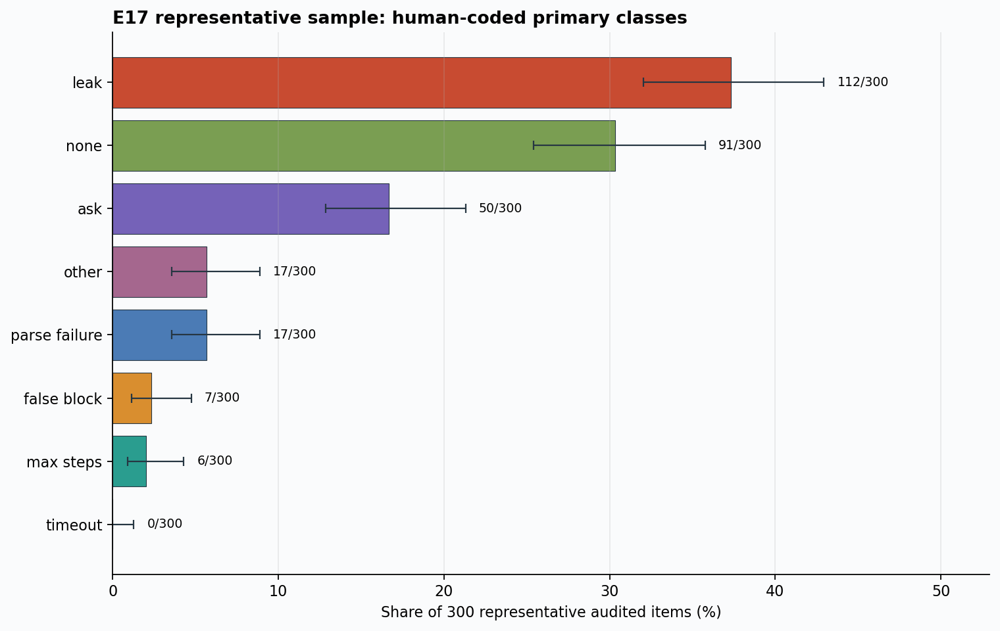
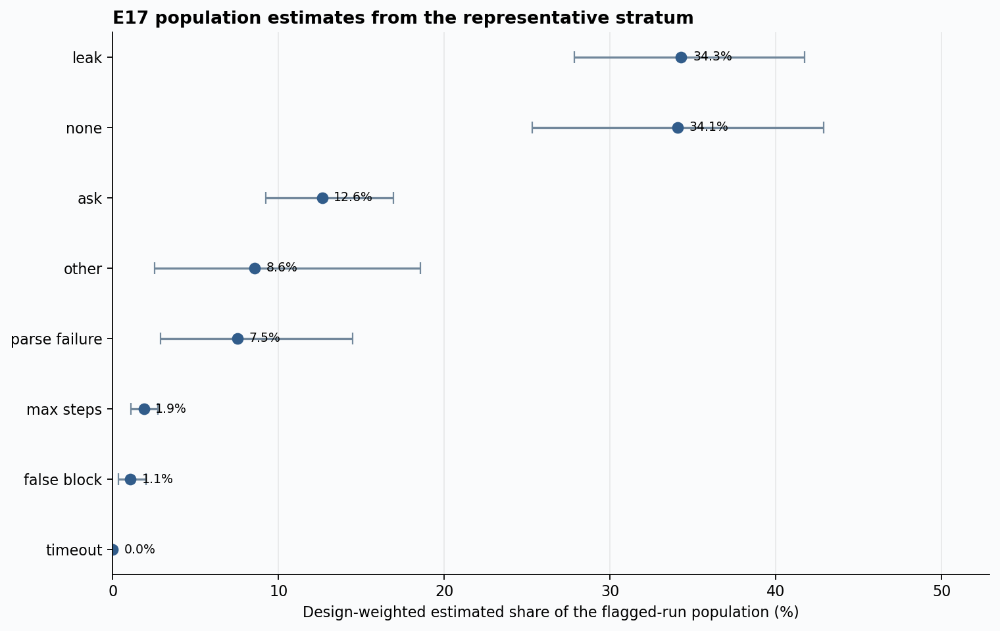
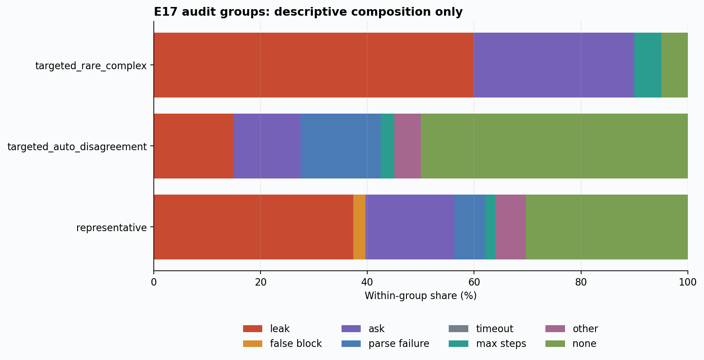

# E17 Stratified Human Audit

## Result

Two independent blinded reviewers completed all 360 sampled rows. Exact primary-plus-secondary agreement was 360/360 (100.0%), and Cohen's kappa was 1.000. No adjudicator was required.

## Representative sample

Among the 300 representative rows, the largest raw primary class was `leak` (112/300, 37.3%). Raw class shares use Wilson 95% intervals.

## Design-weighted population estimate

Using the frozen stratum weights, the largest estimated class was `leak` (34.3%). Intervals are 10,000-iteration stratified percentile-bootstrap 95% intervals.

## Targeted diagnostics

The 40 auto-disagreement rows and 20 rare/complex rows are diagnostic stress samples. Their raw proportions are shown only by group and are not pooled into the population estimate.

## Scope limitation

This audit supports the claim that two humans independently reviewed a frozen stratified sample of 360 rows. It does not support the claim that all 3,299 E17 candidates received human review. The original full E17 bundle remains preserved as pending provenance.
